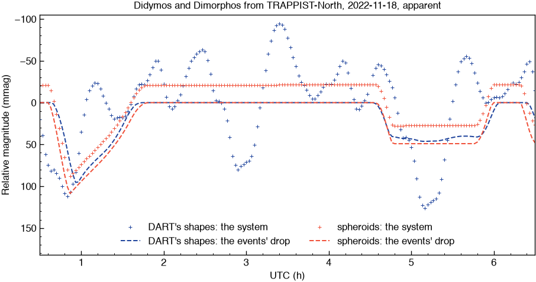
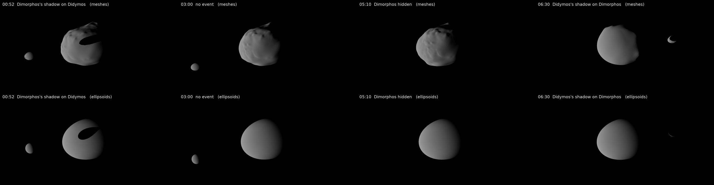

# Didymos and Dimorphos from the ground

The light curve of the binary asteroid (65803) Didymos one night as
TRAPPIST-North (Oukaimeden, Morocco) saw it, 2022-11-18, 00:30 to 06:30 UTC
at a phase angle of 60 deg: Didymos turning every 2.26 h, and the mutual
events of its moon Dimorphos -- about 00:40 to 01:45, Dimorphos's shadow on
Didymos; 04:35 to 06:00, Dimorphos hidden behind Didymos; from 06:20,
Didymos's shadow on Dimorphos. kalast places the two
bodies from DART's SPICE kernels, at the time their light left for the
site, and `kalast.lightcurve.flux` sums every facet's light under Buratti et
al. (2024)'s Hapke law, what each body shadows or hides of the other exact.

- [lightcurve.py](lightcurve.py): the light curve, plotted to
  `out/lightcurve_didymos.png` as Scheirich et al. (2024) draw theirs and
  opened -- the system's magnitude about the night's mean, every 2
  minutes -- with one shape model or the other, `SHAPES` at its top:
    - `meshes`: DART's shape models of the two;
    - `ellipsoids`: Scheirich et al. (2024)'s, the bodies the system's events
      are predicted with -- oblate spheroids of DART's volume and axis
      ratios, their radii in `EXTENTS`,
      [../../res/ico5.obj](../../res/ico5.obj) stretched -- under the same
      law, so that the shapes alone differ. Scheirich et al. predict under
      Lommel-Seeliger's: with it, the shadow takes about 0.10 mag at its
      deepest rather than 0.109.

  and its magnitudes one way or the other, `MAGNITUDES`:
    - `apparent`: as the observatory measured them, the system's distances
      from the Sun and from the site and its phase angle as they were;
    - `reduced`: at unit distances and one phase angle, as Pravec et al.
      (2022) and Scheirich et al. give theirs -- the law's own phase curve,
      a sphere's light under it, taken out.
- [scene.py](scene.py): the same night drawn by kalast's renderer, as the
  observatory looks at it, north up, orthographic, 2.4 km top to bottom:
  DART's shape models at their finest or the spheroids, `SHAPES` at its
  top. 30 s of the night a frame at 30 frames a second, to the night's
  end; `P` pauses it.
- [scene_lightcurve.py](scene_lightcurve.py): the two in one -- the night
  drawn as `scene.py` draws it, and its light curve made as it goes, a
  point a frame: each frame's light summed on the GPU from the frame itself,
  its shadows and the bodies' law (`photometry`), so DART's shapes are
  measured at their finest at the drawing's pace. At the night's end the
  plot is written and opened, the scene left paused. `SHAPES` and
  `MAGNITUDES` as in `lightcurve.py`; the rendered light agrees with
  `lightcurve.py`'s within 0.2 mmag rms.
- [telescope.py](telescope.py): the night as TRAPPIST-North recorded it, and
  its reduction. Each 2 minutes a 90 s exposure in Rc, written as a FITS
  frame, the field's stars from Gaia and the target at its light. The
  frames are then read back and reduced as a real night's are: the target
  in an aperture, the zero point from the comparison stars, the light curve
  plotted beside the model. Every effect of the frames is in `EFFECTS`, all
  on by default; `SHAPES` as in `lightcurve.py`.
- [kernels.tm](kernels.tm): the SPICE kernels the scripts load.



DART's shapes add Didymos's rotation, a tenth of a magnitude either way at
this phase; a spheroid turning about its axis has none, and what is left
is the events. The phase angle closing over the night, 60.63 to 60.38 deg,
brightens the system 1.7 mmag an hour, and its distances growing take 1.5
of it back: the apparent curve is flat between the events within
0.25 mmag an hour, the reduced one within 0.05. The events differ too,
sampled every 2 minutes: Dimorphos's shadow takes 0.095 mag from
DART's Didymos, 0.109 from the spheroid; hidden whole, DART's elongated
Dimorphos takes 0.040 to 0.046 as it turns, the sphere 0.049 throughout.

## Input data

The paths in the scripts are where these are kept here: set them to yours.

1. **SPICE kernels**: the seven [kernels.tm](kernels.tm) lists, 171 MB --
   DE430 120 MB of it, DART's system solution 51 MB -- from NAIF's
   [DART SPICE archive](https://naif.jpl.nasa.gov/pub/naif/pds/pds4/dart/dart_spice/spice_kernels/),
   in their folders there. Set its `PATH_VALUES`.
2. **DART's shape models**, for `meshes`: Didymos v003 and Dimorphos v004,
   49,152 facets each, 3.6 MB each, from the PDS Small Bodies Node's
   [DART shape models](https://pdssbn.astro.umd.edu/holdings/pds4-dart_shapemodel-v1.0/):
   [didymos_g_9309mm_spc_obj_0000n00000_v003.obj](https://pdssbn.astro.umd.edu/holdings/pds4-dart_shapemodel-v1.0/data_derived_didymos_model_v003/didymos_g_9309mm_spc_obj_0000n00000_v003.obj)
   and
   [dimorphos_g_1940mm_spc_obj_0000n00000_v004.obj](https://pdssbn.astro.umd.edu/holdings/pds4-dart_shapemodel-v1.0/data_derived_dimorphos_model_v004/dimorphos_g_1940mm_spc_obj_0000n00000_v004.obj),
   `DIDYMOS` and `DIMORPHOS` in `lightcurve.py`.
   `scene.py` and `scene_lightcurve.py` draw the same models at their
   finest, 3,145,728 facets each, 231 MB each:
   [didymos_g_1165mm_spc_obj_0000n00000_v003.obj](https://pdssbn.astro.umd.edu/holdings/pds4-dart_shapemodel-v1.0/data_derived_didymos_model_v003/didymos_g_1165mm_spc_obj_0000n00000_v003.obj)
   and
   [dimorphos_g_0243mm_spc_obj_0000n00000_v004.obj](https://pdssbn.astro.umd.edu/holdings/pds4-dart_shapemodel-v1.0/data_derived_dimorphos_model_v004/dimorphos_g_0243mm_spc_obj_0000n00000_v004.obj).
   A light curve on them would take 40 to 58 s an epoch.
3. **The field's stars**, for `telescope.py`: asked of ESA's Gaia archive
   the first time, 1,006 stars to G = 19 within 0.3 deg, and kept in
   `out/gaia_didymos_2022-11-18.csv` after that. Its frames take 1.4 GB in
   `out/trappist_2022-11-18/`, 8 MB each: a smaller `Telescope(width=...,
   height=...)` or a longer `DT` takes less.

## Running

From kalast's folder, where the scripts name their files from:

```sh
python examples/lightcurve_didymos/lightcurve.py         # the light curve: 32 s (spheroids) to 90 s (DART's shapes)
python examples/lightcurve_didymos/scene.py              # the night drawn
python examples/lightcurve_didymos/scene_lightcurve.py   # both: the plot at the night's end, 25 s
python examples/lightcurve_didymos/telescope.py          # the frames, then their reduction: 2 min
```

A plot window cannot open in a process where kalast's window has opened --
on macOS the two take the process down -- so the plots are drawn to a file
and opened in the system's viewer.



Another night, another site: `START`, `END` and `SITE` in each script. The
kernels hold the system from 2001 to the end of 2024, the impact on
2022-09-26 in them. DART's kernel turns Didymos at 2.2600 h; the scripts
turn it at its true period, 2.2603891 h before the impact and 2.260440 h
after (Durech et al. 2025), its phase the kernel's at the impact. Even so,
the 2022 campaign's photometry puts DART's Didymos 8 to 50 deg off in its
turning, by date: read the rotation's phase loosely, the events' times
closely.
