# Phobos in Mars Express HRSC SRC images: shadows and light

12 October 2026, M1 Pro.

A colleague asked for four HRSC SRC images of Phobos to be reproduced with
kalast, and compared reduced to lit or not -- "0 dans l'ombre versus 1 pas
dans l'ombre" -- as his own code does, which scored his h8870 at IoU 0.72
with Phobos's rotation from PCK00011 (`examples/phobos_shadows_fit/
sample_h8870_0006_sr2__PCK00011.png`). The user: find which of his
meta-kernel's kernels the images need, the shape model behind its DSK, and
whether a better one is wanted; compare the shadows lit or not, then with
the light: Lambert with an albedo map, then Hapke; and kalast's shadow
methods against each other, the maps, the rays and the reference.

`examples/phobos_shadows_fit/`: `main.py` draws the four images,
`compare.py` scores them and makes the figures, `hrsc.py` reads an image,
`phobos_hrsc.tm` loads the kernels.

## The kernels: 13, 9 of them out of 350

`rot_shdw.TM` loads 350 kernels -- 264 of them a month of Mars Express's
orbit each, and solar-array attitudes, ASPERA, ground stations. The four
images need eleven of them, all in ESA's Mars Express set, and three it
does not load -- the attitude as measured, below (`phobos_hrsc.tm`). Since
13 October JPL's MAR099 stands in for two of the eleven, MAR097 and DE405:

| kernel | for |
|---|---|
| `lsk/NAIF0012.TLS` | UTC to TDB |
| `sclk/MEX_250326_STEP.TSC` | the spacecraft's clock, for the attitude |
| `fk/MEX_V16.TF` | the spacecraft's and HRSC's frames |
| `ik/MEX_HRSC_V09.TI` | the SRC: focal length, pixels, field of view |
| `pck/PCK00010.TPC` | Phobos's shape constants and rotation |
| `mar099s.bsp`, NAIF's generic kernels | Phobos about Mars, and the Sun and Mars (DE440): JPL's MAR099 of 2025, for rot_shdw.TM's `spk/MAR097_030101_300101_V0001.BSP` and `spk/DE405.BSP` |
| `spk/ORMM_T19_101201000000_00755.BSP`, `..._110101000000_00758`, `..._130601000000_00985` | Mars Express in December 2010, January 2011, June 2013 |
| `ck/ATNM_T6_P060401000000_01346.BC` | where the spacecraft pointed, as commanded |
| `ck/ATNM_MEASURED_100101_110101_V03.BC`, `..._2011_V04`, `..._2013_V04` | where it pointed, as measured on board: 717 MB, not in `rot_shdw.TM` |

`rot_shdw.TM` names a later SCLK (`MEX_250915_STEP.TSC`); the clock's
correlation for 2010-2013 is the same in both. Positions are taken in J2000
and turned into the camera's frame: asked relative to `MEX_HRSC_SRC` itself
with light time, SPICE wants the camera's own ephemeris
(`MEX_STRUCT_V01.BSP`), which these images do not otherwise need. With
Ernst et al.'s model `main.py` loads NAIF's `pck00011.tpc` after them, the
model's frame.

## The shape models

`rot_shdw.TM`'s DSK, `PHOBOS_M157_GAS_V01.BDS`, is Gaskell's 2011 model
from Viking Orbiter and Phobos 2 images: 3,145,728 plates, 1,579,014
vertices, from 456 landmarks (`VO1-SA-VISA/VISB-5-PHOBOSSHAPE-V1.0`).
ESA ships it as an OBJ beside the DSK, `PHOBOS_M157_GAS_V01.OBJ` --
byte for byte `PHOBOS_M003_GAS_V01.OBJ`, and the same vertices and facets
as `~/data/mesh/phobos/phobos_m003_gas_v01.obj`, which was on this laptop
already. Its plates are fine, about 40 m; its relief is not -- 456
landmarks -- and craters come out shallow (below).

Phobos looks softer in kalast than in the images for this reason, the
model's relief: its facets are drawn flat, each with its own normal, not
smoothed; and the level of detail is no cause -- the reference draws the full
mesh without it and scores the same, and with it off on h8870 1.4 % of the
lit pixels change, at the limb. The SRC resolves grooves, rims and craters of
tens of metres that the model has not got; Ernst et al.'s has them, below.

Two others: DLR's `PHOBOS_K275_DLR_V02` from HRSC images (Willner et al.
2014), 274,874 facets, in the same ESA set. And one better than both: Ernst
et al. (2023), stereophotoclinometry from 2,382 images, the SRC's among
them -- 18 m facets, 12.6 million of them, with an albedo per plate. Not yet
in the PDS, but the Small Body Mapping Tool's shared-files page serves it
without an account -- the SBMT application's own data server is the one
that wants one, which is all this note first found. `main.py` draws with it
by default; what it changes is in its own section.

## The camera

The SRC: focal length 984.76 mm, 9 µm pixels, 9.139 µrad a pixel, a 1024
x 1024 reference CCD centred on (512.5, 512.5). A level-2 product is 1008
samples by 1018 lines read from (13, 3) on it, so its centre is 4 samples
and 1 line off the boresight: the camera looks through the window's
centre. The images are stored turned half a turn from the IK's diagram --
a sample along +X, a line along +Y -- which the first renders showed:
upside down and mirrored, all four. Phobos's position carries light time
and stellar aberration, the latter alone about 10 SRC pixels; its rotation
is taken at the time the light left it.

The images are not absolutely calibrated (`ABSOLUTE_FLUX_CALIB_FLAG =
'N'`, the radiance scaling `-9.99e+31`): brightness is compared up to one
scale an image. Wargnier et al. (2025) have since calibrated the SRC on
Jupiter and stars: I/F is DN over the exposure in seconds, times the Sun's
distance in AU squared, over 1.73 x 10^7 (+-7.5 %). IMAGE_TIME is the
middle of the exposure, 19-22 ms long, during which Phobos drifted 2-7
pixels along the samples.

| image | UTC | range | pixel | phase |
|---|---|---|---|---|
| h8870_0006 | 2010-12-10 06:44:31 | 3,642 km | 33 m | 90° |
| h8951_0005 | 2011-01-02 21:16:29 | 1,205 km | 11 m | 70° |
| h8963_0005 | 2011-01-06 09:21:16 | 2,394 km | 22 m | 58° |
| hc069_0004 | 2013-06-29 06:02:43 | 875 km | 8 m | 85° |

Mars is 60-120° off the boresight in all four, and Phobos is out of its
shadow. h8870's night side reads 67 DN, the sky beside Phobos 63 and far
from it 16, the day side about 1100: kalast's Mars puts some 30 DN there,
the rest is the camera's own scattered light (below).

## Lit or not

A pixel of an image is lit above a fifth of the image's brightest (its
99.5th percentile): the shadows read 60-160 DN, the lit ground 1000-1600 at
the median. kalast's `mask` runs are lit wherever the Sun reaches -- the
geometric answer, grazing slopes included; its Hapke runs are cut at the
same fifth as the images, the like for like. Scored by the intersection
over union of the lit pixels, as SPICE points the camera, and moved to
where the two overlap best.

## Results

Every run: `maps`, `rays` and `reference`, lit-or-not, Hapke and Lambert,
Gaskell's model and DLR's, PCK00010 and, with the rays, PCK00011 -- 23 runs
of four images, `table.md` beside this -- with the attitude as commanded;
the measured one after. IoU as SPICE points the camera / moved to where the
two overlap best.

Hapke, cut at a fifth like the images -- the like for like:

| model | method | h8870 | h8951 | h8963 | hc069 |
|---|---|---|---|---|---|
| gaskell | maps | 0.791 / 0.883 | 0.901 / 0.907 | 0.913 / 0.942 | 0.742 / 0.749 |
| gaskell | rays | 0.791 / 0.879 | 0.901 / 0.907 | 0.913 / 0.942 | 0.742 / 0.749 |
| gaskell | reference | 0.791 / 0.882 | 0.901 / 0.908 | 0.914 / 0.942 | 0.743 / 0.750 |
| dlr | maps | 0.765 / 0.879 | 0.898 / 0.918 | 0.895 / 0.933 | 0.716 / 0.725 |
| dlr | rays | 0.765 / 0.874 | 0.897 / 0.918 | 0.895 / 0.933 | 0.717 / 0.726 |
| dlr | reference | 0.768 / 0.883 | 0.898 / 0.919 | 0.895 / 0.934 | 0.716 / 0.725 |
| gaskell, PCK00011 | rays | 0.789 / 0.888 | 0.899 / 0.908 | 0.907 / 0.943 | 0.757 / 0.758 |
| dlr, PCK00011 | rays | 0.761 / 0.890 | 0.884 / 0.918 | 0.890 / 0.939 | 0.734 / 0.742 |

Lit wherever the Sun reaches, grazing slopes included:

| model | method | h8870 | h8951 | h8963 | hc069 |
|---|---|---|---|---|---|
| gaskell | maps | 0.747 / 0.828 | 0.857 / 0.884 | 0.879 / 0.904 | 0.778 / 0.783 |
| gaskell | rays | 0.749 / 0.824 | 0.859 / 0.888 | 0.881 / 0.907 | 0.778 / 0.783 |
| gaskell | reference | 0.748 / 0.828 | 0.857 / 0.886 | 0.878 / 0.905 | 0.778 / 0.782 |
| dlr | rays | 0.739 / 0.834 | 0.851 / 0.897 | 0.863 / 0.893 | 0.756 / 0.759 |
| gaskell, PCK00011 | rays | 0.746 / 0.831 | 0.856 / 0.891 | 0.875 / 0.908 | 0.789 / 0.793 |

Brightness where both are lit, with the rays: the correlation r, and the
image over kalast at the 16th and 84th percentiles:

| model | law | h8870 | h8951 | h8963 | hc069 |
|---|---|---|---|---|---|
| gaskell | Hapke | 0.80, 0.84-1.25 | 0.79, 0.86-1.18 | 0.89, 0.88-1.17 | 0.48, 0.75-1.32 |
| gaskell | Lambert | 0.77, 0.83-1.32 | 0.74, 0.84-1.26 | 0.82, 0.86-1.26 | 0.52, 0.77-1.32 |
| dlr | Hapke | 0.79, 0.82-1.23 | 0.79, 0.85-1.20 | 0.88, 0.88-1.17 | 0.63, 0.77-1.23 |
| dlr | Lambert | 0.76, 0.81-1.29 | 0.75, 0.83-1.26 | 0.82, 0.84-1.24 | 0.65, 0.79-1.23 |
| gaskell, PCK00011 | Hapke | 0.81, 0.84-1.24 | 0.80, 0.86-1.17 | 0.89, 0.88-1.16 | 0.56, 0.77-1.25 |

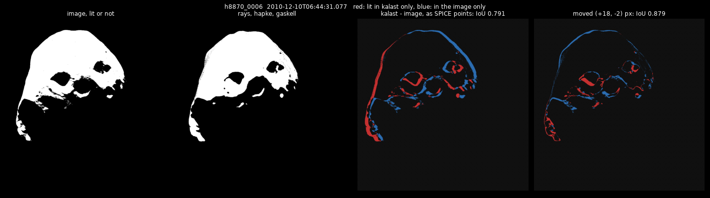

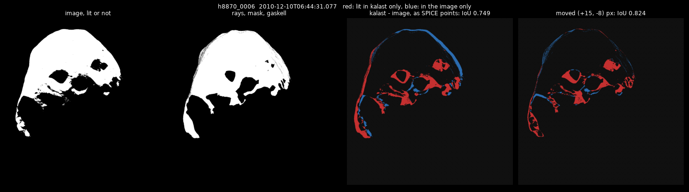

What the tables say:

- **The shadow methods agree.** The maps, the rays and the reference are
  within 0.01 of each other in every IoU and 0.04 in every r. At the SRC's
  8-33 m a pixel the maps resolve what the rays do; the reference's
  integrated pixels change edges by a fraction of one. Which method draws
  the shadows does not decide this comparison; the shape and the pointing
  do.
- **The pointing is off by 10-20 pixels.** The best overlaps are
  (+15..+20, -2..-10) pixels off for h8870 and (+11..+16, 0..-13) for h8963
  over all runs, 110-180 µrad; h8951's lies along one axis (0, -8..-35),
  little limb in its frame to pin it, and hc069's is not determined at all
  (3-124 pixels), Phobos filling the frame. `ATNM_T6_P...` is the
  attitude as commanded -- "predicted attitude as commanded", ESA's CK
  readme -- and the colleague's own figure shows the same rim along the
  limb. ESA has the attitude measured on board too, a kernel a year, not in
  `rot_shdw.TM`: `ATNM_MEASURED_100101_110101_V03.BC` (241 MB),
  `ATNM_MEASURED_2011_V04.BC` (217 MB) and `ATNM_MEASURED_2013_V04.BC` (226
  MB) cover these images -- what they change is below. Moved, h8870 goes
  from 0.79 to 0.88.
- **Like for like scores higher than lit at all.** Cut at the same fifth as
  the image, h8870 is 0.79 as pointed, against 0.75 lit wherever the Sun
  reaches, and the colleague's 0.72: a grazing slope dim in the image is lit
  in a geometric mask.
- **Neither shape model is better throughout.** DLR's fits h8951 better
  moved (0.918 against 0.907), Gaskell's h8963 (0.942 against 0.933) and
  hc069 (0.749 against 0.725). Both are too coarse for hc069 at 8 m a
  pixel: a crater with a clear shadow in the image is a smooth lit bowl in
  both, and the large crater's shadow edge is off, at 0.75 whatever is
  moved. Ernst et al.'s 18 m model would be the one for it -- and is, in
  its section below, once the image is moved where its craters say.
- **PCK00011 fits a little better.** Moved, it is ahead or level on every
  image with both models, by up to 0.016, and hc069's brightness correlates at 0.56
  against 0.48 with Gaskell's model; as pointed the pointing error
  dominates and it is mixed. Phobos's orientation differs by 0.56-0.84°
  between the two kernels at these dates.
- **Hapke over Lambert.** The brightness correlates at 0.79-0.89 with Hapke
  against 0.74-0.82 with Lambert on the three images the models resolve, and
  spreads less (h8963: 0.88-1.17 against 0.86-1.26). The lit-or-not cut is
  nearly the same with either, being relative to each image. What is left,
  ±15-20 %, shows as broad patches in the ratios -- Phobos's lighter and
  darker units among them, the albedo being uniform here -- with the shape's
  missing relief and the light the model has not got: Mars-shine and light
  from the surface around.

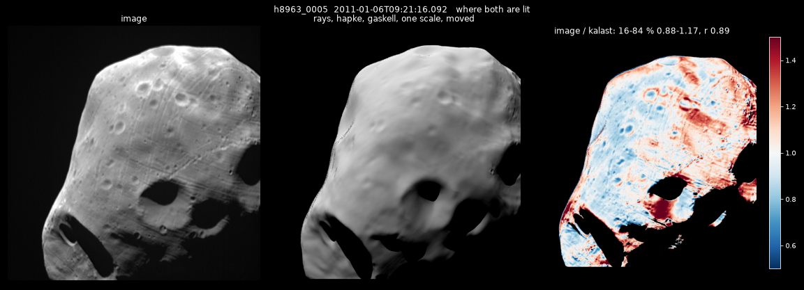

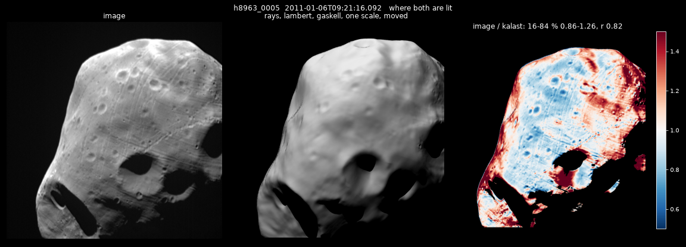

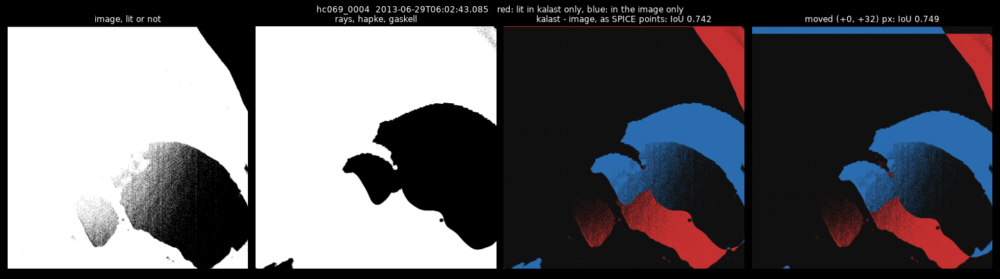

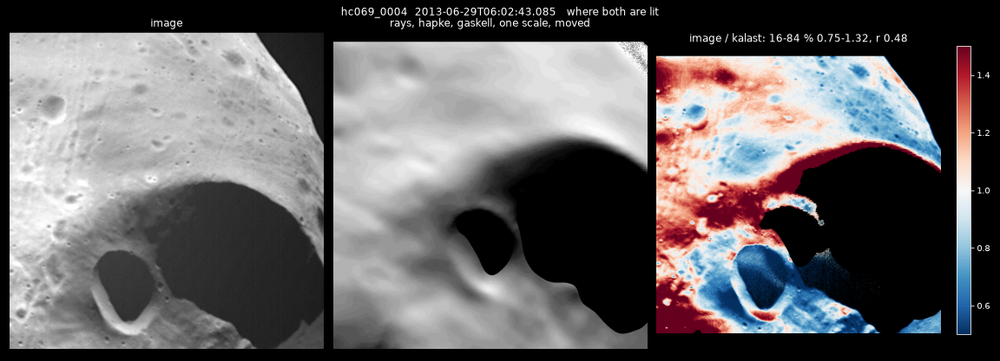

## On the way

- **Lambert's frames clipped.** At an exposure of 3 a Lambert surface of
  colour 1 saturated the 8-bit export wherever cos i passed a third, and its
  brightness correlated at 0.41-0.64 with the maps and the rays against
  0.74-0.82 with the reference, whose floats are never clipped. 0.8 now;
  Hapke's 12 leaves its frames at 44-78 of 255, quantised but no worse: the
  reference's floats correlate the same.
- **The reference's floats unclamped.** The lit-or-not cut was half the
  frame's brightest, which for the reference's floats at an exposure of
  10,000 was hundreds: IoU 0.55. Clamped to 1 first now.
- **A reference stops at its error, which a lit-or-not frame never
  reaches**: every pixel on an edge is a coin toss, which would need 65,000
  samples. `reference.max_samples = 1024` puts such a pixel within about
  1.5 %.
- **Speckles along the limb** in Gaskell's model, the lit-or-not frames
  dotted with unlit pixels where the surface is seen edge on: its facets'
  own roughness, some facing away from the Sun. Not the level of detail --
  the same with `shading.lod` off -- and the reference averages them away.

## The measured attitude

The three `ATNM_MEASURED` kernels, loaded after the commanded one, cover
the four images. They move Phobos in the frame by (-1.0, -15.6) pixels in
h8870, (-1.5, -9.3) in h8951, (0.1, -8.8) in hc069 -- 80-143 µrad -- and by
nothing in h8963, where the spacecraft pointed as it was told to (2 µrad).
The rays, Hapke, the like for like, as pointed / moved, with the shift the
images need, commanded and measured:

| model | attitude | h8870 | h8951 | h8963 | hc069 |
|---|---|---|---|---|---|
| gaskell | commanded | 0.791 / 0.879, (+18, -2) | 0.901 / 0.907, (0, -12) | 0.913 / 0.942, (+12, -4) | 0.742 / 0.749 |
| gaskell | measured | 0.740 / 0.878, (+19, +13) | 0.908 / 0.908, (0, -1) | 0.913 / 0.942, (+12, -4) | 0.734 / 0.742 |
| dlr | measured | 0.737 / 0.873, (+21, +12) | 0.913 / 0.917, (0, -6) | 0.895 / 0.933, (+15, -1) | 0.709 / 0.718 |

The measured attitude puts h8951 in place -- 12 pixels to 1 -- and leaves
h8963 as it was. h8870 it moves along the lines, and the image wanted it
moved across them: 18 pixels needed become 23, and as pointed it scores
0.74 rather than 0.79, the commanded attitude having half hidden the rest.
What is left is 12-21 pixels across the lines in h8870 and h8963 with either
attitude, 110-190 µrad: not the attitude -- Phobos's ephemeris (MAR097) or
the spacecraft's, some 0.7 km across the line of sight at h8870's 3,600 km,
or the SRC's alignment on the spacecraft. hc069's shift is no
better determined than before. `phobos_hrsc.tm` loads the measured attitude:
it is what is known of where the camera pointed. The lit-or-not runs, rays,
measured: Gaskell's model 0.749 / 0.824, 0.874 / 0.887, 0.882 / 0.907,
0.771 / 0.776; DLR's 0.754 / 0.834, 0.871 / 0.895, 0.864 / 0.893, 0.750 /
0.753.

## Ernst et al.'s model

13 October. SBMT's shared files (https://sbmt.jhuapl.edu/shared-files/)
hold version 4 at 18, 36, 73, 148 and 296 m -- 12,582,912 plates down to
49,152 -- each with a coloring file, and regional DTMs at 10 m. Version 4
is shifted so its centre of figure is its centre of mass, moved to
PCK00011's frame, and its maplets iterated ten times. Downloaded, 780 MB, to
`~/data/mesh/phobos/ernst2023/`: the 18 m and 36 m models and the 36 m
coloring. The 18 m OBJ is 925 MB, 6,291,458 vertices in km; kalast loads it
in 0.7 s and prepares its levels of detail in 3.6 s, and an image takes 3.5-7
s in `main.py` with the rays against Gaskell's 1.5-3.6. Its centroid is 0.2 m
from its origin (Gaskell's 7 m), its volume 5,693 km³ (Gaskell's 5,760).

With PCK00011, its frame, and the measured attitude; the rays, Hapke cut like
the images; IoU as pointed / moved, the move, and the brightness's r
(`table_ernst.md`):

| model | h8870 | h8951 | h8963 | hc069 |
|---|---|---|---|---|
| Gaskell | 0.742 / 0.888, (+19, +12), 0.81 | 0.907 / 0.908, (0, -4), 0.80 | 0.907 / 0.943, (+13, -6), 0.89 | 0.750 / 0.756, 0.47 |
| Ernst, 36 m | 0.740 / 0.925, (+19, +9), 0.83 | 0.877 / 0.920, (+13, -23), 0.89 | 0.882 / 0.960, (+17, -11), 0.92 | 0.753 / 0.762, 0.54 |
| Ernst, 18 m | 0.739 / 0.924, (+20, +9), 0.83 | 0.875 / 0.919, (+13, -23), 0.89 | 0.879 / 0.958, (+16, -12), 0.90 | 0.752 / 0.760, 0.54 |

Lit wherever the Sun reaches, moved: Gaskell's 0.831, 0.891, 0.908, 0.788;
Ernst's 18 m 0.888, 0.931, 0.934, 0.788.

- **Sharp.** The grooves, the crater chains and the craters of a few tens
  of metres the images show are in kalast's now; Gaskell's model blurs them
  away at 8-11 m a pixel. Moved, the shadows overlap better on the three
  images that can tell: h8870 0.888 to 0.924, h8951 0.908 to 0.919, h8963
  0.943 to 0.958, and lit at all 0.831 to 0.888, 0.891 to 0.931, 0.908 to
  0.934. h8951's brightness correlates at 0.89 rather than 0.80. The 36 m
  model scores as well as the 18 m; the 18 m draws small craters a little
  crisper, and is `main.py`'s.
- **As pointed it scores lower**, 0.875 against 0.907 on h8951: its shadows
  fall where the image's do once the craters line up, and the craters say
  the pointing is further off than Gaskell's blurred shadows let on.
- **The surface's texture pins the pointing**, now there is texture to
  match: both images high-passed and correlated (a scratch script, not in
  `compare.py`), the peak 7-13 times the next one on three images and 2.7
  on hc069. It agrees with the lit-or-not overlap within two pixels on
  h8870 (+20, +9), h8951 (+15, -24) and h8963 (+17, -12). hc069, Phobos
  filling the frame, the overlap never pinned; the craters put it at (-104,
  +114). There they line up -- the large crater's rim, the small one's lit
  wall, the shadows' edges -- and the brightness correlates at 0.80 rather
  than 0.54 (Gaskell's model: 0.59). The lit-or-not scores only 0.70 there.
  A move that large leaves a margin the frame does not cover, counted
  unlit. And the image's shadows, lit by their walls, reach the cut, where
  kalast's are black.
- **The pointing is Phobos's ephemeris, in part.** h8870's and hc069's
  moves lie within 3° of the way Phobos moves about Mars, as each image
  sees it: Phobos 0.9 km behind where MAR097 puts it in December 2010, 1.6
  km behind in June 2013. h8951's and h8963's lie 72° and 38° from it, with
  0.3 km left over across that direction. (That afternoon: in June 2013
  MAR099 agrees, 1.2 km; in 2010-11 Pasewaldt et al.'s astrometry puts the
  moves on the SRC's pointing -- the next section.)
- **The albedo map changes little.** The coloring's albedo, one per plate,
  is 0.068 at the median, within ±3 % between the 16th and 84th
  percentiles, and 0.039-0.103 at the extremes. It went in as each facet's
  colour over the median -- the law's albedo scaled -- carried to the 18 m
  plates from the nearest 36 m plate centre, 9 m away at the median.
  Hapke's r goes from 0.83, 0.89, 0.90 and 0.80 (hc069 where its craters
  line up) to 0.84, 0.89, 0.91 and 0.81, and Lambert's gains 0.01-0.02
  likewise. Hapke stays ahead of Lambert on the first three, 0.83, 0.89,
  0.90 against 0.80, 0.84, 0.84; on hc069 Lambert reads 0.82.
- **What is left**, ±12-20 % between the 16th and 84th percentiles, is no
  longer the relief. In h8870 and h8963 one side of the
  disc is brighter than the other: the law's dependence on incidence and
  emission, or units of different albedo that this map, ±3 %, does not
  show. The shadows are lit by their walls in the images and black in
  kalast; the reference's bounces would light them. And Mars-shine on
  h8870's night side, as before.

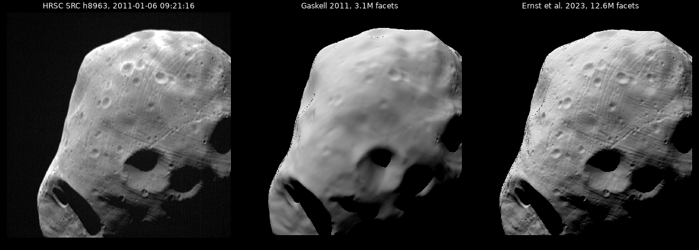

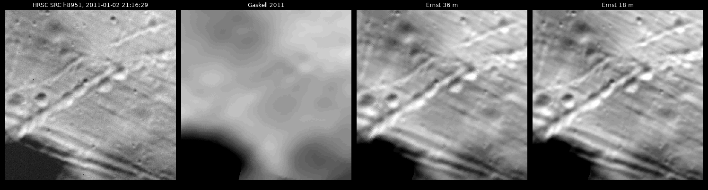

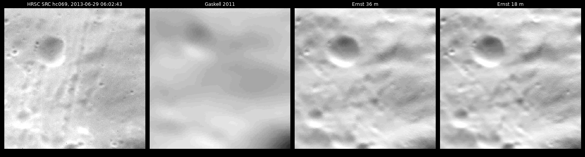

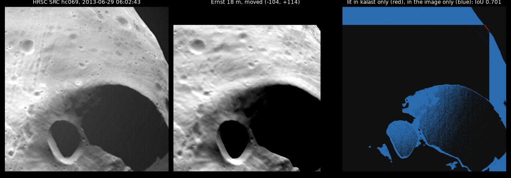

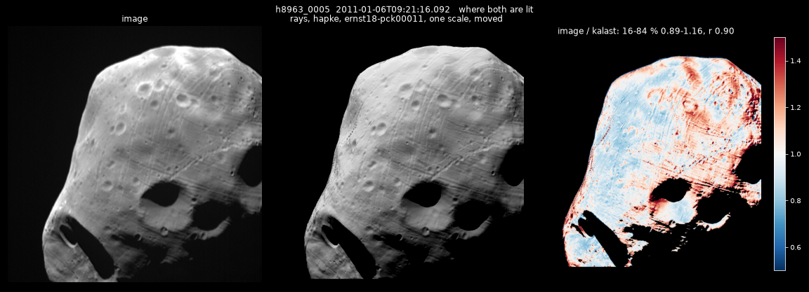

## The ephemeris and the pointing

13 October, afternoon. The user: "can you fix/correct for it? or can you
use updated kernels?"

**Two later ephemerides than MAR097** (`compare_eph.py`, scratch): JPL's
MAR099 (June 2025, `mar099s.bsp` from NAIF's generic kernels, DE440's
planets in it) and IMCCE's NOE-4-2020 (Lainey et al. 2021, the SRC's
astrometry to 2018 in it). Both put Phobos 1.17 km behind MAR097 in June
2013 (along its orbit -1.166 and -1.177 km), which moves it (-59, +68) and
(-66, +75) pixels in hc069: 60 % of what its craters asked, the same way.
In 2010-11 they move it by 0.2-0.6 km, mostly radially: 1-19 pixels.

**Pasewaldt et al. (2015, A&A 580, A28) measured three of the four**:
Phobos's direction from Mars Express in h8870_0006, h8951_0005 and
h8963_0005, by control points and by its limb, the SRC's pointing checked
against stars (IMCCE's NSDB, collections mm0031 and mm0032). Their
spacecraft positions are ESA's to 6 m (50 m in the ESAC set). Observed minus
computed, control points, in each image's pixels:

| | h8870 | h8951 | h8963 | their 1 sigma |
|---|---|---|---|---|
| MAR097 | -0.4, -14.0 | -4.3, -0.1 | -5.5, -1.2 | 8, 21, 11 |
| MAR099 | +0.6, -9.3 | -3.7, +18.8 | -2.9, +8.2 | |
| the craters' move, MAR097 | +20, +9 | +15, -24 | +17, -12 | |
| what is the pointing's | +20, +23 | +19, -24 | +22, -11 | |

So in 2010-11 Phobos's ephemeris is out by 14 pixels at most, and the
craters' move is mostly the SRC's pointing: 19-22 pixels along the samples
in all three, and across them +23, -24 and -11. The limb fits say the same
within 2.5 pixels. What it is not:

- **The clock.** IMAGE_TIME is the middle of the exposure (START_TIME and
  STOP_TIME, 20 ms apart). The spacecraft held still (`INERT`) and Phobos
  drifted along the samples at 84, 256, 122 and 346 pixels a second: the
  moves would want -0.25, -0.06, -0.16 and -0.13 s, a different offset each.
- **Stellar aberration**, 9 pixels, applied in the right sense: without it
  the moves grow.
- **The spacecraft's orbit**, 6 m from Pasewaldt et al.'s.
- **The SRC's alignment, in part.** `MEX_V16.TF` carries Duxbury's angles of
  2013; Roatsch's of 2003 move Phobos (+20.4, +16.2) pixels: the samples'
  20 the three images ask for, not the lines'. The alignment moved by as
  much between its two calibrations.

**Corrected**: `phobos_hrsc.tm` loads MAR099 in place of MAR097 and DE405
(the small kernel alone gives the same positions to the metre), and
`main.py` turns the camera by where each image's craters put Phobos,
`POINTING`: (+20.7, +14.1), (+15.4, -4.8), (+19.8, -2.2) and (-44.1, +44.5)
pixels, measured with MAR099 by the texture's registration, now in
`compare.py` to a fraction of a pixel. `spice` in `main.py`'s arguments
leaves them out. What `compare.py` finds left: under 0.3 pixel on all four.
Lit or not as pointed, the rays: 0.924, 0.935, 0.963, 0.862 (hc069 was 0.70
at its registered move, with margins); the reference 0.935, 0.940, 0.966,
0.874.

## The light in the shadows

The user: "fix the 3 points you listed and afterwards keep looking for any
hint/possibility in discrepency to reproduce the same images with same
brightness and same shadows". The three: the walls' light, Mars-shine, and
one side of the disc brighter than kalast's.

**kalast's bounces took every surface for Lambert**, the colour its albedo:
under Hapke's law, whose colour is a scale of 1, Phobos reflected bounced
light as a white surface, 36 times too much at each reflection (the law's
bihemispherical albedo is 0.028). Each surface now reflects by its own law;
`2026-10-10_ray_traced_shadows/`, 13 October.

**The walls' light is nothing.** With the bounces by the law, Phobos's own
surface lights its shadows by 0-3 DN, where the images read 67-308: at an
albedo of 0.03 a second reflection is a thousandth.

**Mars-shine is real**: Mars in the scene, a Lambert sphere of its Bond
albedo, 0.25 (`res/ico5.obj` at Mars's radii, turned as `IAU_MARS`), and one
bounce. From Phobos Mars is gibbous, at phase 24-45 deg. It puts 32 DN on
h8870's night side and 14 in its cast shadows, 56 and 49 in hc069's, 1-9 in
the other two. Under the Hapke law fitted to Hera's AFC images of Mars
(`hera_mars_swingby/afc.py`, colour 0.672, TES's mean), 20-28 % less.
`main.py`'s reference has it.

**Most of the shadows' light is the camera's.** Where kalast's direct light
is nil, the images read about what the sky beside Phobos reads:

| DN | lit ground | night side | cast shadows | sky, 3-40 px from the limb | Mars-shine |
|---|---|---|---|---|---|
| h8870 | 1126 | 67 | 71 | 63 | 32, 14 |
| h8951 | 1242 | 151 | 181 | (no sky) | 7, 1 |
| h8963 | 1682 | 142 | 148 | 152 | 9, 5 |
| hc069 | 1299 | 308 | 305 | 238 | 56, 49 |

The more of the frame Phobos fills, the higher this veil: 6 % of the lit
ground in h8870, 20 % in hc069. Light scattered in the SRC, which is known
for it: an astigmatic, asymmetric response, blurring and ghosts (Oberst et
al. 2008), straylight from Mars (Wargnier et al. 2025, on Deimos).

**The SRC's response, fitted** to the four images at once through kalast's
reference with Mars (scratch `camera_fit7.py`), in log brightness so the sky
and the shadows weigh as the lit ground does, the scene drawn 256 pixels
wider on every side so Phobos's light from beyond the frame -- 1.44 and 1.05
times the frame's own in h8951 and hc069 -- is spread in too:

- Phobos's drift along the samples during the exposure, SPICE's drift times
  EXPOSURE_DURATION: 1.86, 4.90, 2.34 and 6.98 pixels (Hemmi & Kikuchi 2025
  deblur SRC images of Phobos by this alone);
- a Gaussian core of 2.19 pixels, 2.2-2.5 in the other fits that kept to
  physical bounds;
- 1.2 % of the light within about 53 pixels and 28 % over about 434;
- an offset per image: 8, 3, 0 and 101 DN, hc069's Phobos reaching beyond
  even the wider frame.

A halo of 28 % is large, and fits with a free offset ran to 50-60 %; the
light budget agrees with the bounded one. In I/F by Wargnier et al.'s
calibration of the SRC (1.73 x 10^7 DN/s, +-7.5 %), where Phobos fills the
frame the image's total light is kalast's to 0.1 and 1 % (h8951, hc069),
and 7-8 % of it has moved from the lit ground to the dark: what a halo
does. Beside Phobos, h8963's sky is matched within 10 DN; h8870's reads 62
DN between 20 and 60 pixels out against the model's 37 -- the response is
not the same in every image, h8870 taken at 5 deg C, the others at 8-10.

`hrsc.response` applies it, and `compare.py` sets the images against
kalast's through it, a scale and an offset fitted (`table_src.md`):

| | h8870 | h8951 | h8963 | hc069 |
|---|---|---|---|---|
| the image / kalast, 16-84 %, r | 0.86-1.21, 0.86 | 0.88-1.16, 0.91 | 0.89-1.15, 0.92 | 0.87-1.20, 0.81 |
| through the SRC | 0.88-1.19, 0.90 | 0.91-1.12, 0.92 | 0.91-1.14, 0.92 | 0.89-1.16, 0.84 |
| the dark, image / kalast through the SRC (DN) | 63 / 42 | 180 / 154 | 142 / 135 | 261 / 250 |

The reference with Mars and a bounce, the Sun a disc. Through the SRC the
shadows are grey as in the images, the craters as soft, and the sky beside
Phobos lit.

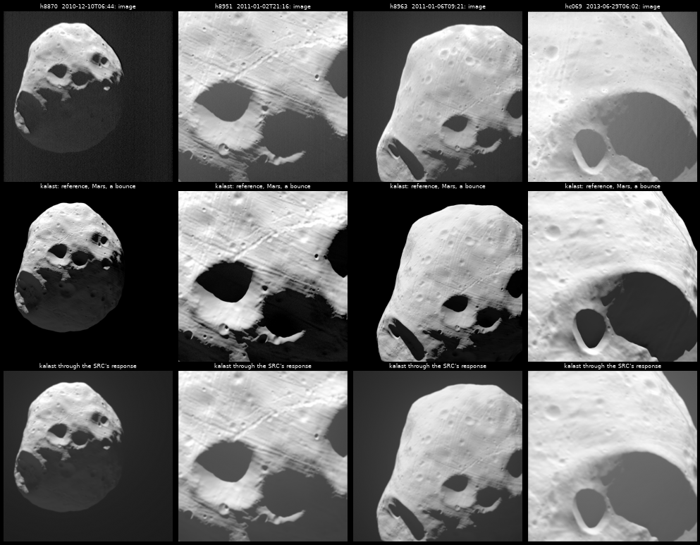

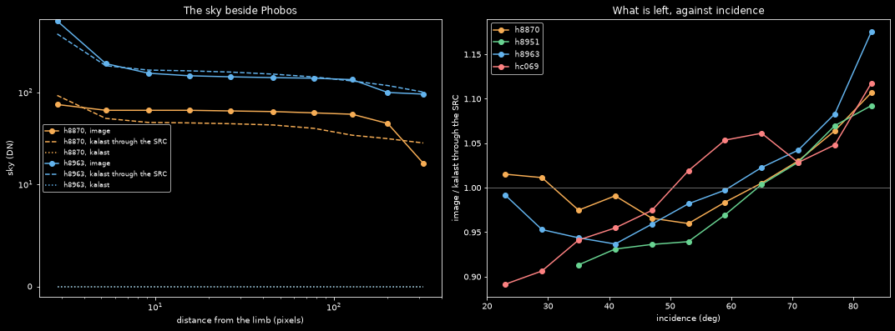

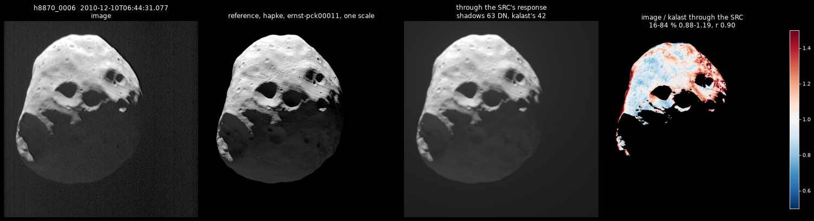

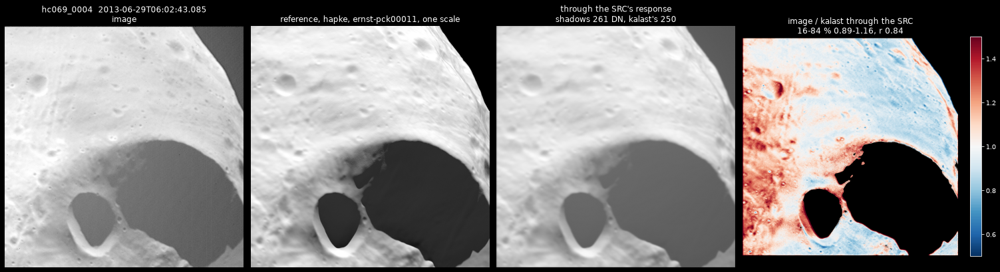

## The brightness: what is left

- **Absolutely**, by Wargnier et al.'s calibration, the images' lit ground
  is 0.89, 0.94, 0.77 and 0.92 of kalast's I/F under Fornasier et al.'s law.
  h8963, at the lowest phase (58 deg), reads 23 % under, beyond the
  calibration's 7.5 %.
- **Against incidence**, through the SRC: from 0.89-1.01 at 20-45 deg to
  1.09-1.18 at 80-85 deg, in all four. With an albedo per 5-degree cell of
  the surface fitted besides, still 0.93 to 1.10. Not Mars-shine: largest on
  facets that face away from Mars. Not Hapke's roughness or albedo either:
  refitted (23.3 deg, w 0.052) they gain nothing; without roughness, or with
  Lommel-Seeliger, the trend goes and the fit as a whole worsens (rms of the
  log ratio 0.140 against 0.130); Lommel-Seeliger 0.9 with Lambert 0.1 does
  marginally better (0.129). The law near the terminator, or the response's
  near halo, which spreads light into dim ground beside bright.
- **On the surface**, in 5-degree cells, the ratios correlate between images
  at 0.81-0.89, but much of it is the incidence they share: each image
  predicted from the other three's cells, 0.37-0.51, and the rms of its log
  ratio down by 0.02 in three of the four. Some albedo, a few percent; Ernst
  et al.'s map says 3.
- **Not looked at**: the electronic undershoot Wargnier et al. find to the
  right of bright objects.

## Not done

- **The SRC's response as part of kalast**: an image smeared, blurred and
  spread as a camera records it, at export or on the reference's floats --
  here it is `hrsc.response`, numpy in the example. The halo wants the scene
  beyond the frame drawn too.
- **The SRC's response from its own star images** (Oberst et al. 2008,
  Wargnier et al. 2025): its halo measured without kalast, and whether it
  changes with the camera's temperature, as h8870's sky suggests.
- **The pointing's own cause.** 19-22 pixels along the samples in 2010-11
  are the SRC's pointing -- its alignment or the attitude -- by Pasewaldt et
  al.'s astrometry; there is none for 2013, where MAR099 leaves hc069 still
  (-44, +45) pixels off, along Phobos's orbit.
- **The law near the terminator**, 10-18 % brighter in the images at
  incidence 80-85 deg than Fornasier et al.'s Hapke draws it, and an albedo
  map of a few percent from the SRC's images.
- **Facet by facet**, as the colleague suggests: kalast's lit fraction of
  each facet (`sim.facet_shadow`) against the image's brightness over the
  pixels showing it (`sim.facet_id_map()`).
- **Phobos's rotation fitted** to the shadows -- the colleague's aim: the
  IoU as pointed as the objective, over the rotation's angles, the pointing
  fixed by the craters so that it cannot stand in for the rotation.

## Running it

From the repository root, after setting the paths in `phobos_hrsc.tm` and
`main.py`, and downloading Ernst et al.'s 18 m model from SBMT's shared
files and MAR099's small kernel from NAIF:

    python examples/phobos_shadows_fit/main.py rays hapke             # Ernst et al., PCK00011
    python examples/phobos_shadows_fit/main.py reference hapke        # with Mars, a bounce, the Sun a disc
    python examples/phobos_shadows_fit/main.py rays hapke spice       # pointed as SPICE has it
    python examples/phobos_shadows_fit/main.py rays hapke gaskell
    python examples/phobos_shadows_fit/compare.py

The frames go to `out/phobos_hrsc/<run>/`, the figures and `table.md` to
`out/phobos_hrsc/figures/`. `main.py` reproduces the runs here: to the bit
where `POINTING` is as fitted (h8963), elsewhere within its rounding to a
tenth of a pixel. On the M1 Pro a run of four images takes about a minute
with the maps or the rays, and 10 minutes with the reference and Mars.
