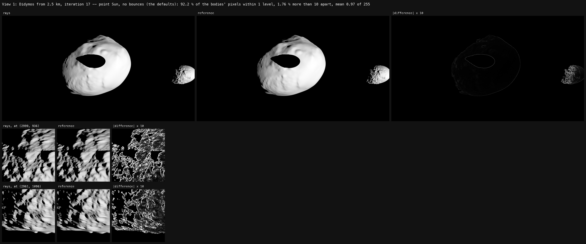
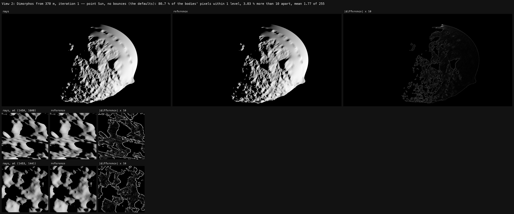
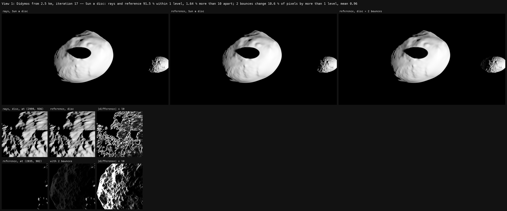
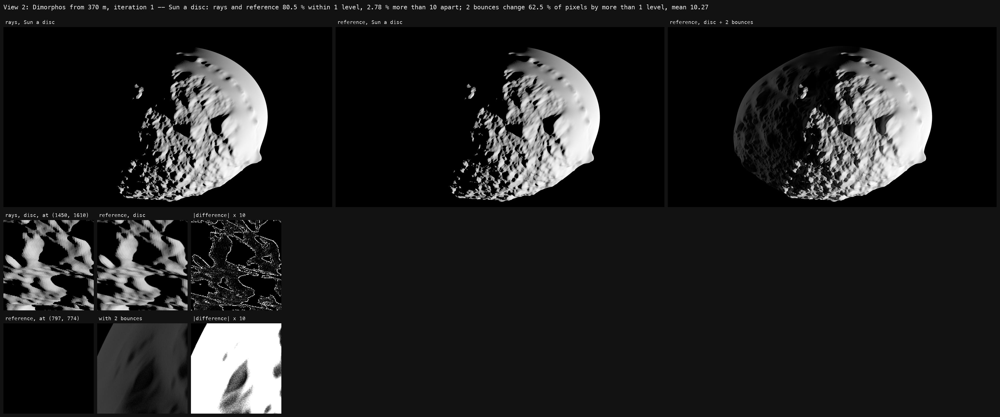

# Rays against the reference, at the user's views

12 October 2026, M1 Pro.

"i dont see the difference between rays and reference -- can you show me on
this camera pos". Two views of `examples/didymos/main.py`, the Didymos pair
at full resolution, both drawn at the UI app's viewport on the user's 4K
screen, 3234 x 1774:

- view 1, iteration 17: `pos=[-1.678, -1.844, 0.347]`, Didymos from 2.5
  km, Dimorphos's shadow across it;
- view 2, iteration 1: `pos=[-0.444, -1.236, 0.319]`, Dimorphos from 370 m.

Each drawn with `shadows.method = "rays"` and `"reference"`, then both again
with the Sun a disc (`light.sun_as_point = False`), then the reference with
two bounces (`reference.bounces = 2`). Exported PNGs compared pixel for
pixel, the difference the largest of the three channels.

## The defaults: the same shadows

With the defaults -- the Sun a point, no bounces -- the two trace the same
shadows: rays against the same full meshes, to the same point. What the
reference does besides is average each pixel over its area, hundreds of
samples to its stated error, where the rays' image takes one shading sample
a pixel and MSAA's four for coverage. So the difference is anti-aliasing:

| view | within 1 level | more than 10 apart | of those, on an edge | mean |
|---|---|---|---|---|
| 1, Didymos from 2.5 km | 92.2 % | 1.76 % | 58 % | 0.97 of 255 |
| 2, Dimorphos from 370 m | 80.7 % | 3.03 % | 68 % | 1.77 of 255 |

An edge is the silhouette's or a shadow's -- both border black, which the
PNGs cannot tell apart. The rest is relief finer than a pixel, which the
rays' image samples and the reference averages: Dimorphos's boulders, crisp
and stepped against smooth, and more of them in view 2, where they fill the
frame. A straight seam across Dimorphos at (2999, 936) in view 1 is in both:
the shape model's.

Nothing to see at the screen's scale is what the reference is for: it is
the image the others should be, converged and the same every run -- the
yardstick for the maps and the rays, and a still for a data product.

## The Sun a disc, and two bounces

With the Sun a disc both draw the penumbrae, the rays with
`shadows.ray_samples` rays a point and the reference integrating the disc:
view 1 91.5 % within 1 level and 1.64 % more than 10 apart, view 2 80.5 %
and 2.78 % -- the same picture as with a point.

Bounced light is where the reference looks different. In view 1 two
bounces lit 78,102 pixels that were black -- Dimorphos's night side, by the
light Didymos sends it, and the eclipse's shadow on Didymos -- at 7.7 levels
on average, 32 at the 95th percentile; a lit pixel gains 0.35 on average,
0.2 %. In view 2, Didymos large behind the camera, the whole of Dimorphos's
night side comes up: 1,090,853 pixels black without bounces, at 18.7 levels
on average and 52 at the 95th percentile, and the lit ones gain 2.1, 1.2 %.
The bounce treats a body as a Lambert surface of its facets' colour, white
here, as the example leaves them: with Didymos's own albedo, about 0.15, it
would be several times fainter.

The two-bounce references took 671 s and 1241 s, 2544 and 4032 samples, the
other references 29-203 s.
