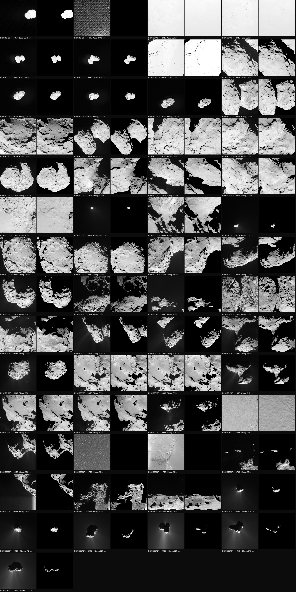
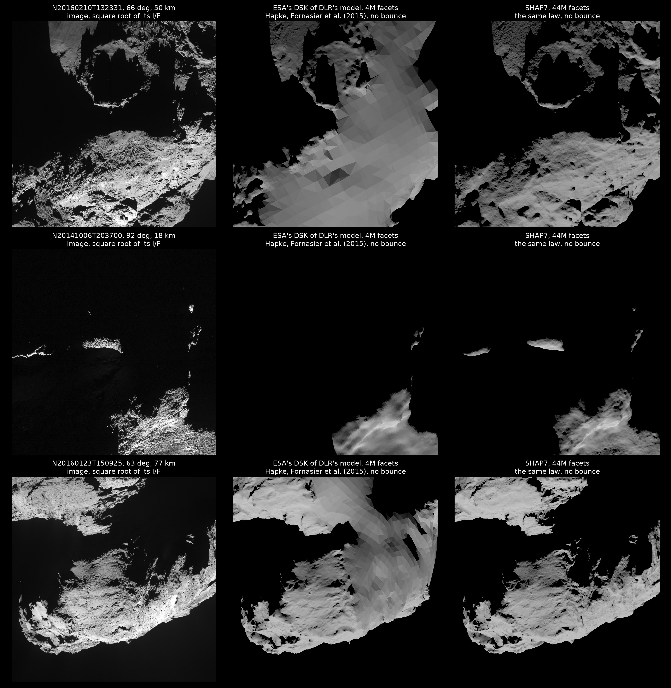
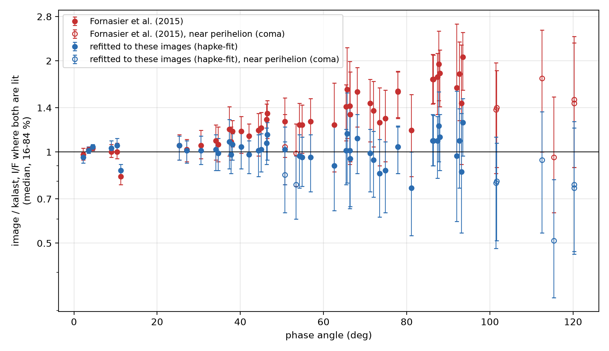
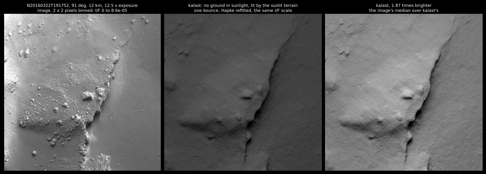
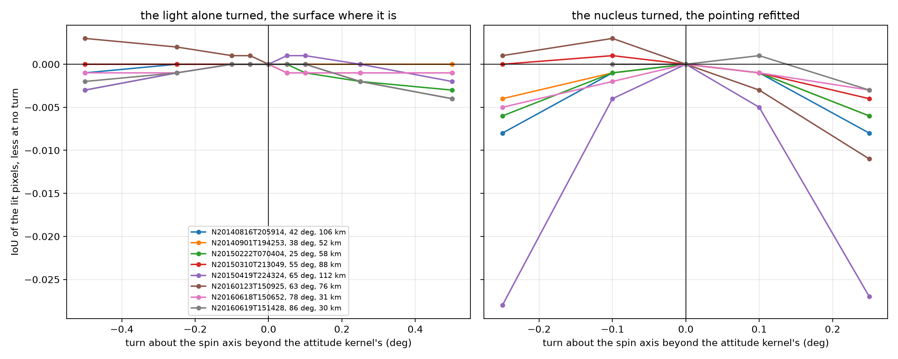

# Comet 67P in Rosetta OSIRIS NAC images: shadows and light

13 October 2026, M1 Pro (32 GB).

The user: "in a separate example folder, can you do same image reproduction
of 67P images from Rosetta. Take a series of multiple images, some close or
medium distance, where the shadows are really visible and maybe less, as
many different phase angle as possible, and try to reproduce the same phobos
shadow fit work on 67P"; on the shortlist's thumbnails, "i lke the 57
thumbnails, if we can reproduce them it would be nice"; and on the first
renders, "the shape model looks really not good, not high res".

`examples/comet67p_shadows_fit/`: `main.py` draws the images of
`images.csv`, `compare.py` scores them and makes the figures, `osiris.py`
reads an image and downloads it, `rosetta.tm` loads the kernels; its README
says where the data comes from.

kalast's are drawn with the reference, SHAP7 in full and the Hapke law refitted to these images (`hapke-fit`, below), without bounced light: ground in shadow is black where the images show it lit by the terrain around it (see "The comet's light on its night side").

## The images: 57 of 15,570

Every NAC image of the archive's stray-light-corrected reflectance sets
(`RO-C-OSINAC-4-*-67P-*-STR-REFL-V1.0`, 35 mission phases) through the
orange filter, 649 nm -- 15,570 -- with its geometry from SPICE: distance,
phase angle at the nucleus's centre, the nucleus's angle from the boresight.
Kept: the nucleus within 0.7 deg of the boresight; 13 bins of phase from 0
to 140 deg, in each one or two images per distance class (0-15, 15-30,
30-60, 60-120, 120-250 km and beyond), from different days, six at most. 57
images, 25 July 2014 to 12 August 2016: phase 2.1 to 120 deg, 8.7 to 2,941
km (median 77), 0.16 to 55 m a pixel (median 1.4), 1.28 to 3.66 au from the
Sun.

The products are I/F in float32, geometric distortion corrected (a pinhole
camera of 18.82 microradians a pixel, `ROS_OSIRIS_V17.TI`), stored with
their first line along the NAC's +X: kalast's camera up along +X, and the
frame mirrored top to bottom, `image.flip_y`. Each is drawn at its
`START_TIME` plus half its exposure; the time in a file's name is about
70 s earlier. Four are windows of the CCD (256, 512 and two 1024 pixels
square), their centre off the boresight, counted with the samples against
the CCD's X. Checked on an image from 44 km: the distance,
the sub-spacecraft and sub-solar points as its label has them (44.089 km
against 44.093).

## The kernels: 18

From ESA's Rosetta set, as its final meta-kernel `ROS_OPS_V350_20220906_001`
loads them, plus the attitude as measured and as reconstructed, which it
does not load (`rosetta.tm`):

| kernel | for |
|---|---|
| `lsk/NAIF0011.TLS`, `sclk/ROS_160929_STEP.TSC` | time, the spacecraft's clock |
| `fk/ROS_V38.TF` | the frames, `67P/C-G_CK` and its clock among them |
| `spk/DE405.BSP` | the Sun |
| `spk/CORB_DV_257_03___T19_00345.BSP`, `spk/RORB_DV_257_03___T19_00345.BSP` | the comet, Rosetta |
| `ck/former_versions/CATT_DV_145_02`, `..._223_02`, `ck/CATT_DV_257_03` | the comet's attitude: each from its date on, the latest winning |
| `ck/ROS_OSIRIS_V2.BC` | OSIRIS on the spacecraft |
| `ck/former_versions/RATT_DV_145_01`, `..._223_01`, `ck/RATT_DV_257_02` | the spacecraft's attitude, as commanded |
| `ck/ROS_SC_MES_140120_150101_V03`, `..._160101_160930_V03` | as measured on board |
| `ck/ROS_SC_REC_140801_141231_V01`, `..._150101_151231`, `..._160101_160601` | as reconstructed from OSIRIS images |

The reconstructed attitude covers 46 of the 57; three of July and August
2014 take the measured, and eight of June to August 2016. ESA's newest
comet attitude, `CATT_DV_257`, starts on 30 December 2015: the earlier
images take the superseded files, as ESA's meta-kernel has them.
`ROS_CHURYUMOV_V01.TF`, an older frames kernel, redefines the comet's clock
and breaks `67P/C-G_CK` if loaded; it is not needed.

## The shape model: SHAP7, 44M facets

ESA's DSKs carry three models of the nucleus at 4M facets. The first tried,
`ROS_CG_M004_OSPGDLR_N_V1`, DLR's stereophotogrammetry: facets 4.6 m
(median edge) in the north, but south of the equator largely a hull of
facets 30 to 150 m across -- 21 % of the surface, all of it south of -75
deg, 80 % between -60 and -45 -- presumably made from images taken while
the south was in polar night, until May 2015. Images of 2015-2016 seeing
the south drew as coarse triangles: on February 2016's at 50 km, 61 % of the
pixels on facets over 15 m. ESA's model from NAVCAM images by
stereophotoclinometry, `ROS_CG_M004_NSPCESA_N_V1`, covers the whole nucleus
with facets of 6-8 m: worse than DLR's on 31 images, better on 4.

Preusker et al. (2017)'s SHAP7 is DLR's final model, from 1531 NAC images
of August 2014 to February 2016: the whole nucleus in 44M facets 1-1.5 m
apart, decimetre-level vertically, with reductions to 4M and fewer. It is on
ESA's Rosetta simulator server
(`comsim.esac.esa.int/rossim/SHAPE_MODEL_DRAFTS/SHAP7_8/SPG/`) as binary
PLY, 835 MB, made OBJ once (the example's README). It is in the same frame
as `67P/C-G_CK`, the Cheops frame: the terrain registers within a pixel of
where DLR's DSK put it.

kalast draws it whole: loaded in 2 s, its level-of-detail tree built in
14-17 s, the reference at 64 samples a pixel in about 20 s an image at 30
km; the 57 in 12 minutes. It takes nearly all the laptop's memory: a peak
footprint of 31 GB, 10.9 GB resident.

With SPICE's pointing alone, over the 54 images where the nucleus is lit:

| | DLR's DSK, 4M | NAVCAM's DSK, 4M | SHAP7, 44M |
|---|---|---|---|
| IoU, median | 0.851 | 0.833 | 0.855 |
| IoU, mean | 0.796 | 0.781 | 0.822 |
| IoU, median, phase 60 deg and over (28) | 0.685 | | 0.769 |

SHAP7 is better than DLR's DSK by over 0.01 on 16 images and worse on 3;
February 2016's at 50 km goes from 0.394 to 0.603, January 2016's from
0.595 to 0.793, and at 92 deg and 18 km ridges lit in grazing light that the
DSK left dark come out where the image has them.

Drawn under Fornasier et al. (2015)'s Hapke law, the one published, without bounced light, all three as the square root of their I/F on the image's scale. Under that law kalast is 1.2-1.6 times too dark at 60-90 deg (below), which is the difference in brightness between the columns here; the refitted law takes it away. What it cannot take away is the texture: boulders, fractures and roughness at one to a few of these pixels, 0.35-1.4 m, at or below SHAP7's sampling of 1-1.5 m, which stereophotogrammetry smooths further; and the surface's own albedo, one value all over in kalast.

**A correction.** November 2014's image at 93 deg and 31 km
(N20141122T163853) had looked like a data problem: kalast drew a sliver of
it, and the OSIRIS team's own incidence backplane for it agreed with kalast
rather than with the image, whatever the comet's spin offset. It was the
DSK's southern hull, which the backplane was presumably computed on as well:
with SHAP7 the cliff, the lit wall and the terrain beside it are where the
image has them (IoU 0.52, the shadows' detail below the model's metre).

## Pointing

As for Phobos, where kalast's terrain falls on the image's: the phase
correlation of the brightness in log, high-passed, within 120 pixels,
trusted where its peak stands twice above any other. With SPICE's pointing
alone, on the 45 images where it does, the nucleus is off by a common
(-2.6, -4.5) pixels -- 49 microradians -- with a spread of a few pixels
(16-84 %: -4.2 to +2.2 along the samples, -8.6 to -2.8 along the lines);
(-3.2, -6.3) in 2014, (-2.7, -4.1) in 2015, (-1.7, -4.3) in 2016. The NAC's
alignment against the reconstructed attitude, or the reconstruction's own:
the same at 30 km and at 3000. `images.csv` holds each image's (`dx`,
`dy`), and the median for the 12 where the correlation is weak: no nucleus
or nothing lit (3), opposition with no shadows (2), and close views at 90
deg and more, or at 8.7 km, where the image's texture is finer than the
model's metre. With them `compare.py` finds 0.2 pixel or less left on all 45.

## Shadows

Lit or not as `compare.py` cuts them, within the nucleus's outline, with the
pointing of `images.csv` (`table.md`):

| phase (deg) | images | IoU, median | range |
|---|---|---|---|
| 0-30 | 8 | 0.976 | 0.951-0.994 |
| 30-60 | 18 | 0.935 | 0.859-0.973 |
| 60-90 | 18 | 0.886 | 0.622-0.988 |
| 90-100 | 4 | 0.604 | 0.524-0.885 |
| 100-125 | 6 | 0.746 | 0.682-0.820 |

29 of the 54 over 0.9. Where it falls short:

- **At 90 deg and more, close**: October and November 2014's at 18 and 31
  km (0.56, 0.52), February 2015's at 49 km (0.65). The Sun grazes the
  ground, and shadows are cast by relief at or below the model's metre --
  pixels of 0.35-0.9 m.
- **Near perihelion**, September 2015, 101-120 deg from 320-415 km (0.68 to
  0.82): the coma and its jets, bright in the images, are not in the scene;
  the nucleus's lit limb is a few pixels wide.
- **The night side**, March 2016 at 91 deg from 12 km: no ground in sunlight
  in the frame -- kalast draws it black; one image reads I/F 4 x 10^-5,
  ground lit by the comet's own sunlit terrain (below), the other nothing.
- **A window that misses the nucleus**: July 2014's 512-pixel window from
  1,419 km holds stars only, as kalast's does.

## Brightness: the phase function

The images are calibrated, so the comparison is absolute. Under Fornasier
et al. (2015)'s Hapke fit of the NAC's images -- w 0.034, g -0.42, B0 2.25,
h 0.061, theta_bar 28 deg, K 1.2, fitted at 1.3-54 deg -- the images over
kalast's I/F, as `compare.py` has them: 0.98-1.03 under 30 deg, 1.05-1.26
at 30-60, 1.2-1.6 at 60-80, 1.6-2.1 at 80-94. The law darkens too fast with
phase beyond where it was fitted.

**Refitted** on SHAP7: the pixels kalast lit by the Sun in full -- its I/F
within 3 % of the law's for the facet the pixel sees, away from edges and
penumbrae, and lit in the image too -- 20,000 at most an image, beside the
facet's incidence, emission and phase; Hapke as kalast has it, in numpy
(within 3 x 10^-5 of `kalast.scattering.Hapke`); robust least squares in
log, each image weighted alike. The six images near perihelion and the two
from 900-1,460 km of the same weeks left out, for their coma: 46 images,
860,000 pixels. w, b (one backward lobe) and theta_bar free, then B0 too,
which the images under 5 deg asked for:

| | w | g | theta_bar | B0 | per image, mean abs log |
|---|---|---|---|---|---|
| Fornasier et al. (2015) | 0.034 | -0.42 | 28 deg | 2.25 | 0.254 |
| refitted | 0.0356 | -0.276 | 24.4 deg | 4.73 | 0.078 |

Held out, in two halves of alternate images: 0.230 to 0.092 and 0.278 to
0.081, the images over the model at 16-84 % 1.03-1.48 to 0.87-1.05 and
1.06-1.65 to 0.97-1.14. B0 is loosely held -- 3.65 and 7.37 in the halves --
the rest within 0.005 in w, 0.05 in b, 1.1 deg. What is left is the images
among themselves: at 92-94 deg, 0.73 to 1.24 of the model, the geometry
each frame sees beyond what one law carries. `main.py`'s `hapke-fit`.

**Drawn by kalast** with it, the 57 again (`hapke-fit`), as `compare.py`
has them (`table.md`): the images over kalast's, per image, mean abs log
0.269 to 0.099 over the 54, 0.271 to 0.069 away from perihelion; median 1.26
to 1.01; within 10 %, 14 images to 35. By phase: 0.83-1.05 to 0.87-1.05
under 30 deg, 0.99-1.34 to 0.78-1.14 at 30-60, 1.23-1.61 to 0.85-1.15 at
60-80, 1.18-2.06 to 0.76-1.25 at 80-95. Beyond 95 deg, where it was not
fitted, 0.51-0.94: too bright there, or the coma's light misread as the
nucleus's in the old law. The shadows are the same, IoU within 0.003.

## The comet's light on its night side

The two images of 22 March 2016 at 91 deg from 12 km are 12.5 s exposures of
ground with no sunlight on it -- the night side, on purpose. At 19:17 the
ground reads I/F 4.4 x 10^-5 (2.9-6.8 x 10^-5, 5-95 %), at 20:47 nothing
(6 x 10^-7, the noise). kalast with `bounces=1` -- each pixel's ground lit
by whatever of the nucleus it sees in sunlight, through the law of both --
draws the first frame's terrain as the image has it: the cliff, the plateau's
edge, its shading; I/F 2.3 x 10^-5, the image 1.87 times brighter (their
medians), r 0.47 smoothed over 6 pixels. The second it draws black: no sunlit ground in sight.
The first in 230 s at half resolution and 1024 samples a pixel. Left out of
kalast's light: a second bounce, presumably a few percent on ground this dark;
the coma's own light; the boulders, metres across, bright in the image and
below the model's metre. Phobos's night side from Mars, the comet's from
itself.

## The rotation in the shadows

As for Phobos's libration: how far the shadows hold the nucleus's rotation.
Eight images with strong shadows and firm registration, 2014 to 2016, 25-86
deg, 30-112 km (`spin=DEG`, `light=DEG`, rays):

- **The light alone** turned about the spin axis, the surface where it is --
  what the shadows say by themselves: half a degree changes the lit pixels'
  IoU by 0.004 at most, 0.001 in most. At pixels of 0.5-2 m the shadows'
  edges move by less than one; they say little of the rotation below a
  degree.
- **The nucleus turned**, the pointing refitted from the terrain each time,
  `IoU there`: 0.1 deg costs up to 0.005, 0.25 deg up to 0.028 and
  typically 0.004-0.008 -- the view changing as the terrain turns, which no
  move of the image undoes. All eight fit best within 0.1 deg of the
  attitude kernel, three of them at -0.1 or +0.1 by 0.001-0.003.
- **Where the terrain falls** says more than the shadows' outlines: 0.1 deg
  moves it 0.5-3 pixels in these eight, and the registration finds it to a
  fraction of a pixel, the pointing scattering by about 3. The terrain's
  motion for a turn, worked out for every image from the facets it sees lit
  (0.2-71 pixels a degree, median 7), and the 45 registered offsets fitted
  as one pointing plus a turn of the nucleus per comet-attitude kernel:

| kernel | images | turn beyond the kernel |
|---|---|---|
| `CATT_DV_145`, to February 2015 | 21 | -0.03 +- 0.04 deg |
| `CATT_DV_223`, 2015 | 17 | +0.09 +- 0.03 deg |
| `CATT_DV_257`, 2016 | 7 | +0.03 +- 0.04 deg |

  The turns take the offsets' scatter from 3.44 to 3.38 pixels rms: the
  kernels' rotation holds to about 0.1 deg -- 3.5 m at the nucleus's
  rim -- and 2015's +0.09 is a hint, three standard errors. With a pointing
  of its own per kernel, the same within 0.01 deg. The reconstructed
  attitude was itself fitted to OSIRIS images through these kernels, which
  may hide part of a turn in the pointing.

For a fit of 67P's rotation, then: the terrain's registration across many
images and distances -- a pointing error the same at 30 km and 3,000, a
turn of the nucleus growing with nearness -- with the shadows' IoU to keep
the view right; the light alone does not reach a tenth of a degree.

## Not done

- **The coma**: dust in the scene for the images near perihelion, as Mars's
  dust is for the Hera swing-by (`body.atmosphere`), but a comet's is
  neither a layer nor static.
- **The NAC's response**: its PSF and its stray light, the SRC's
  `hrsc.response` for Phobos; the archive's products are already corrected
  for stray light.
- **An albedo map** of the nucleus from these images, as for Deimos and
  Phobos: 67P's albedo varies by 10-20 %.
- **PLY in kalast**: SHAP7 and other shape models come as PLY; kalast reads
  OBJ, so it is converted once.
