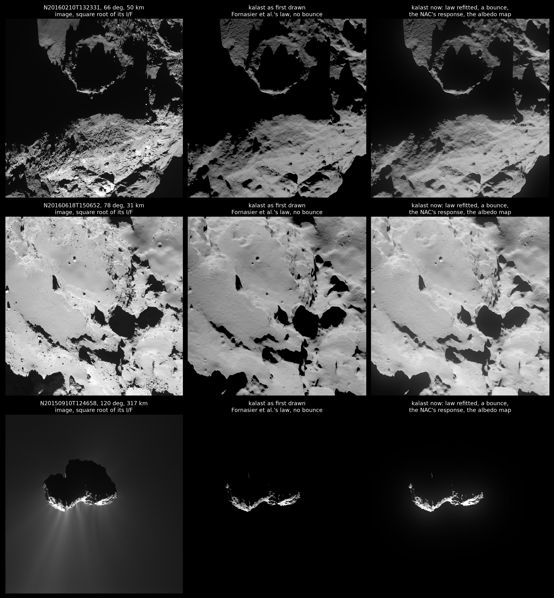
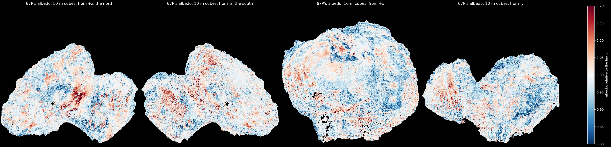
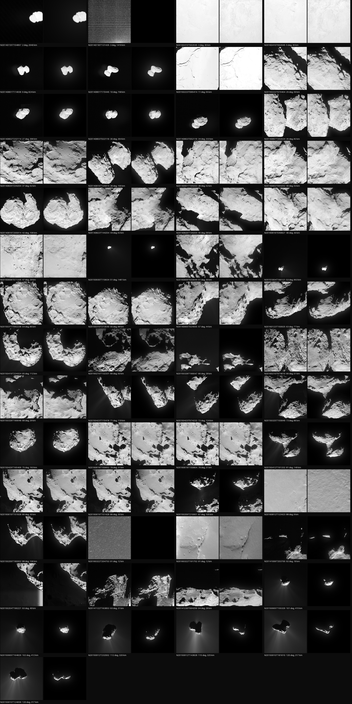
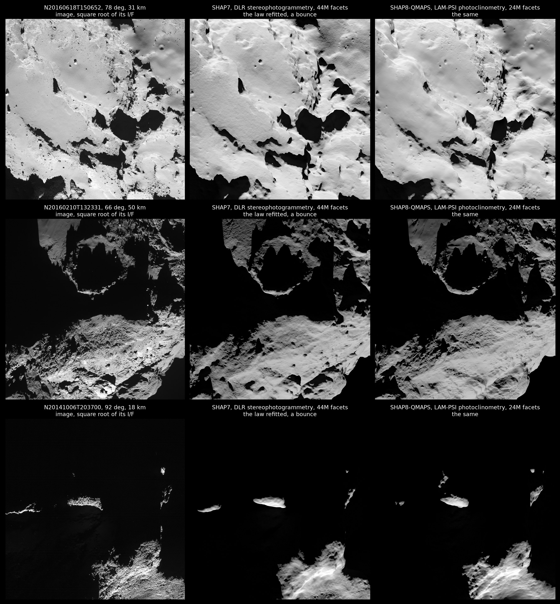

# 67P: bounced light, the NAC's response, the coma, an albedo map, and the shape models

14 October 2026, M1 Pro (32 GB). Following `2026-10-13_67p_osiris_shadows/`.

The user, on its figures: "between left column and right column you can
clearly see that the surface brightness is not the same. Did kalast used
hapke or lambert"; "there are many more details on the surface of the image
than on the kalast surface that looks smoother and flat gray without
brightness variation"; "in the sheet.jpg there are so many examples where i
doubt the ray bounces were used because some shadows are full black in
kalast but not in real image"; "finish the todo on 67p for coma / also do
reponse function of the camera / also albedo map / can we improve the mesh
to match this much much more details of the surface? i cant believe this is
the best shape model available publicly".

## What the figures were drawn with

`shape_models.jpg` was drawn under Fornasier et al. (2015)'s published Hapke
law, and `sheet.jpg` under the law refitted to these images; neither with
bounced light -- only the comet-shine figure had a bounce. Both say so now,
in their titles and the note. The brightness between the columns of
`shape_models.jpg` is the published law, 1.2-1.6 times too dark at 60-90 deg.
The texture is the rest: boulders, fractures and roughness at one to a few
pixels (0.35-1.4 m there), at or below SHAP7's 1-1.5 m, which
stereophotogrammetry smooths further; and one albedo all over.

## Bounced light in the 57

`main.py reference hapke-fit shap7 bounces=1`: 32 minutes for the 57 (64
samples a pixel). The shadows are lit by the terrain they see, as the
images have them, where they see sunlit ground; the night-side frame of 22
March 2016 goes from black to its terrain, IoU 0.85. The IoU is otherwise
unchanged, to 0.001 -- the cut between lit and not, a fifth of the brightest,
is far above bounced light -- and so is the brightness where lit.

The first run drew nothing: "step() saw no frame in 5 s; giving up on the
loop". SHAP7's 44M facets uploaded and their rays' structures built inside
one pump of the event loop, past the five seconds `app.step()` waited for a
frame. Fixed in kalast (`f19c2dc`): a busy pump restarts the five seconds.

## The NAC's response

As the HRSC SRC's was fitted (`2026-10-12_phobos_hrsc_shadows`): kalast's
image convolved with a Gaussian core and an exponential halo -- each part
normalised over the offsets of the crop padded to twice its size -- times a
scale and plus a background per image, against the image around the nucleus,
least squares (soft L1), on images where SHAP7's metre is under a pixel.

| images | core sigma (px) | halo | held out |
|---|---|---|---|
| 14 from 100 km and more, perihelion's included | 1.06 (1.00, 1.11 in halves) | 16 % over 25 px | -25 % and -29 % |
| 6 from 330 km and more, away from perihelion | 0.97 (0.97, 0.97) | 13 % over 74 px (10 % over 45, 18 % over 103 in halves) | -36 % and -47 % |
| 21 from 25-100 km, away from perihelion | 3.3 (3.1, 3.3) | 11 % over 264 px (9 % over 54, 19 % over 415) | -8 % and -8 % |

The core is the camera's, about sigma 1 pixel, 2.3 pixels at half height:
Magrin et al. (2015) fit a Moffat profile to Vega of 1.8-1.9 pixels in the
orange filters, with wings their apertures needed beyond 5 pixels for. With
the perihelion frames in, the halo takes their coma for its own; up close,
the core takes SHAP7's smoothness for the camera's. `main.py`'s `response`
uses the six far frames' fit: sigma 0.97 pixels, 13 % of the light over 74
pixels, the halo's share and scale loosely held between them.

The archive's STR-REFL products have the Sun's stray light taken out, not
the camera's ghosts, about 1 % of the light in orange (two spots 73 and 101
pixels off, a broad halo of 320-500 pixels: OSIRIS's in-field stray light
note, Kovacs 2022); the INF-REFL products, for four months of 2015, have
those out too. What the halo fitted here is mostly nearer: the mirrors'
scattering, the wings of the Moffat core.

## The coma near perihelion

A steady, optically thin coma, A / rho + B at rho from the nucleus's centre,
fitted to each image's sky; over the nucleus only the coma in front of it,
the nucleus a sphere of its silhouette's area. At the limb, I/F 9 x 10^-5 to
1.0 x 10^-4 in September 2015's six frames -- Gerig et al. (2018)'s Afrho of
about 1.5 m gives 8 x 10^-5 at 3 km, I/F = Afrho / 8 rho -- against the lit
nucleus's 1-2.6 x 10^-3: 4-10 %. Added to kalast's images it changes no IoU
(0.732 to 0.731, 0.682 to 0.684, ...), nor the brightness where lit.

The images show why. The night side stands dark against the coma behind it
(`before_after.jpg`, the third row): the nucleus hides the coma there, and
its shadows read 4-7 x 10^-6, ten times under what a spherical coma in front
of it would add -- the coma is two to four times brighter on the dayside
than the nightside after perihelion (Gerig et al. 2020), and its jets, the
bright rays below the nucleus, are 10-30 % above it. What these frames lack
in kalast is the camera's response, which carries the lit crescent's light
into the sky: with it, the image over kalast at 90 deg and more goes from
0.83 to 0.93, the crescents' pixels' correlation from 0.48 to 0.66. The
shadows' IoU there, 0.73, is the crescent's few pixels and the jets.

## An albedo map

The images' I/F over kalast's at each pixel lit in both -- edges and limbs
eroded away -- the facet the pixel sees binned into cubes of the surface,
and log(ratio) = a(cube) + b(image) fitted by alternating: b for what the law
and the coma leave of each image, a the albedo, shrunk toward 1 where under
20 pixels see a cube. The 36 images firmly registered, lit, and away from
perihelion; 12.5M pixels, 400,000 at most an image; a minute.

Held out -- fitted on alternate images, the others' scatter of log(image /
kalast) once each image's own median is taken out:

| | 5 m | 10 m | 20 m | 50 m |
|---|---|---|---|---|
| even -> odd, from 0.0948 | 0.0887 | 0.0875 | 0.0889 | 0.0922 |
| odd -> even, from 0.1048 | 0.0984 | 0.0961 | 0.0963 | 0.0997 |

With the NAC's response, kalast's through it: 0.0899 to 0.0827 and 0.0999 to
0.0919 -- the response taking 5 % off, the albedo 8 % more. 10 m cubes, 590,000
of them seen, the albedo 0.88-1.07 at 5-95 %. A modest share of the scatter:
the rest is relief below the model's metre and how it shades, which changes
with the light where an albedo does not. The two frames at opposition, 3.5
and 4.5 deg, with no shadows, correlate worse with it (r 0.75 to 0.58): the
map holds some of the shading the other frames saw.

`examples/comet67p_shadows_fit/67p_albedo.npz`, 1.2 MB: the cubes' keys as
steps, the albedo in half floats; `main.py`'s `albedo` gives each facet its
cube's.

## All together

`main.py reference hapke-fit shap7 bounces=1 response albedo`, `compare.py`'s
measures, median over the images (in-sample for the albedo, which these
images were fitted with):

| | images | IoU | image / kalast | its spread, half log 16-84 % | r |
|---|---|---|---|---|---|
| as on 13 October: the refitted law, no bounce | 56 | 0.905 | 1.01 | 0.212 | 0.69 |
| a bounce | 56 | 0.905 | 1.01 | 0.216 | 0.68 |
| a bounce, the response, the albedo map | 56 | 0.911 | 1.06 | 0.159 | 0.80 |
| the same, under 40 km | 17 | 0.926 -> 0.930 | 1.04 -> 1.10 | 0.195 -> 0.142 | 0.66 -> 0.59 |
| the same, 40-120 km | 22 | 0.903 -> 0.906 | 1.00 -> 1.06 | 0.195 -> 0.155 | 0.76 -> 0.83 |
| the same, 120 km and more | 17 | 0.898 -> 0.909 | 0.87 -> 0.96 | 0.269 -> 0.216 | 0.71 -> 0.82 |
| the same, 90 deg and more | 12 | 0.707 -> 0.736 | 0.83 -> 0.94 | 0.452 -> 0.385 | 0.48 -> 0.65 |

The pixels' scatter a quarter less, their correlation 0.69 to 0.80; from far
and at 90 deg and more, the images' brightness within 4-6 % of kalast's
where it was 13-17 % off -- the response's halo had carried the small and
crescent nuclei's light into the sky. Up close r falls, by the two
opposition frames' 0.75 and 0.66 to 0.58 and 0.51; the rest rise, 0.66 to
0.79 at 31 km. kalast's lit ground comes out about 6 % dark: the law was
refitted without the response, whose halo takes light off it. 41 minutes
for the 57 (`table.md`).

**The law refitted with the response on.** Deep inside lit ground, where
the halo takes as much as it gives, the images over kalast's through the
response were 1.081 (1.067 and 1.085 in halves; 1.094, 1.063, 1.098 by
phase): `hapke-fit`'s w through the response is 0.0385, 8 % more than
without it (`main.py`). The 57 again, everything else the same:

| | images | IoU | image / kalast | its spread | r |
|---|---|---|---|---|---|
| w 0.0356 | 56 | 0.911 | 1.06 | 0.159 | 0.80 |
| w 0.0385 | 56 | 0.911 | 0.98 | 0.162 | 0.80 |
| under 40 km | 17 | 0.930 | 1.10 -> 1.02 | 0.142 | 0.59 |
| 40-120 km | 22 | 0.906 | 1.06 -> 0.98 | 0.155 -> 0.158 | 0.83 |
| 120 km and more | 17 | 0.909 | 0.96 -> 0.89 | 0.216 -> 0.217 | 0.82 |
| 90 deg and more | 12 | 0.736 | 0.94 -> 0.87 | 0.385 -> 0.383 | 0.65 |

kalast's brightness within 2 % of the images' over all, the shadows and the
pixels' scatter as they were. A trend is left with distance and phase:
close and moderate phases 2 % bright, far and past 90 deg 11-13 % dark --
the response's halo is one law for nuclei of every size, and the law's
phase function one for every terrain. 42 minutes for the 57.

## The shape models

Every 67P model found, its producer's documents and papers read (a search
of the archives, ESA's Rosetta simulator server and the literature):

| model | method | facets, sampling | images | where |
|---|---|---|---|---|
| 67P-132M, Lamy et al. (2024, MNRAS 531, 2494) | photogrammetry | 132M, ~0.9 m | 7,682 NAC, 1,504 WAC, after perihelion only | not downloadable: a 7 GB PLY its authors send on request |
| **SHAP7**, Preusker et al. (2017) | DLR stereophotogrammetry | 44M, 1-1.5 m | 1,531 NAC to February 2016 | ESA's draft shape models (comsim), PLY; DLR's final model |
| SHAP8-QMAPS (LAM, PSI) | photoclinometry, 1,515 Q-maps of 1 m fused | 24M, ~1.5 m; 12.6M; 3.1M | 20,679 NAC, 6,072 WAC to September 2016 | comsim, VRML (2.9 GB) |
| Abydos MPCD (LAM) | multi-resolution photoclinometry | 0.76M, 0.25-0.5 m, 190 x 270 m only | ROLIS, OSIRIS | ESA's SPICE DSKs |
| SHAP5, SHAP4S, NAVCAM SPC, SHAP2 | SPC, SPG | 1.3-4M, 4-20 m | to 2016 | the archive's shape model sets |

All in the Cheops frame, `67P/C-G_CK`; 67P-132M's not stated. There is no
DLR SHAP8; no regional DTM of Hathor, Imhotep, Agilkia or Sais was found to
download. Nothing public reaches the 0.15-1 m of the close images
everywhere.

**SHAP8-QMAPS against SHAP7** on the 39 images within 120 km, the same law,
a bounce, `images.csv`'s pointing (`main.py`'s MESHES had it for this, not
committed): 36 minutes for the 39 (23.8M facets, 7 s for their LOD tree),
converted from VRML in 49 s, 18.72 km^3 inside. Its terrain falls 1-7 pixels
off SHAP7's on the images; registered, it does worse on 21 of 27 and better
on 1, IoU 0.903 against 0.926; the brightness where lit as close (spread
0.197 both, r 0.68 both); better at 90 deg and more, r 0.53 against 0.44,
over 6 images. Smoother, and its cast shadows sit where the image's do less
often:

SHAP7 stays. What the closest images show beyond it -- boulders, fractures,
roughness at their 0.16-1 m -- no public model holds; 67P-132M is the one
finer, on request from its authors, and of the surface after perihelion.

## Not done

- Jets and outbursts, and a coma brighter on the dayside: the frames near
  perihelion.
- The trend left with distance and phase: 2 % bright up close, 11-13 % dark
  from far and past 90 deg.
- The INF-REFL products, ghosts removed, for the frames they exist for.
- Relief below SHAP7's metre: what an albedo map cannot hold.
