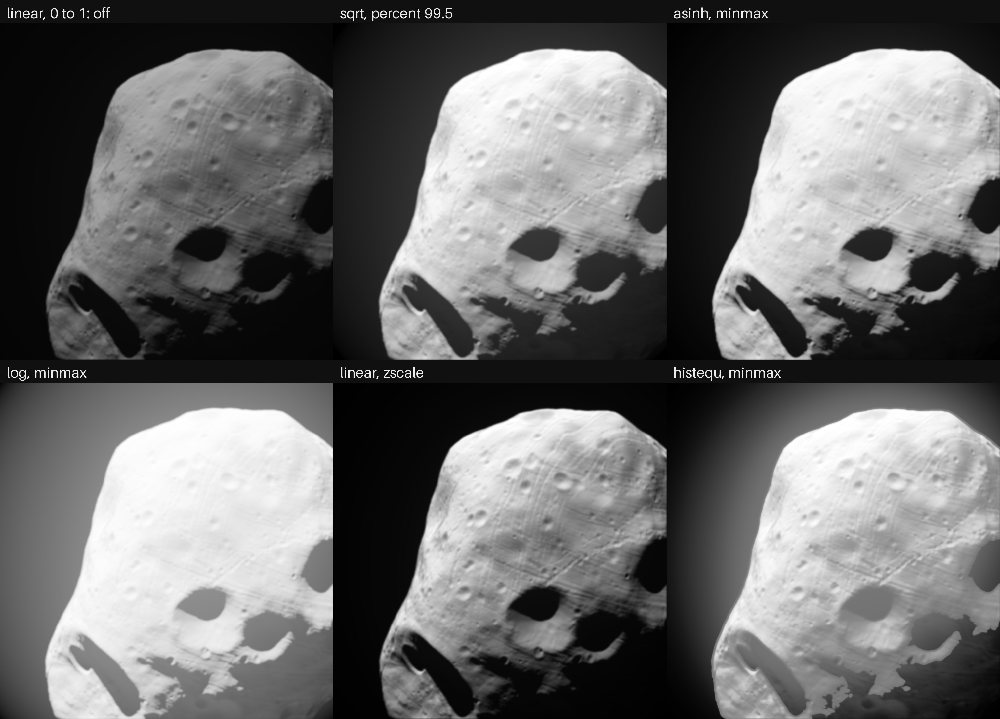

# A stretch, as SAO DS9 scales an image

14 October 2026. Asked after the Phobos figures' square root was explained --
each panel `sqrt(value / the image's 99.5th percentile)`, the window linear
and so darker: "it should be possible in kalast UI and script to change the
stretching too with such methods like SAO DS9 is also doing".

`config.stretch`: each value taken from between two limits, black at the low
one and white at the high one, through a function. DS9's scales and limit
modes:

```python
s = app.simulation.config.stretch
s.scale = "sqrt"          # linear, log, pow, sqrt, squared, asinh, sinh, histequ
s.limits = "percent"      # user (low, high), minmax, percent, zscale, zmax
s.percent = 99.5
sim.stretch_limits        # (low, high) as found, a frame or two late
```

In the UI app: Simulation tab, Image, under the camera response, with a line
saying the limits found and the image's range.

## What it is

- **The functions** are DS9's, each made 1 at 1 exactly: `log(a x + 1) /
  log(a + 1)`, `(a^x - 1) / (a - 1)`, `asinh(10 x) / asinh(10)`, `sinh(3 x) /
  sinh(3)` -- DS9 divides by `log(a)`, `a`, 3 and 10, within 0.2 % of these.
  `a` is `stretch.exponent`, 1000. `histequ` shows each value as the share of
  the values between the limits below it.
- **The limits**: given (`user`), the least and greatest values (`minmax`),
  the values `percent` of them lie between, as many cut below as above, as
  DS9 and astropy's `PercentileInterval` cut them (`percent`), IRAF's zscale
  as astropy's `ZScaleInterval` has it, contrast `stretch.contrast`
  (`zscale`), or zscale's low and the greatest (`zmax`).
- **A value** is a pixel's largest channel as the image stores it --
  `exposure * I/F` with `srgb_mode = 1` -- so a grey image is DS9's own and a
  coloured one keeps its colours, its brightest channel never cut. The
  background counts, as a sky does in DS9.
- **What is shown** goes where the value would have: decoded for an sRGB
  target with `srgb_mode = 1`, so the target stores it -- DS9's grey level --
  and with `0` through the sRGB curve, as the shaded mode shows light. Off,
  `"linear"` between `"user"` limits of 0 and 1, the image is drawn as before,
  by the same path.
- **Where**: after the reference's mean and the camera's response, before the
  light cube, the colour bar, the HUD and the axes. The window and exported
  frames show it; `sim.reference_image()` reads the values. A reference's sum
  carries on through any change of it (`reference_scene` keys without it).
  The shaded colour mode only: the data mode's colours are data.

## How

`src/app/stretch.rs`, `shaders/stretch.wgsl`; `Passes::finish_float` routes
the image through it.

On, the image is drawn into floats -- `Rgba32Float`, single-sampled, as for
the camera's response: the main pass draws there, or a reference resolves
its mean there, or the response shows its result there (`show_float`, new).
Then, every frame:

1. `cs_gather`: a workgroup a 64 x 64 tile, its values counted into a
   histogram in the workgroup's memory -- a black sky is hundreds of
   thousands of adds to one bin, which global atomics serialise -- with their
   least and greatest, then each bin it filled added to the image's. Bins
   from a value's bits: zero, then 32 an octave from 2^-40 to 2^24, from the
   exponent and the first five bits of mantissa, so 2.2 % wide at most.
   Least as the greatest complement, so a cleared buffer needs no setting.
2. `cs_limits`, one workgroup of 256: for `percent`, each thread counts nine
   bins, the counts are run through (Hillis-Steele), and the thread whose
   bins hold a percentile finds the bin where the running count passes it,
   linearly across the bin. For zscale, 1000 values -- every `size / 1000`-th
   along the rows, astropy's sampling -- bitonic-sorted in the workgroup's
   memory, then astropy's fit: a least-squares line against rank, the samples
   further than 2.5 sigma cut, the cut grown as numpy's convolution with
   `int(n / 100)` ones in mode "same" grows it -- `i` cut where any of `i -
   ngrow/2 .. i + (ngrow - 1)/2` is -- five times at most or until nothing more
   is cut; the slope over the contrast, about the median, within the samples'
   own least and greatest. Every sum is a reduction over the threads, read
   back by `workgroupUniformLoad` so the loop's end is uniform for its
   barriers; the cut is a bit a sample.
3. `histequ` only: `cs_equalize` counts the values between the limits into
   2048 bins of equal width, the same way, and `cs_cdf` runs them through.
4. `fs_show`: the image through the function into the target.

The limits are copied back after each frame without waiting (`after_frame`),
for `sim.stretch_limits` and the panel's line: a frame or so late.

## Checked

`tests/test_stretch.py`, a lit sphere at 300 x 200, its reference's mean the
values, each stretch's exported frame against numpy and astropy in float64:

| | |
|---|---|
| each scale between user limits | within 0.84 of 255 (rounding to 8 bits) |
| minmax | the least and greatest to float32's last place |
| percent 99.5 and 90 | 0.06 % and 0.1 % from numpy's percentiles |
| zscale at contrast 0.25 and 0.1, zmax | astropy's to 6 digits, on a frame-filling sphere of albedos near 0.5 with outliers both ways |
| histequ, minmax and user limits | numpy's equalisation over the same bins, within 0.84 of 255 |
| the reference's sum | carried on through all of them |
| the maps, no reference | within one step of 255 of the plain frame stretched |

A sphere on black sky cannot test the contrast: its zscale line is cut to the
samples' own least and greatest whatever the contrast, in astropy too.

## On Phobos

h8963 as `simple.py` draws it -- the reference with Mars and a bounce, 1024
samples, through the SRC's response, exposure 40 -- then the same mean through
six stretches, the sum carried on through each (309 s for the sum, a build
sharing the machine):



The SRC's halo lights the sky: its floor is 0.017 (I/F 4 x 10^-4), where
minmax and zscale start rather than at 0. `sqrt` between `percent` 99.5
limits, 0.018 to 0.69, is the look of the Phobos note's figures -- the halo's
glow round Phobos and the shadows' floor showing. `log`, at DS9's exponent,
shows Mars's light on the night side and the halo across the whole frame, the
lit ground saturated; `histequ` spreads the night side's levels.

## Cost

1008 x 1018, the maps, an M1 Pro, frames a second over 200 frames, median of
five, a process a mode:

| | ms a frame | the first version |
|---|---|---|
| off (4x MSAA) | 3.17 | 3.11 |
| linear, user limits | 2.93 | 3.05 |
| sqrt, minmax | 2.76 | 2.99 |
| sqrt, percent | 2.93 | 3.32 |
| sqrt, zscale | 2.91 | 8.33 |
| histequ, minmax | 3.31 | 3.98 |
| histequ, zscale | 3.72 | |

The first version found the percentiles, zscale's fit and equalisation's
running count on one thread of the workgroup: zscale's 5 ms, a GPU thread
being slow alone. With the threads sharing them, the stretch costs well under
a millisecond; it comes out under the plain frame because the float path is
single-sampled.

## Not done

- MSAA under a stretch: the float path is single-sampled, so the maps' and the
  rays' edges alias as with the camera's response. A float MSAA target
  resolved before the stretch would keep them -- with `srgb_mode = 1`'s own
  resolve.
- A colour bar for the stretch, DS9's grey bar with its values.
- DS9's contrast and bias, dragged on the image.
- Limits per channel, as DS9's RGB frames have them.
- zscale's sample count is astropy's 1000; DS9's preference is 600.
