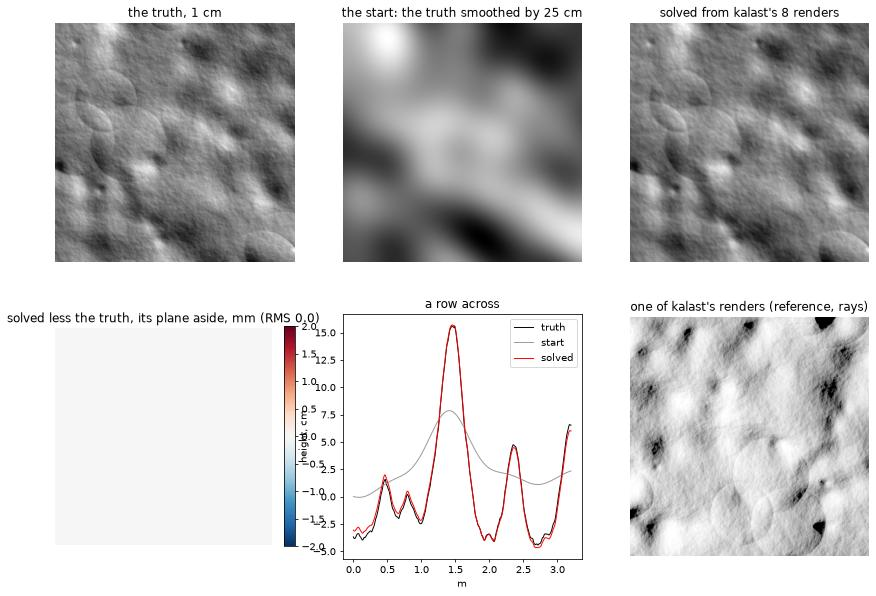
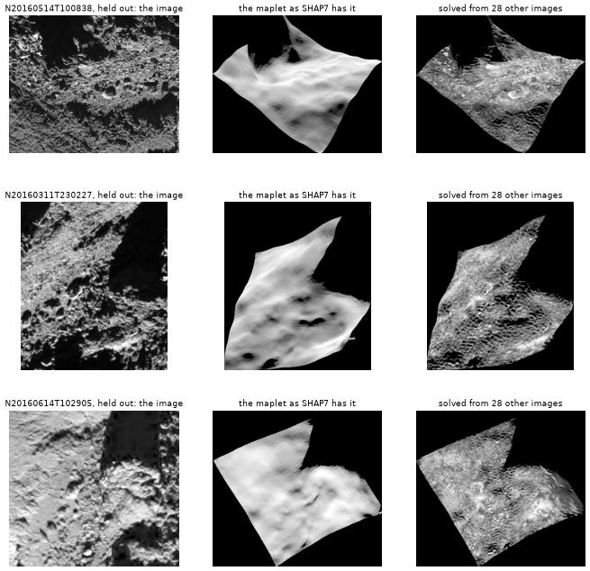

# Shape from images: stereophotoclinometry in kalast

14 October 2026, M1 Pro (32 GB).

The user, on 67P's closest images against SHAP7: "i would like implemented in
kalast a method to derive shape model (being stereophotogrametry or
stereophotoclinometry, or whatever, even a newer most powerful/robus/realistic
method) for 67p to match the best images you have shown me where we can all
agree the 44M is lacking details. This will be a good exercize for the
upcoming images of Didymos/Dimorphos by Hera AFC/TIRI".

`kalast.shape` (`src/shape/`): a surface's relief finer than its shape
model, from the images that see it.

## The method

Stereophotoclinometry (SPC), as Gaskell et al. (2008) built it for Eros and
as every small body imaged up close since has been modelled -- Itokawa,
Vesta, Ceres, Bennu, Ryugu; 67P's SHAP4S and SHAP5 too. Chosen over the
alternatives for what it does with what kalast already has:

- **Stereophotogrammetry** (SHAP7's) matches image patches between views and
  triangulates them: absolute positions, but a matching window of several
  pixels smooths what it finds -- SHAP7's 1-1.5 m sampling resolves 3-5 m.
- **Photoclinometry** reads slopes from shading, one pixel at a time: the
  detail is there, but one image cannot tell a slope from an albedo, and
  slopes summed over distance drift.
- **SPC** does both: many images under different Suns tell slope from albedo
  at each point -- photometric stereo -- and the shape model, or stereo,
  holds the long wavelengths. Its forward model is a scattering law, shadows
  and a camera, which kalast has: Hapke's law fitted to the images, cast
  shadows, SPICE geometry, the camera's response.
- Newer, **inverse rendering** (MPCD, differentiable renderers, neural
  fields) deforms a whole mesh until its renders match every image at once:
  the most complete, and what kalast's renderer could become the forward
  model of. A later step: SPC's maplets first give it a start and a check.

The surface is cut into *maplets*: square grids of heights and albedo over a
patch of the shape model, along its mean normal. Each pass:

1. **Register** every image to the maplet: the shift, to a fraction of a
   pixel, that brings the image's patch onto the maplet's shading under the
   image's Sun and camera, and a scale -- what pointing, the shape model's
   position and the calibration leave. A whole-pixel search by correlation
   on the first pass, then Gauss-Newton on shift and scale together.
2. **Photoclinometry**: at each grid point, the two slopes and the albedo
   that make it as bright as it is in every image that sees it lit and in
   view -- Gauss-Newton on three unknowns, the law tabulated per image,
   residuals weighed by each image's own scatter, Huber beyond two sigma,
   and a weak prior toward the slopes the heights have and toward the
   neighbours' albedo, which keeps a point few images see where it was.
3. **Integrate** the heights from the slopes: least squares on the
   differences between neighbours, each the mean of its two points' slopes
   along the edge, held to the shape model with the weight the grid's
   Laplacian gives a wave of `anchor` metres -- the heights follow their
   slopes below that wavelength and the shape model above it -- by
   conjugate gradients.
4. Again, from the new heights: their own cast shadows and what hides what
   (a horizon carried across the grid toward the Sun and each camera,
   `O(n^2)`), each point's emission and incidence, where each point falls in
   each image.

An image finer than the grid is smoothed to it first (a Gaussian of 0.35
spacing, the box's width), the mean of its *valid* pixels -- so neither a
shadow nor the sky bleeds in; one coarser weighs as the square of the ratio
less, and beyond `resolution` spacings is left out. `levels` starts coarser
by halves, where more images are fine enough. What the maplet cannot see
from its own grid -- the shape model's shadows cast from beyond it, terrain
beyond it hiding it from a camera -- comes with each image as a mask, which
a kalast render of the shape model in that image's geometry draws.

## In Rust and Python

```python
from kalast.shape import Maplet, View

m = Maplet.from_surface(mesh.positions, mesh.indices, centre, size=201, spacing=0.0005)
views = [View(image, position, axes, focal, sun, centre=(cx, cy), valid=mask) for ...]
report = m.solve(views, law, iterations=8, levels=2, anchor=0.010)
vertices, facets = m.mesh()
```

Rust: `kalast::shape::{Maplet, View, Options}`, `Maplet::solve`. In f64 --
kalast's `Float` is f32 by default, short of integrating 100,000 heights
from their slopes. Every grid point and image in parallel on the CPU.

## Checked on terrain whose relief is known

**Against kalast's own renders** -- the independent check: a terrain 4.8 m
square at 1 cm (rolling ground, 70 boulders, 7 craters, a few centimetres of
fractal roughness, an albedo varying 6 % and 3 % point to point) loaded as a
mesh of 460,000 facets and drawn by the reference -- ray-traced shadows, the
shader's Hapke law (67P's, `hapke-fit`) -- from eight cameras 200 m away,
8 mm a pixel, from overhead to 30 deg off, under eight Suns 35-55 deg up,
each camera pointed up to two pixels off. The maplet, 321 points 1 cm apart,
starts from the terrain smoothed by 25 cm, as a model a few times coarser
would have it.



- The relief comes back to **0.5 mm RMS** once the plane is set aside,
  from 4.2 cm: every boulder, crater rim and the roughness, its amplitude
  1.00 of the truth's under 25 cm. The plane is the start's, as held
  (below): over 3.2 m the smoothing left it 1.2-1.3 cm tilted.
- Each view's pointing is found to **0.01-0.07 pixel**, once the views'
  shared part moves the maplet instead (below).
- Each view's fitted scale is 0.997-1.007: the solver's law and kalast's
  renderer's are the same law.
- The images' residual 14.7 % to 1.3 %; the albedo correlated 0.84 with
  the truth's. 11 s for 103,000 points, eight views, twelve passes.

`View.project` puts a facet's centre where kalast's facet-id map has it to
0.03 pixel: the two cameras are one convention.

**Against `Maplet.render`** (`tests/test_shape.py`, `cargo test shape::`):
the same kind of terrain at 4 cm, 4.5 cm a pixel, in two seconds -- heights
2.5 cm to 0.15 cm, pointing to 0.07 pixel, residual 5.1 % to 0.28 % (the
truth's own, rendered at a finer grid, is 0.28 %).

## What these checks changed

Each found on the synthetic terrain, its fix kept:

- **The anchor holds only the long wavelengths.** A spring on the heights
  themselves held every wavelength in the share its weight bears to the
  Laplacian's there: a 4 m wave the start had smoothed by 11 % stayed 9 %
  short, 0.9 cm of error. Now the heights' low-pass (a Gaussian as three
  boxes, normalised: each value the mean of the grid's within reach) is
  held to the reference's: 0.2 cm. As cheap at any width -- a Gaussian of
  283 taps had made a solve 47 s, now 2.
- **The plane is the reference's, rigidly.** A tilt changes every point's
  brightness alike, which each view's scale takes up, so shading says
  little of it: it is set to the reference's after each integration.
  Held inside the least squares instead, a disagreement of a hair bent the
  surface into a cubic, 0.14 to 0.30 cm.
- **The maplet goes where the views' pointing puts it.** A sideways slide
  of the whole relief, every view following, changes nothing the images
  tell: the first registration's slip on the smooth start stayed, 1 cm --
  every view 1.7 pixels off in one direction on the ground, 0.07 once that
  was taken out. What the views' shifts share as one move of the ground
  now moves the maplet and its reference, after each pass.
- **Shadows the maplet does not cast are left out**: darker than a tenth of
  the view's median. Read as slopes, a shadow from a boulder the start does
  not have flattened what casts it.
- **A grid at the images' scale.** Images more than twice finer than the
  grid place a boulder's lit flank, a few pixels across, where the grid's
  slopes can have it -- along each view's Sun -- and the registration
  follows: views 1-3 pixels off at 3.6 pixels a spacing, 0.1 at one. A
  coarse level leaves them to the finer ones; the last level is best at
  the finest images' pixel.
- **Registration first, at a coarse level, wide.** Close images' pointing
  from SPICE is tens of pixels off; `search` sets how far the first
  registration looks, at the first level a view is used in.

## Comet 67P: Wosret, beside Abydos -- first look

The patch the NAC saw best, from a search of the archive's 15,343
orange-filter images against SHAP7 (4M facets) with occlusion and cast
shadows: 120 m in Wosret, 63 m from Abydos, Philae's last site, centre
(+2.436, -0.123, -0.333) km. 63 images at 0.05-0.5 m a pixel after their
labels were read (saturation, the patch lit in at least half), on 25 days
from September 2014 to September 2016 -- most of them from the 2016 search
for Philae -- phases mostly 88-111 deg, the Sun only ever from the north
half of the sky. NASA's SBN, where `osiris.py` fetches from, answered in
16 s and reset most transfers; ESA's PSA serves the same products in a
second.

Each image: its camera from SPICE as `examples/comet67p_shadows_fit`'s
`main.py` sets it; a kalast render of SHAP7 (4M facets, `rays`) for what
the maplet cannot see -- lit, and the pixel's facet on the patch;
registered on the maplet itself, on SHAP7's heights at 2 m, as far as
25 m on the ground, then at 0.5 m. Five whole days held out (12 images),
the rest solved: 120 m at 0.25 m, 231,000 points, three levels, 11 s.

| held-out day | images | m a pixel | phase | correlation with the image: SHAP7 -> solved |
|---|---|---|---|---|
| 2016-05-14 | 4 | 0.15 | 97-99 deg | 0.14-0.25 -> 0.48-0.54 |
| 2016-03-11 | 2 | 0.29 | 96-98 deg | 0.28-0.31 -> 0.42-0.45 |
| 2014-12-13 | 2 | 0.33 | 94-96 deg | 0.35-0.38 -> 0.33-0.40 |
| 2016-06-14 | 3 | 0.50 | 49-54 deg | 0.26-0.30 -> 0.15-0.25 |
| 2016-08-21 | 1 | 0.09 | 95 deg | 0.15 -> 0.14 |



On a day it never saw, the solved maplet draws what the images show and
SHAP7 does not -- pits, lit rims, the boulder field -- the correlation
doubled at 0.15 m a pixel. Not yet what the synthetic terrain promised:

- **Registration.** SHAP7's shading at 2 m correlates 0.2-0.57 with images
  that resolve ten times finer; 23 of the 63 fell under 0.3 and were left
  out, the two finest (5 cm a pixel) among them. Registering on the
  shadows' pattern as well as the shading -- the strongest thing these
  low-Sun images show -- took the held-out median from no gain (0.30 ->
  0.29) to 0.26 -> 0.41; images seconds apart still disagree by a few
  pixels.
- **A ripple** a few pixels across the solved surface, which the images
  do not show: views a pixel or two apart pulling the slopes their ways.
  The finest level's residual creeps up over its passes, where the coarser
  level's falls.
- **The finest images** gain nothing: at twice finer than the grid they are
  in the regime the synthetic terrain showed biased; a maplet at 0.125 m
  registered fewer of them and did worse.
- **2014's images** gain nothing: the surface before perihelion, or their
  registration.

Next: coarser images (148 see the patch at 1 m a pixel or finer) for the
coarse levels, so that each registers on the level before, as SPC builds
its maplets; the pointing shared by every maplet in an image; LAM's MPCD
model of Abydos (0.4 m, 380,901 vertices, half the maplet) to compare the
heights with; the maplet merged into SHAP7 for kalast to draw. The
pipeline becomes an example once the result holds.

Continued in `2026-10-15_shape_direct/`: the coarser images, the heights
fitted to the images directly, and LAM's MPCD model as the referee.
