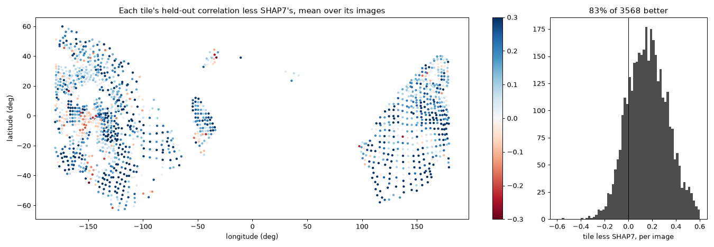
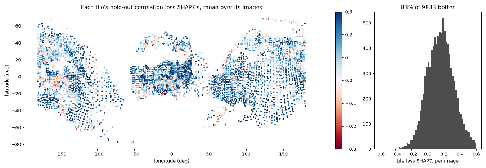

# Comet 67P whole, in tiles at the finest its images allow

The maplet beside Abydos (`2026-10-15_shape_direct/`) was one patch of
120 m. Asked for the whole comet improved, the choice made was **tiles at
the finest spacing the images allow, loaded per image beside SHAP7** --
not one global mesh: the comet at 0.5 m would be about 290M facets (72M at
1 m), and SHAP7's 44M already take about 31 GB in kalast on a 32 GB Mac.

What it took, in `kalast.shape`:

- `Surface(vertices, facets)`: a shape model with a bounding volume
  hierarchy over it (binned SAH, `src/shape/bvh.rs`): SHAP7-4M builds in
  2.7 s.
- `Surface.samples(size)`: the surface in cubes, a point, a normal and an
  area each (two where the surface crosses a cube twice): 179,236 at 20 m.
- `Surface.sees(points, normals, camera...)`: per point, in the frame,
  facing the camera, unhidden, lit -- 17 ms an image for the 179k.
- `Surface.tiles(points, normals, areas, finest, size, overlap)`: tiles laid
  as a lattice grows over the surface, finest spacing first.
- `kalast.shape.choose(...)`: each tile's images, as MPCD keeps them.
- `Surface.mask(maplet, view, margin)`: a view's pixels the rest of the
  comet hides or shadows, for `View.valid`.
- `kalast.shape.compose(vertices, facets, maplets, spacing)`: SHAP7 with
  tiles in it, one mesh; `kalast.mesh.Mesh.from_arrays` to load it.
- The direct solver's triangles for images finer than the grid
  (`triangles=0.4`), below.

## Coverage

Every orange-filter NAC image of the archive within 215 km (9,403), against
SHAP7-4M's 20 m samples: 8,048 see some of the comet lit (in the frame,
facing, unhidden, incidence under 80 deg, emission under 75 deg), 59.6M
image-sample pairs, two minutes. Share of the surface (by area) with images
of 2014 and 2016 from three or more Sun azimuth octants:

| images at least | n >= 5 | n >= 10 | n >= 20 | n >= 40 |
|---|---|---|---|---|
| <= 0.5 m a pixel | 63% | 55% | 30% | 5% |
| <= 1 m a pixel | 90% | 88% | 80% | 62% |
| <= 2 m a pixel | 99% | 99% | 98% | 91% |

2015 adds 1-5% at most: 2014 and 2016 see nearly everything, the south in
January-March 2016.

## The spacing a place allows

First rule: 0.5 m where ten images within 1 m a pixel see it from three
Sun octants. 8,072 tiles, 7,690 at 0.5 m. Tried on tiles of 2014 images, the
solutions came out rippled -- worms of a few metres, +-5 m from SHAP7 --
and stayed so with the triangles off, without the masks, with a curvature
penalty five times stronger, on three levels. Tile 789 (53 S): its thirteen
finest images were 7-10 February 2016 at 0.87-0.94 m a pixel, two of the
grid's spacings: a grid finer than any image resolves, filled with
whatever fits. At 1 m the same tile is ridges and blocks.

The rule now: a spacing where **five images are as fine as it** (two Sun
octants) **and ten within twice it** (three octants). 0.5 m on 71% of the
surface, 1 m on 24%, 2 m on 5%, none on 0.2%; 6,489 tiles of 241 x 241
points overlapping by a fifth -- 5,667 at 0.5 m, 711 at 1 m, 111 at 2 m.

## The lattice

`Surface.tiles`: finest spacing first; from a seed sample, a tile along the
mean normal of the surface within its half-width, then its four neighbours
a tile's width less the overlap away, on the surface as it turns, each laid
where at least half of what it covers allows its spacing and at least 40%
is not covered yet. A sample a tile covers: within the middle of its square,
facing within 60 deg of its normal, not under an overhang. A seed takes a
tile whatever is covered around it, along its own normal if the mean's
leaves it out -- a cliff under a plain's tile. Then the tiles whose every
sample another covers too are dropped, the last laid first. On a sphere:
1.5x the count a perfect square lattice would need; on 67P, 6,489 in under a second.

## Each tile's images

`choose`: finest first, an image joins unless one already taken is within
10 deg of its Sun and its view, 1.5x of its scale, and sees 70% of the same
ground -- MPCD's rule, which drops the images seconds apart under one
geometry. At most 70; images up to four spacings a pixel; 2015's only where
2014 and 2016 give fewer than ten. Eight whole days are held out from every
tile: 1 October and 13 December 2014; 11 March, 14 May, 14 June, 9 July,
21 August and 5 September 2016 -- 276 images, 4,177 tiles seen by them.

On the Abydos patch, the example's 13 held-out images (correlation, mean
over the images -- the median jumps: the 13 fall in two groups, about 0.2
and 0.4, and the median sits between them):

| | images | held out | at the model's scale | CPU |
|---|---|---|---|---|
| the example: 3 levels, all to 4 m a pixel | 209 | 0.412 | 0.455 | 131 core-s |
| 2 levels, to 2 m a pixel, 80 chosen | 80 | 0.412 | 0.453 | 62 core-s |
| 2 levels, 60 chosen | 60 | 0.407 | 0.452 | |
| 2 levels, 40 chosen | 40 | 0.379 | 0.429 | |
| 3 levels, 80 chosen | 80 | 0.358 | 0.398 | |
| 2 levels, all 203 to 2 m a pixel | 203 | 0.357 | 0.392 | |

Two levels and 70 chosen images: the example's score at half the CPU.

## Triangles for the finest images

An image finer than the grid resolves within a cell what a point stands
for. With `triangles` (default 0.4), a view whose pixel is under 0.4
spacings is compared, where the maplet lights it, triangle by triangle --
each cell's two, as `Maplet.mesh` cuts and `render` draws them -- with the
image's mean over the triangle (the image blurred half a pixel, sampled at
the centroids of the m x m triangles it cuts into, so that it moves
smoothly with the corners). A cell's two triangles take its corner's
albedo, so the albedo is still eliminated point by point; its slopes are
the differences of its corners, its parallax its mean height's. The view's
shadows and their edges stay with the points.

- Drawn by `render` and seen by the triangles, a maplet agrees with itself
  to 0.13% of the image's mean (the pixels astride edges): a test now.
- On the test terrain, half or all of its views four times closer, the
  heights come back no better: 0.12-0.19 cm against the points' 0.11-0.16,
  perfect pointing or not, the terrain on the grid's own spacing or finer.
- On 67P they are better -- 11 of the 13 held-out images:

| solve (80 images, 2 levels) | held out | at the model's scale |
|---|---|---|
| points | 0.412 | 0.453 |
| triangles under 0.25 spacing a pixel | 0.441 | 0.488 |
| triangles under 0.4 | 0.445 | 0.491 |

11 March 0.50 -> 0.54 (MPCD 0.65), 14 June up to 0.36 -> 0.51; 21 August,
the finest at 0.09 m a pixel, 0.14 -> 0.13.

Registration stays on the points' shading; held after a view's first
registration instead, the finest views drifted 4-10 pixels from the
start's.

## A fix in the direct solver

The step's trial cost left out the shadows' agreement, which the cost
before the step had: a step was taken when it lowered the images' misfit
by more than it raised the shadows'. Both counted now. On the Abydos
patch, the same 0.412 / 0.453; on the test terrain, the same 0.13 cm.

## The rest of the comet over a tile

`Surface.mask` casts each grid point's rays to the camera and to the Sun
against SHAP7-4M, the tile's own prism left aside: a pixel shows the tile
as its grid can tell it unless the rest of the comet hides it or shadows
it, 2 m plus two spacings around. On Abydos, beside a plain, it changes
nothing; around the neck and the cliffs it is what the grid cannot know.

## Into one mesh

`compose`: a point of the surface is the finest tile's over it, then the
one it is most in the middle of; a tile keeps its cells and one more all
round, SHAP7 loses each facet whose corners are all tiles'. Tiles coarser
than an image's need are resampled to it (`spacing`).

## The example, and the run

`examples/comet67p_tiles/`: the plan as `tiles.csv` (centre, normal,
spacing, the images each is solved from and scored on) and `images.csv`,
so that every machine solves the same tiles -- recomputed on another CPU, a
threshold flipping one sample would regrow the lattice differently. `main.py
fetch|solve|score A B` for tiles A to B-1, resumable. Checked against the
scripts the plan was made with: on two tiles the heights differ by 1-1.8 m
RMS, all of it in lines along scarps a fraction of a pixel apart and a
shadowed patch -- smoothed by 4 m, 3-8 cm; the same residuals and
registrations.

The run: tiles 0-1999 on the Mac (M1 Pro, five at once, about 20 s a
tile each), 2000-6488 on the home PC (`handoff_home_pc.md`). The images'
lines: 5,049 images, 70 GB fetched as floats, 30 GB kept as half floats,
at 20-27 MB/s from PSA, slower on the closest images of 2016.

## The Mac's share, scored

Tiles 0-1999 -- all at 0.5 m -- solved on the Mac in about five hours of
the final pass (five at once, `nice`d), none failing once every image was
in. Each scored on up to three held-out images that see it (`main.py
score`): 3,568 tile-image pairs over the 1,459 tiles the eight held-out
days see.

| held-out images | pairs | SHAP7 | tiles | tile better |
|---|---|---|---|---|
| all | 3,568 | 0.327 | 0.493 | 83 % |
| finer than 0.25 m a pixel | 1,079 | 0.263 | 0.463 | 91 % |
| 0.25-0.5 m a pixel | 1,385 | 0.387 | 0.535 | 80 % |
| 0.5-1 m a pixel | 1,104 | 0.312 | 0.469 | 78 % |

At the model's own scale: 0.537 against SHAP7's 0.342.

The gains cover both regions; the losses cluster near longitude -150 to
-130, latitude -10 to 0, and a few are scattered -- the tiles the second
pass is for.

## The Abydos tile, five ways

Tile 4341, 12 m from the maplet example's centre, on that example's 13
held-out images (mean correlation; SHAP7 0.25-0.27):

| | held out | at the model's scale |
|---|---|---|
| as planned | 0.359 | 0.406 |
| without the masks | 0.281 | 0.304 |
| at the example's centre and normal | 0.423 | 0.474 |
| the example's centre, the plan's normal | 0.418 | 0.471 |
| the plan's centre, the example's normal | 0.417 | 0.466 |
| the 80 images of the Abydos test | 0.417 | 0.463 |
| both | 0.455 | 0.507 |

The masks are worth a lot here. The rest is the planned tile being unlucky
rather than misplaced: any small change gives the gain back. Between the
planned tile and one moved 12 m, the finest images -- 0.05 to 0.2 m a pixel
-- registered 25 to 54 pixels apart (2.5-5 m on the ground), each run
locking some of them onto a different match at correlations of 0.1-0.4.
They tell the most of the relief and are the easiest to misplace: a tile's
held-out score moves by about 0.06 with them.

What SPC, ASP and MPCD do: fix each image's pointing outside the shape fit,
from all of it. This run gives the means: an image is in dozens of tiles,
and each records its shift there -- their consensus is its pointing. A
second pass over the tiles, each image started there and searched a few
pixels, is the next step once both machines are done.

## The whole comet, and the second pass

All 6,489 tiles were solved on the Mac by 06:55 on 16 October, its range
from the top down overnight (about 500 tiles an hour, none failing). The
home PC had started all the same, at 17:23 on the 15th, unknown here: it
solved 2000-6488 too, by the same code (`run_home_pc.md`), and found three
faults below (*What the home PC found*).

The first pass over the whole comet, each tile on up to three held-out
images that see it -- 9,833 tile-image pairs, 4,156 tiles:

| | pairs | SHAP7 | tiles | tile better |
|---|---|---|---|---|
| all | 9,833 | 0.342 | 0.504 | 83% |
| tiles at 0.5 m | 9,285 | 0.342 | 0.503 | 83% |
| tiles at 1 m | 510 | 0.342 | 0.510 | 83% |
| tiles at 2 m | 38 | 0.351 | 0.448 | 89% |
| images finer than 0.25 m a pixel | 2,284 | 0.246 | 0.426 | 88% |
| images at 0.25-0.5 m a pixel | 4,064 | 0.388 | 0.528 | 80% |
| images at 0.5-1 m a pixel | 3,485 | 0.353 | 0.526 | 83% |

At the model's own scale, 0.544 against SHAP7's 0.357.

The second pass:
1. Fit each image's pointing and each tile's offset to the first pass's
   shifts, over every tile (`pointing.py`). 312,583 image-tile pairs,
   4,894 images, 6,450 tiles:
   - residual median 1.83 px, 27% of pairs over 5 px -- the wrong
     registrations;
   - tile offsets 2.8 m at the median, 5.2 m at 90%.
2. Solve each tile again from its offset, every image's pointing held at
   the fit, 3 px searched, no `follow`.

Trial on 41 tiles, the same held-out pairs:

| | pairs | SHAP7 | first pass | second pass | second better |
|---|---|---|---|---|---|
| the 20 that lost most | 39 | 0.419 | 0.179 | 0.363 | 87% |
| 20 that won, at random | 48 | 0.363 | 0.541 | 0.589 | 65% |

The worst tiles were mostly wrong registrations, and the good ones gain
too. Started on all tiles at 07:10, into `tiles2/`.

## What the home PC found

`run_home_pc.md`, on its run of 2000-6488; the first two hold for the
Mac's run too.

- **Tiles where the surface turns.** Where much of a tile's grid has no
  SHAP7 facing up beneath it -- the neck, the cliffs, mostly the 1 m and
  2 m tiles, 240 and 480 m across -- the points there are compared with no
  image, only filled in, but the tile is registered and held to its plane
  on what is left, and the known part goes with it: down by tens of metres,
  tilted. Its test, which needs no held-out image (moved over 5 m RMS from
  SHAP7 where SHAP7 is, or no image used at the end), on the Mac's first
  pass: 132 tiles -- 6 at 0.5 m, 69 at 1 m, 57 at 2 m; 74 of the 82 with
  SHAP7 missing under over 70 % of the grid, 38 of 55 at 50-70 %, 15 of 237
  at 10-50 %, 5 of 6,115 under 10 %; 39 used no image. Only a third are
  seen by a held-out image, so scoring misses most. The second pass, the
  same solver, makes them again.
- **Windows cut short.** `fetch` keeps of each image the lines of its
  tiles' boxes, a quarter of a tile's half-width above and below its
  square; `cut` takes the window from the tile's points, which stand
  outside the box where the relief is higher, and clips it to the lines
  kept without a word. The home PC, fetching 2000-6488 alone, cut 509 of
  298,761 tile-image pairs short, in 353 tiles; a tile's result then
  depends on the tiles fetched with it (tile 2000's heights 0.85 m apart).
  The Mac kept every tile's lines.
- **`osiris.fetch_lines` on Windows.** The kept file stayed open, and
  Windows will not replace an open file: widening an image failed. Closed
  first now.

## Open

- The second pass over all tiles, then scored. The tiles still below SHAP7
  on their held-out images are left as SHAP7 in `compose`, and so are the
  tiles that fail the home PC's test.
- The tiles where the surface turns: smaller tiles there, or their points
  with no surface beneath left out of the registration and the plane as
  well as the comparison.
- `fetch` sized from the points `cut` takes, so that a tile's result is its
  own.
- `comet67p_shadows_fit`'s `tiles` mesh (SHAP7-4M with the tiles an image
  sees, at its scale) is in, tried on one far image: a close image drawn
  with it beside SHAP7 in full is still to make, with the second pass's
  tiles.
