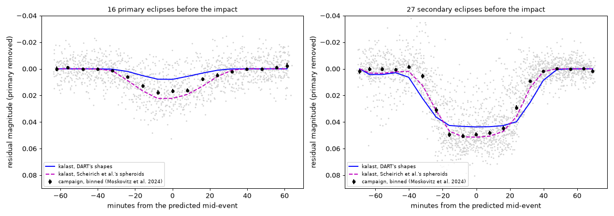
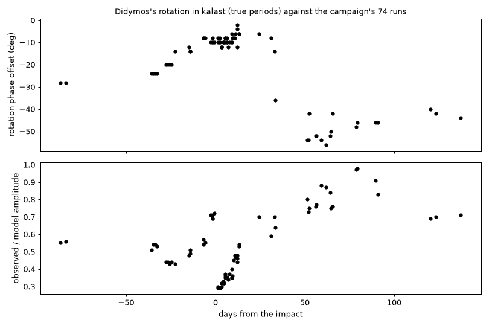

# Didymos and Dimorphos from the ground, for Eli: mutual events in kalast, checked

Eli (ROB, Didymos mutual events, work package 2) asked for kalast light
curves of 15 nights, 2022-09-20 to 2023-01-19, and later all nights from
August 2022 to January 2023; five nights had been simulated before
(2022-08-16, 08-24, 08-26, 09-13, 09-17, Les Makes), some matching her
photometry, some not. Her material is on the ROB cloud share ("Mutual
events": TRAPPIST-North 24 nights, TRAPPIST-South 8, the five Les Makes
nights, Scheirich et al. 2024's event predictions).

Before comparing with her nights, kalast was checked against Pravec and
Scheirich's published model and against the 2022 campaign's photometry.

## The simulation

- **The system**: DART's reconstructed SPICE kernels -- Dimorphos's orbit
  solution s542 with the impact in it (11.921 h before, 11.367-11.369 h
  after, the orbit slightly eccentric after), the barycentre s205, de430.
  The orbit pole there (310.0, -80.6 ecliptic) is Scheirich et al. 2024's
  (310.0, -80.4); Didymos's pole on it; DIMORPHOS_FIXED a switch frame,
  synchronous through the impact.
- **The shapes**: DART's models (g_01165mm_spc_didy_v003,
  g_00243mm_spc_dimo_v004) at 3072 facets: 0.730 and 0.150 km; at 10k, the
  same to 0.2 mmag in an event's depth.
- **The light**: Buratti et al. (2024)'s Hapke parameters,
  `kalast.lightcurve.flux` -- exact lit and visible areas by polygon
  clipping, so the partial phases of every event are exact.
- **Time**: each observed UTC epoch simulated at its emission time
  (`spkcpo` from the site, converged light time); TRAPPIST-North (Z53),
  TRAPPIST-South (I40), Les Makes; Earth's centre for the nights without
  data.
- 0.28 s an epoch for the system and each body apart (the drop the events
  make is their ratio).

## Against Scheirich et al. (2024)'s predictions

Their table: every contact of every event as seen from Earth's centre,
July 2022 to 2025, from their nominal pre- and post-impact orbits.

- 2022-11-18, TRAPPIST-North: kalast's occultation of Dimorphos 04:32 to
  05:59, 0.046 mag; the table 04:33 to 05:57, 0.046.
- Secondary eclipses, August 2022: start within -4 to +1 min, end +3 to +8,
  depth 0.041-0.045 against 0.043-0.048.
- **Primary eclipses came out 2-5 times shallower** (0.005-0.016 against
  0.022-0.029). Not the orbit -- the secondary eclipses, of the same
  geometry, agree -- but **DART's shape of Didymos**: lopsided north to
  south (z from -0.338 to +0.267 km), its southern pole a broad flat cap
  (radius 0.235 km 275 m below the equator, where a spheroid of the same
  flattening has 0.150). With the Sun 12 deg south of the orbit plane in
  August 2022, Dimorphos's shadow falls on that cap at grazing incidence and
  takes little light.
  **Corrected on 19 October** (`2026-10-19_didymos_questions/`): the shadow
  falls on the north, not on that cap. The Sun 12 deg south of the orbit
  plane casts Dimorphos's shadow about 0.2 km north of Didymos's equator,
  near its north pole, lit at grazing incidence and seen from Earth -- 27
  to 43 deg south -- near the limb. DART's Didymos reaches 0.267 km there,
  the spheroid 0.296: its polar ground faces the Sun and Earth less, and the
  shadow takes 0.3-0.5 % of Didymos's light where the spheroid's takes
  1.1-1.8 %.
- **With their model, kalast gives their numbers.** Scheirich et al.
  model both bodies as oblate spheroids with DART's axis ratios
  (Didymos 1.369, Dimorphos 1.504 before the impact, a sphere after) under
  Lommel-Seeliger, D2/D1 = 0.223 (0.202 after). The 2022-08-16 primary
  eclipse: 0.029 mag, 19:48 to 20:52, against their 0.027, 19:45 to 20:51;
  the secondary eclipse 0.042 against 0.043. Hapke for Lommel-Seeliger
  changes it by 1-2 mmag.

Superseded on 16 October (`2026-10-16_didymos_every_day/`): these were
August's, run before Didymos turned at its true period and with a fault in
the clipping since fixed. Every third cluster to January: the primary
eclipses 2-3 times shallower before the impact, the table's depths after
it; the spheroids' secondary eclipse 0.047 -- no run gave the 0.042 above.

## Against the 2022 campaign's photometry

Moskovitz et al. (2024, PSJ 5:35), Table 4: 38,532 points from 28
telescopes, with the primary's rotation removed (`Resmag`); public. Its 44
runs before the impact (10,493 points) cover 49 events. Each simulated with
both models at the data's light-time-corrected epochs; each model's depth
scaled to fit the data, pooled by kind:

| | events | data / DART's shapes | data / spheroids | rms: DART, spheroids, none |
|---|---|---|---|---|
| primary eclipses | 16 | 1.32 | 0.75 | 0.0107, 0.0097, 0.0121 |
| secondary eclipses | 27 | 0.89 | 0.90 | 0.0150, 0.0120, 0.0301 |
| secondary occultations | 5 | 0.65 | 0.76 | 0.0157, 0.0131, 0.0210 |

Superseded on 16 October: run before the true period. Again with it, and
the clipping fix, the primary eclipses 1.48 and 0.74
(`2026-10-16_didymos_every_day/`); the reading below stands.

Stacked on their predicted mid-times: the secondary eclipses go 0.050
deep, the spheroids' depth, beginning and end -- DART's shapes give 0.043,
its Dimorphos (0.150 km) 15 % smaller in cross-section than the photometric
one (D2/D1 = 0.223 of 0.730 km). The primary eclipses lie between the two
shapes: deeper than DART's southern cap allows, shallower than a smooth
spheroid. **They measure
Didymos's southern polar shape**, where DART's model rests on the fewest
views. [Its northern polar region: corrected on 19 October, above.] The secondary events are 10 % shallower than either model: Dimorphos
a few percent smaller than D2/D1 = 0.223.

## Didymos's rotation

DART's kernel turns Didymos at 2.2600 h exactly from W0 = 0 at J2000; its
shape model agrees with that phase at the encounter only. Didymos's
sidereal period is 2.2603891 h before the impact and 2.260440 h after
(Durech et al. 2025, PSJ 6:308): the kernel's phase slips -0.66 deg a day
before, -0.74 after -- 54 deg of light-curve phase by mid-August, 78 by
mid-November, 168 by mid-January. The simulation keeps the kernel's phase
at the encounter and turns Didymos at the true periods.

Fitted to the campaign's primary component (`Diffmag - Resmag`), run by
run (74 runs, `rotcheck.py`), what is left:

| | phase offset | model amplitude / observed |
|---|---|---|
| July to early September | -28 to -14 deg | about 2x too large |
| a week either side of the impact | -8 to -12 deg | ejecta: x0.3 rising to x0.5 by 10 October |
| mid-November to February | -40 to -56 deg | about right (x0.7-1.0) |

Flat across November-February: not a period, but the geometry -- Earth 27
deg south of the orbit plane in August, 5 deg north in November, where
DART's shape departs most from Didymos. The simulation applies these
offsets, interpolated by date (`phase_fix`), and each night also shows the
rotation scaled to the data.

## The level

kalast's magnitudes are 0.6-0.8 mag fainter than Eli's and than H-G
(H = 18.16, G = 0.2). Buratti et al.'s Hapke parameters give a geometric
albedo of 0.095; H = 18.16 and D = 0.730 km want 0.18 (0.7 mag), and the
phase curve is 0.1 mag steeper than H-G at 60 deg. Moskovitz et al. use
HG1G2 (H 18.16, G1 0.84, G2 0.05). The nights fit one offset each; the
events and the curve's shape do not depend on it.

## The earlier simulations

`examples/old/mutual_events/` (dead code, read only for this): DART's
kernels and shapes too -- the rotation curves correlate 0.77-0.89 with the
new ones, 0.02 mag apart; secondary events 0.044-0.046 in both; the
primary eclipse of 2022-08-16 0.006 in the old, as DART's shape gives. What
they lacked: Didymos's true period (their curves drift out of phase away
from the encounter -- why some nights matched and some did not), the
check of the events against Scheirich et al. and the campaign, and the
spheroid alternative.

## After the impact

The ejecta brighten the system for weeks (TRAPPIST-North R 13.0 on
2022-09-28, 16.0 in November): no shape model has their light. They dilute
the rotation's amplitude (above) and make the events shallower -- by 0.04
mag at first, decaying with half-lives of 24 days (secondary events) and
49 days (primary), 0.01 left after (Moskovitz et al.). Compare after the
impact in relative terms only.

## Eli's nights

45 nights: TRAPPIST-North's 24, TRAPPIST-South's 8, the five Les Makes
nights, and the requested nights without data in the share (2022-09-20,
09-25, 09-26, 09-27, 10-02, 10-12, 10-16, 2023-01-19) over the whole UTC day
from Earth's centre; both models, every 2 min; to `out/didymos_eli/` with
a README for Eli (CSV, plots, the scripts).

The rotation from DART's shape, even corrected, is no baseline to read
events against: rotating it by the campaign's offsets mends the nights near
the encounter and not those of November (the best offset flips between
branches 180 deg apart, Didymos's curve nearly the same after half a turn).
So the events are read as Pravec et al. read them: each night's rotation
fitted to its data outside the predicted events (four harmonics at the
sidereal period), taken out, the rest beside the two event curves; chi in
the events, in units of the stated errors (`events.csv`):

- **The events show in Eli's data** where a model lowers chi:
  2022-09-14 TS 1.32 -> 0.63, 09-21 TS 1.65 -> 0.61, 08-24 LM 1.46 -> 1.11,
  09-30 TN 3.94 -> 2.11, 11-21 TN 0.54 -> 0.28, 11-22 TN 5.58 -> 4.43,
  12-18/19 TN 0.26-0.29 -> 0.11-0.15, 2023-01-14/16/17 TN about halved.
- **Primary eclipses** (09-04, 09-05, 09-12 TS): the spheroids a little
  better than DART's shape (2.32 -> 1.93; 0.88 -> 0.77; 1.00 -> 0.92).
- Run again on 16 October with the clipping fix: chi moved by 0.01 to 0.3,
  the reading stands (`2026-10-16_didymos_every_day/`).
- **Three weeks after the impact** (09-28 to 10-21) the models are worse
  than no event: the events shallower than predicted, the ejecta's
  dilution Moskovitz et al. measure.
- TRAPPIST-North's error bars from November on are 3-10 times the scatter
  about the fitted rotation (chi under 1); 2022-12-29 has an outlier that
  dominates.

## Open

- What Eli's analysis wants next: her nights' rotation removed as above
  for her fits; the event depths after the impact with the ejecta's
  dilution (Moskovitz et al.'s half-lives) if she fits through October.
- The albedo: Hapke's `w` for H = 18.16 at Didymos's size, or the
  campaign's HG1G2, for absolute magnitudes.
- Didymos's southern shape from the primary eclipses. [Northern: corrected
  on 19 October.]
- `kalast.lightcurve.flux` holds Python's lock: released, a night's epochs
  would run on every core. (Released on 16 October:
  `2026-10-16_lightcurve_piece_cap/`.)

Continued on 16 October in `2026-10-16_didymos_every_day/`: every day of
the campaign, and all of it again with the true period and the clipping
fix.
