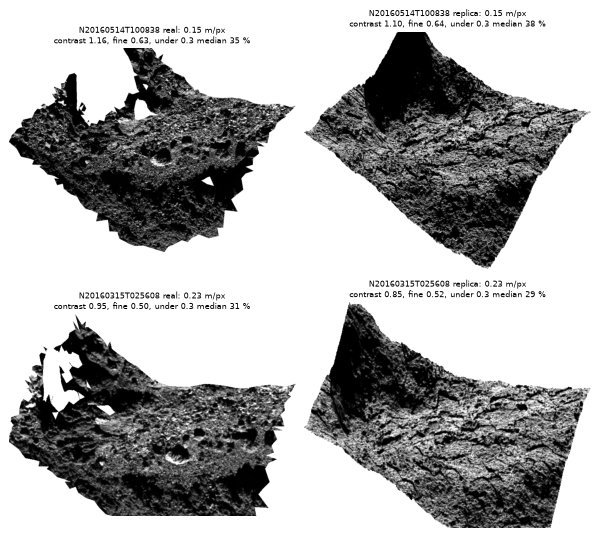
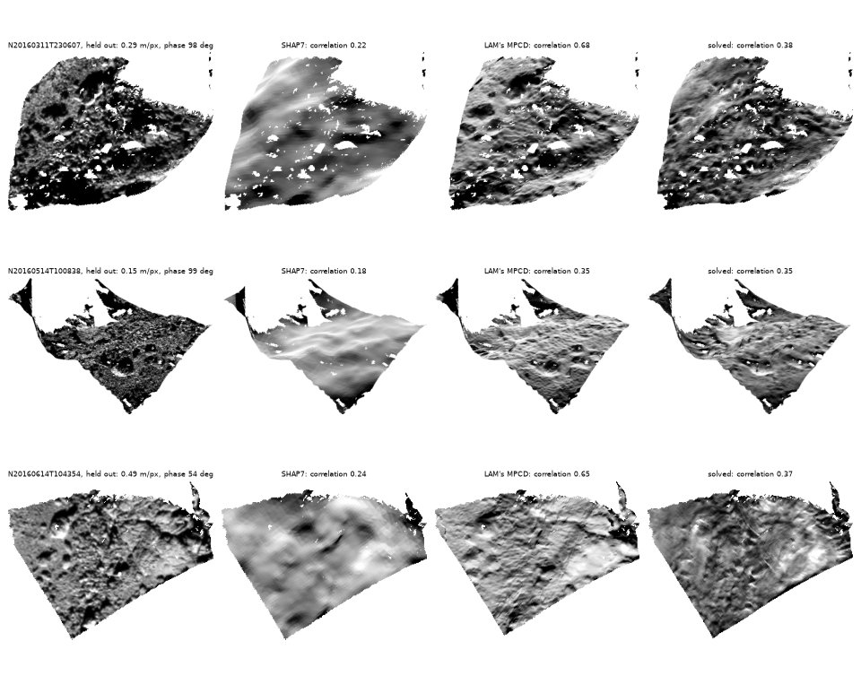

# Shape from images, fitted directly: shadows, parallax, coarser images

15 October 2026, M1 Pro (32 GB). Continues `2026-10-14_shape_from_images/`.

The user, on fetching 67P's coarser images for the coarse levels and making
the 67P pipeline an example once the result holds: "yes".

## Coarser images, their rows only

ESA's PSA answers HTTP ranges, so an image's label and the rows that see
the patch come alone: 551 orange NAC images facing Wosret at 0.5-4 m a
pixel, 200 m of ground and a margin for the pointing, 1.2 GB in 84 s where
whole they were 21 GB. 393 kept: not binned, under 1 % of the frame
saturated, a tenth of the patch at least valid in a kalast render of SHAP7.
Most are 2015's, around perihelion; the Sun from the south only then.

## A synthetic Wosret

The 14 October synthetic terrain -- rolling ground, boulders -- solved
easily and told nothing of 67P. A copy of the patch instead: SHAP7's heights
under the maplet, plus what SHAP7 lacks -- fractal roughness below 5 m
(RMS slope 0.7), 2,500 boulders of 0.5-5 m, 400 plates with scarps between
them, 30 pits -- and an albedo varying 8 %; drawn by `Maplet.render` at
0.125 m through each real image's camera and Sun, blurred by 0.6 pixel,
noised, each image pointed up to 6 m off on the ground.

| image | m a pixel | contrast, real / copy | fine contrast | under 0.3 of the median |
|---|---|---|---|---|
| N20160514T100838 | 0.15 | 1.16 / 1.10 | 0.63 / 0.64 | 35 / 38 % |
| N20160315T025608 | 0.23 | 0.95 / 0.85 | 0.50 / 0.52 | 31 / 29 % |
| N20160607T121851 | 0.50 | 0.36 / 0.33 | 0.21 / 0.21 | 5 / 3 % |



Wosret at a decimetre is blocks and their shadows: at phase 100 deg a third
of the pixels lie in shadow, and the lit ones are rims. On the copy, 14
October's pipeline -- per point, the images registered on SHAP7 at 2 m
first -- gave back a third of the relief below 5 m (correlation 0.54 with
the truth's), five held-out days 0.43 to 0.63. With the pointing exact,
0.66; the truth itself, on the maplet's 0.25 m, scores 0.85 there. The
images hold twice what the method took.

## Fitted directly

`direct=True`, now the default (`src/shape/direct.rs`): every point each
image shows, lit or in shadow, is a residual of all the heights at once,

```text
image(where the point falls) = scale albedo law(n(h)) lit(h) + offset
```

- `n` from the heights' central slopes; `lit` a soft step, a fraction of a
  spacing wide, at the point's height against the horizon the terrain
  toward the Sun casts over it (`grid::horizon`, which also says which
  point casts it): raising a point lights it, raising its caster darkens it.
- The shadows' agreement (`shadows`): a point the image shows in shadow
  held below that horizon, one it shows lit above it -- which grows what
  casts a shadow the maplet does not have yet.
- The parallax (`stereo`): a point's height moves where it falls in each
  image, and so what the image shows there -- stereo, beside shading and
  shadows. Each step is judged by sampling the images where its own
  heights put the points.
- Gauss-Newton on every height and every point's log albedo, the albedo
  eliminated point by point -- what a darker albedo explains, no slope
  takes; the shape model held above `anchor` as before; a small curvature
  penalty (`curvature`) for what central slopes cannot see; damped
  (Levenberg-Marquardt) until the images agree. By conjugate gradients, the
  normal matrix never formed: per point a 2 x 2 for the slopes summed over
  the views, the residuals at a shadow's edge kept whole.

What it changed, on synthetic terrain:

- **The test terrain** (`tests/test_shape.py`, `cargo test shape::`): as
  good as point by point, 0.13 cm against 0.14; with the parallax, the
  residual 1 % after one pass where shading alone took four.
- **A slope few Suns see weighs as little as it tells.** Integrated point by
  point, the slope across the Suns' azimuths -- 67P's came from the north
  only -- weighed as much as the best constrained: the ripple of 14 October.
- **It stays at the truth.** Started from the copy's truth, point by point
  drifted to a relief correlation of 0.86 and held-out images 0.84 to 0.83;
  fitted directly, 0.91, and the held-out images 0.84 to 0.86.
- **At 0.5 m, pointing exact,** the relief's correlation 0.76 against 0.73
  point by point; held out, 0.70 of the truth's 0.79 from SHAP7's 0.46.
- **A finer level loses:** from 0.5 m to 0.25 m the images' residual stuck
  at 26 % where the truth gives 18 -- boulders' shadows in the finest images
  that no gradient from the 0.5 m surface reaches. 0.5 m is the best
  spacing for these images.

## Registration in the solve

- **`reach`:** a view's first registration looks so far on the ground,
  coarse to fine past eight pixels -- the image and the maplet's shading
  smoothed to a sixth of the reach, a lattice of shifts, narrower -- at the
  level it joins, against the maplet as the coarser levels left it. No
  registration on SHAP7 first: the coarse images register on SHAP7's
  scale, the fine ones on the relief the coarse ones built.
- **`follow`** weighs each view's shift in metres on the ground, not in
  pixels: the finest views, ten times the pixels a metre, had set the
  maplet's place to their own pointing's mean, 0.7 m off on the copy. And
  it moves the maplet only past a quarter of a spacing: a bias the views
  share -- images finer than the grid register a little along their Suns
  -- had moved it anew every pass, 1.7 m over 36 with exact pointing.
  `follow=False` keeps the maplet where it is, its reference holding it.
- **On the copy, each image pointed up to 6 m off:** the relief's
  correlation 0.72 against 0.76 with exact pointing; 0.59 with the views
  weighed in pixels, 0.61 without `follow`.

## Comet 67P

The 63 images of 14 October and the 393 coarser ones; five days held out as
before. Scored on the held-out images where LAM's MPCD model of Abydos
(0.4 m, Capanna et al.) covers the maplet, each model registered on each
image on its own:

| model | held out, median correlation |
|---|---|
| SHAP7 | 0.21-0.24 |
| point by point at 0.25 m, 14 October | 0.34 |
| fitted directly at 0.5 m, every year | 0.35 |
| **fitted directly at 0.5 m, 2014 and 2016** | **0.36** |
| LAM's MPCD | 0.40 |



`solve(..., iterations=12, levels=3, offset=True, reach=0.012,
albedo_sigma=0.05, curvature=0.02)` on a maplet of 120 m at 0.5 m, 209
images, 82 s. The solution draws the pits
SHAP7 smooths over; MPCD draws them sharper, and its rims and scarps, where
the solution is grainy.

- **2015's images** cost a little (0.35 against 0.36 without them): the
  surface around perihelion, or their pointing at 100-200 km. 2016's alone,
  fewer, 0.29 at best.
- **Without the shadows and the parallax,** 0.32 against 0.35. **At
  0.25 m,** 0.30.
  **Curvature 0.002** (the default, best on clean synthetic images), 0.33;
  real images want 0.02. **The albedo free** (`albedo_sigma` 0.3), 0.34:
  it swung 40 % point to point, taking what the heights should.
- **SHAP7 and MPCD disagree:** 1.9-2.8 m RMS in height, about 4 m apart
  sideways, their relief below 5 m correlated 0.2-0.3. The solution agrees
  with MPCD's relief no better than SHAP7 does.
- **Started from MPCD,** the solver leaves it: held out 0.40 to 0.37, the
  images it fits better -- 0.58 to 0.90 for 8 June 2016's -- and those it
  does not see worse, 14 June's 0.48-0.58 to 0.35-0.47 at the same phase.
  Not the shadows' term (0.37 without), nor the parallax (0.37), nor the
  law's roughness (theta-bar halved, 0.36 from SHAP7 as at 24 deg): the
  albedo frozen, 0.31; each view's shift frozen once found, 0.39. The
  shifts and the heights fitting each other is part of it; what remains
  is open. MPCD was likely built from these images, so its 0.40 is an
  upper bound more than a held-out score.

## What the published models did that this does not

A review of how 67P, Bennu, Ryugu, Phobos, Dimorphos and the Moon were
shaped from images, and of methods outside the field (user: "are you
missing something?").

- **Camera geometry is solved outside the shape, from far more than one
  patch.** SPC measures each maplet's place in an image and solves the
  image's position and pointing from all of them, over 50 an image, under
  the navigation's priors (Palmer et al. 2022, PSJ 3, 102); JPL's Dawn
  models left pointing to orbit determination (Park et al. 2019). SHAP7's
  block adjustment used 20,000 tie points, starting from SHAP4S's poses
  because ESA's comet kernels omit a precession worth +-3 m on the surface
  (Preusker et al. 2017, A&A 607, L1). The Ames Stereo Pipeline removed
  camera floating from its shape-from-shading in 3.5.0 (April 2025): "more
  reliable to optimize the cameras beforehand, in bundle adjustment". Here,
  a shift per image is fitted on the same 120 m as the heights, every pass:
  the co-adaptation the MPCD start showed.
- **Few, diverse images, at the grid's scale.** SPC: four or five images a
  maplet, Suns 60-90 deg apart in azimuth, emission under 60 deg, pixels at
  most 2-4 spacings. MPCD keeps an image only if it adds 10 deg of view or
  light or 1.5x of distance; its Abydos model is 14 images at 1-8 m a pixel,
  cut from LAM's own global model, deformed to 0.25 m (Capanna et al.,
  EGU2016-4522). Here: 209, many seconds apart, the Suns in two clusters.
- **Albedo and photometry held.** MPCD has no albedo map; the Ames
  pipeline floats albedo, exposures and haze only with very diverse light.
- **A reference of the images' epoch and frame.** SHAP7 is pre-perihelion,
  built from images to 13 February 2016, Poisson-smoothed; Abydos and
  Wosret lost about a metre of dust and gained new cavities around
  perihelion (Hoang et al. 2020; Fornasier et al. 2021).
- **A quality score at the model's scale.** SPC correlates a held-out image
  with the model's rendering after a best-fit shift: resampling alone costs
  0.10-0.15, 0.7 is good, 0.8 the goal (Palmer et al., LPSC 2018, #1106).
  The scores here are at the images' native pixels, finer than any model.

From outside the field, for the forward model: facet normals rather than
central differences, which leave the finest relief unconstrained (Queau et
al. 2018); edge-preserving priors that keep scarps and rims (bilateral
normal integration, Cao et al. 2022; TGV); images integrated over each
pixel's footprint; robust losses that weigh edges less (DSO); a soft
transmittance toward the Sun, annealed, so that a shadow can grow its
caster (DeepShadow, ShadowNeuS, EO-NeRF for multi-date satellite images,
whose per-image offsets come on last).

## Open

In order, from the review:

1. Each image's pointing from its whole footprint against the global model,
   under SPICE's priors and smooth in time, fixed during the height solve,
   re-estimated in an outer loop.
2. The images thinned to diverse geometry and binned to the grid's scale.
3. The score at the model's scale, and split-data rebuilds.
4. Facet normals, an edge-preserving prior, the offset and albedo held.
5. 2016 alone with a looser reference, against the post-perihelion surface.
6. Shadows that grow their casters.

The pipeline stays in scratch until it reaches LAM's model; then the
example. The coarser images' rows are kept in
`~/data/rosetta/osiris_nac/str_refl_rows/`.
