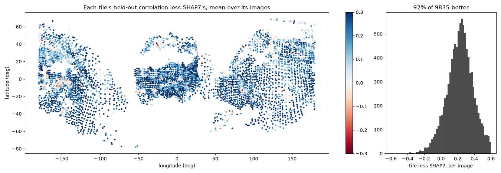

# Comet 67P whole: the first pass scored, a second pass, smaller tiles where the surface turns

16 October 2026, following `2026-10-15_67p_tiles/`: the plan of 6,489
tiles, the example `examples/comet67p_tiles`, the solver's changes, the
first pass on the Mac's share. Here the whole comet after the first pass,
the second pass with each image's pointing held, what the home PC's run
found, and smaller tiles where the surface turns. The scratch scripts
named here (`pointing.py`, `compare_passes.py`, the re-plan's) are not in
the repository; what of them the example needs goes into it.

## The whole comet, and the second pass

All 6,489 tiles were solved on the Mac by 06:55 on 16 October, its range
from the top down overnight (about 500 tiles an hour, none failing). The
home PC had started all the same, at 17:23 on the 15th, unknown here: it
solved 2000-6488 too, by the same code
(`../2026-10-15_67p_tiles/run_home_pc.md`), and found three faults below
(*What the home PC found*).

The first pass over the whole comet, each tile on up to three held-out
images that see it -- 9,833 tile-image pairs, 4,156 tiles:

| | pairs | SHAP7 | tiles | tile better |
|---|---|---|---|---|
| all | 9,833 | 0.342 | 0.504 | 83% |
| tiles at 0.5 m | 9,285 | 0.342 | 0.503 | 83% |
| tiles at 1 m | 510 | 0.342 | 0.510 | 83% |
| tiles at 2 m | 38 | 0.351 | 0.448 | 89% |
| images finer than 0.25 m a pixel | 2,284 | 0.246 | 0.426 | 88% |
| images at 0.25-0.5 m a pixel | 4,064 | 0.388 | 0.528 | 80% |
| images at 0.5-1 m a pixel | 3,485 | 0.353 | 0.526 | 83% |

At the model's own scale, 0.544 against SHAP7's 0.357.

The second pass:
1. Fit each image's pointing and each tile's offset to the first pass's
   shifts, over every tile (`pointing.py`). 312,583 image-tile pairs,
   4,894 images, 6,450 tiles:
   - residual median 1.83 px, 27% of pairs over 5 px -- the wrong
     registrations;
   - tile offsets 2.8 m at the median, 5.2 m at 90%.
2. Solve each tile again from its offset, every image's pointing held at
   the fit, 3 px searched, no `follow`.

Trial on 41 tiles, the same held-out pairs:

| | pairs | SHAP7 | first pass | second pass | second better |
|---|---|---|---|---|---|
| the 20 that lost most | 39 | 0.419 | 0.179 | 0.363 | 87% |
| 20 that won, at random | 48 | 0.363 | 0.541 | 0.589 | 65% |

The worst tiles were mostly wrong registrations, and the good ones gain
too. Started on all tiles at 07:10, into `tiles2/`; done at 22:08, 6,489
tiles, none failing. The same held-out pairs, the turning places' 157 tiles
(below) and the tiles that fail the home PC's test apart
(`compare_passes.py`):

| | pairs | SHAP7 | first pass | second pass | second better than first | than SHAP7 |
|---|---|---|---|---|---|---|
| all | 9,833 | 0.342 | 0.504 | 0.581 | 79% | 92% |
| the rest | 9,758 | 0.344 | 0.506 | 0.583 | 79% | 93% |
| the turning places | 71 | 0.188 | 0.207 | 0.316 | 80% | 83% |
| tiles at 0.5 m, the rest | 9,272 | 0.343 | 0.504 | 0.581 | 79% | 92% |
| tiles at 1 m, the rest | 468 | 0.359 | 0.541 | 0.613 | 85% | 96% |
| tiles at 2 m, the rest | 18 | 0.426 | 0.567 | 0.602 | 72% | 100% |
| images finer than 0.25 m a pixel, the rest | 2,277 | 0.246 | 0.427 | 0.484 | 71% | 95% |
| images at 0.25-0.5 m a pixel, the rest | 4,032 | 0.389 | 0.531 | 0.601 | 79% | 90% |
| images at 0.5-1 m a pixel, the rest | 3,449 | 0.354 | 0.529 | 0.625 | 84% | 94% |

At the model's scale 0.626, against 0.544 and SHAP7's 0.357. Tiles below
SHAP7 on their held-out images, the turning places apart: 264 of 4,118,
where the first pass had 639. The home PC's test finds 109 bad (the first
pass 132), 106 of them in the turning places; outside them 3820, 6159 and
6429, good in the first pass.

What does the work is each image's pointing held. The offset moves a
tile's centre in its plane, which only slides its window over SHAP7: the
reference is SHAP7 sampled where the window is, so the relief stays where
SHAP7 has it (a tile solved from its first-pass centre plus the offset,
or from the plan's plus it, fits its images alike: 7.6 and 7.1 px, 0.803
and 0.815). The first pass's `follow` had moved each tile a median 7.9 m,
mostly its images' common pointing error.

## What the home PC found

`../2026-10-15_67p_tiles/run_home_pc.md`, on its run of 2000-6488; the
first two hold for the Mac's run too.

- **Tiles where the surface turns.** Where much of a tile's grid has no
  SHAP7 facing up beneath it -- the neck, the cliffs, mostly the 1 m and
  2 m tiles, 240 and 480 m across -- the points there are compared with no
  image, only filled in, but the tile is registered and held to its plane
  on what is left, and the known part goes with it: down by tens of metres,
  tilted. Its test, which needs no held-out image (moved over 5 m RMS from
  SHAP7 where SHAP7 is, or no image used at the end), on the Mac's first
  pass: 132 tiles -- 6 at 0.5 m, 69 at 1 m, 57 at 2 m; 74 of the 82 with
  SHAP7 missing under over 70 % of the grid, 38 of 55 at 50-70 %, 15 of 237
  at 10-50 %, 5 of 6,115 under 10 %; 39 used no image. Only a third are
  seen by a held-out image, so scoring misses most. The second pass, the
  same solver, makes them again.
- **Windows cut short.** `fetch` keeps of each image the lines of its
  tiles' boxes, a quarter of a tile's half-width above and below its
  square; `cut` takes the window from the tile's points, which stand
  outside the box where the relief is higher, and clips it to the lines
  kept without a word. The home PC, fetching 2000-6488 alone, cut 509 of
  298,761 tile-image pairs short, in 353 tiles; a tile's result then
  depends on the tiles fetched with it (tile 2000's heights 0.85 m apart).
  The Mac kept every tile's lines.
- **`osiris.fetch_lines` on Windows.** The kept file stayed open, and
  Windows will not replace an open file: widening an image failed. Closed
  first now.

## Smaller tiles where the surface turns

The 157 tiles that fail the home PC's test or have SHAP7 under less than
half their grid: the samples they answered for (4.17 km2) planned again by
`Surface.tiles` with 121 points a side, the same spacing rule -- 1,170
tiles, 622 at 0.5 m where 1 and 2 m tiles had been, the planner now able
to fit them there. 138 still had SHAP7 under less than 70 % of their grid,
planned again at 61 points: 642. Each new tile's images chosen as the
plan's were (`choose`'s rule, up to 70, the held-out days apart), and
SHAP7's lowest and highest heights under it kept in the plan, for `fetch`
to keep every line `cut` takes (the 241-point tiles' box, a quarter of the
half-width either side, fell short: tile 0's relief runs -56 to +17 m;
on the Mac, at most 1,737 of 427,882 pairs cut, in at most 1,065 tiles).

**Free registration fails on small tiles**: on six trial tiles three came
out worse than SHAP7 on their own images, registered 13-16 px from the
pointing on 60-pixel windows. **With each image's pointing held** (the
second pass's), all six better. All solved that way, none failing:

| | tiles | bad (home PC's test) | held-out pairs | SHAP7 | tiles | better |
|---|---|---|---|---|---|---|
| 121 points at 0.5 m | 610 | 4 | 832 | 0.371 | 0.470 | 66% |
| 121 points at 1 m | 372 | 3 | 246 | 0.318 | 0.504 | 78% |
| 121 points at 2 m | 50 | 5 | 30 | 0.318 | 0.509 | 90% |
| 61 points at 0.5 m | 204 | 0 | 145 | 0.400 | 0.343 | 32% |
| 61 points at 1 m | 347 | 11 | 155 | 0.271 | 0.306 | 55% |
| 61 points at 2 m | 91 | 20 | 26 | 0.254 | 0.273 | 58% |
| the 61s' 138 places at 121 points | 138 | 58 | 60 | 0.257 | 0.273 | 55% |

The 121-point tiles do as the big ones do, and 12 of 1,032 fail the test
where 106 of the 157 big ones did. The 61-point tiles fit their own images
(0.60 to 0.72 on a trial) and not the held-out ones: 30 m at 0.5 m is too
little ground for its images. Where the surface turns most (the 138), no
tile beats SHAP7 -- it stays there.

## Open

- The final set: the second pass's tiles outside the turning places and
  the 1,032 121-point tiles in them; the tiles below SHAP7 on their
  held-out images, or failing the home PC's test, left as SHAP7 (or as
  their first pass, where that is good) in `compose`.
- `examples/comet67p_tiles` with it: the plan's `size`, `low`, `high`; the
  second pass -- the joint pointing fit, in kalast -- since the smaller
  tiles need it.
- The Mac's tiles with a window cut (at most 1,065) solved again with the
  lines widened.
- `comet67p_shadows_fit`'s `tiles` mesh (SHAP7-4M with the tiles an image
  sees, at its scale) is in, tried on one far image: a close image drawn
  with it beside SHAP7 in full is still to make, with the second pass's
  tiles.
