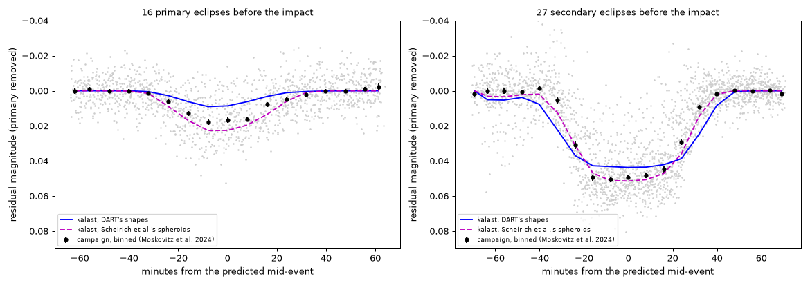

# Didymos for Eli: every day of the campaign, and all of it again with two fixes

16 October 2026, following `2026-10-15_didymos_lightcurves/` (the
simulation, the checks against Pravec and Scheirich's work and the 2022
campaign, Eli's 45 nights). Here: the rest of Eli's request, a fault the
days showed in `kalast.lightcurve.flux`, and everything run again with its
fix and with Didymos at its true period. What Eli gets is in
`out/didymos_eli/` (its README is hers).

## Every day, August 2022 to January 2023

Eli asked for all the nights from August 2022 to January 2023 if kalast
was fast enough: every UTC day of it from Earth's centre, both models,
every 2 minutes (`days.py`, `out/didymos_eli/days/`, `days.csv` summing
them up: phase, median magnitude, Scheirich et al.'s predicted events, each
model's deepest drop). The 184 days took 7 hours on three processes beside
the 67P tiles, and 3 when run again after the clipping fix below.

From Earth's centre against the same epochs from a site -- Les Makes,
TRAPPIST-South and North: the magnitude within 0.002 outside the events,
the site up to an Earth radius nearer the system or farther at 0.07-0.1 au;
an event's times within seconds, the parallax. A day serves any site.

## A fault the days showed

Set against TRAPPIST-North's nights at the same epochs, a day agreed to
0.0005 mag -- but the events' drop jumped by 3 mmag between epochs 20 s
apart. A facet of Didymos under many of Dimorphos's smaller ones shattered
past the clipping's piece cap and came out partly lit: the primary events
too shallow and noisy, after the impact by up to 0.043 mag at an epoch.
Fixed the same day (`2026-10-16_lightcurve_piece_cap/`), and everything
below run again with the fix.

## The 2022 campaign, again

Moskovitz et al. (2024, PSJ 5:35), Table 4: 38,532 points from 28
telescopes, with the primary's rotation removed (`Resmag`); public. Its 44
runs before the impact (10,493 points) cover 49 events. Each simulated with
both models at the data's light-time-corrected epochs; each model's depth
scaled to fit the data, pooled by kind (`campaign_table.py`):

| | events | data / DART's shapes | data / spheroids | rms: DART, spheroids, none |
|---|---|---|---|---|
| primary eclipses | 16 | 1.48 | 0.74 | 0.0102, 0.0097, 0.0123 |
| secondary eclipses | 27 | 0.88 | 0.90 | 0.0152, 0.0120, 0.0300 |
| secondary occultations | 5 | 0.64 | 0.76 | 0.0164, 0.0131, 0.0218 |

Thursday's table (1.32 and 0.75 for the primary eclipses) had been run
before Didymos turned at its true period, and with the clipping fault; the
period moved DART's numbers, the fix hardly these (0.003 mag at most
before the impact).

Stacked on their predicted mid-times: the secondary eclipses go 0.050
deep, the spheroids' depth, beginning and end -- DART's shapes give 0.043,
its Dimorphos (0.150 km) 15 % smaller in cross-section than the
photometric one (D2/D1 = 0.223 of 0.730 km). The primary eclipses lie
between the two shapes: deeper than DART's southern cap allows, shallower
than a smooth spheroid. **They measure Didymos's southern polar shape**,
where DART's model rests on the fewest views. The secondary events are
10 % shallower than either model: Dimorphos a few percent smaller than
D2/D1 = 0.223.

## Scheirich et al.'s table, every third cluster to January

Their table: every contact of every event as seen from Earth's centre,
July 2022 to 2025, from their nominal pre- and post-impact orbits. Every
third cluster of events from August 2022 to January 2023, 302 (369
events), with DART's shapes (`validate.py`); Thursday's figures were
August's alone, before the true period and the fix.

- Secondary eclipses, August 2022 (21): start -4 to +6 min, end -2 to +8,
  depth 0.041-0.046 against 0.042-0.049; before the impact (39) 0.93 of
  the table's depth at the median.
- **Primary eclipses came out 2-3 times shallower** before the impact (38:
  0.003-0.025 against 0.014-0.036, 0.36 of the table's at the median),
  crossing 2 mmag 13 min late and 13-16 early. Not the orbit -- the
  secondary eclipses, of the same geometry, agree -- but **DART's shape of
  Didymos**: lopsided north to south (z from -0.338 to +0.267 km), its
  southern pole a broad flat cap (radius 0.235 km 275 m below the equator,
  where a spheroid of the same flattening has 0.150). With the Sun 12 deg
  south of the orbit plane in August 2022, Dimorphos's shadow falls on
  that cap at grazing incidence and takes little light.
- **After the impact** (225 clusters) the depths are the table's: primary
  eclipses 0.94 at the median, occultations of Didymos 1.19, secondary
  events 0.94-0.95. Events start up to 30 min earlier than the table's
  (the secondary eclipses 9 min at the median) and end within minutes:
  the orbit solution (s542 against their post-impact nominal) or Didymos's
  shadow, not looked into.
- **With their model, kalast is within 2-4 mmag of their depths.**
  Scheirich et al. model both bodies as oblate spheroids with DART's axis ratios
  (Didymos 1.369, Dimorphos 1.504 before the impact, a sphere after) under
  Lommel-Seeliger, D2/D1 = 0.223 (0.202 after). The 2022-08-16 primary
  eclipse: 0.029 mag, 19:50 to 20:49, against their 0.027, 19:45 to 20:51;
  the secondary eclipse 0.047, 13:52 to 14:58, against their 0.043, 13:48
  to 14:57 (Thursday's note had 0.042, which no run gave). Hapke for
  Lommel-Seeliger changes it by 1-2 mmag.

## Eli's nights, again

The 45 nights and their events (`events.py`) with the fix: DART's events
after the impact up to 0.026 mag deeper at an epoch, those before it 0.003;
chi in the events moved by 0.01 to 0.3, and what was read off it stands --
2022-11-22 TN 5.58 -> 4.37 (4.43 before), 09-04 TS 2.32 -> 1.92 (1.93),
09-05 TS 0.88 -> 0.78 (0.77).

## Open

- The albedo: Hapke's `w` for H = 18.16 at Didymos's size, or the
  campaign's HG1G2, for absolute magnitudes.
- Didymos's southern shape from the primary eclipses before the impact.
- After the impact, kalast's events start up to 30 min before the
  table's: the orbit solution (s542 against their nominal) or the shadow.
- What Eli's analysis wants next: the event depths after the impact with
  the ejecta's dilution, if she fits through October.
- `out/didymos_eli/` onto Eli's share, once agreed.
