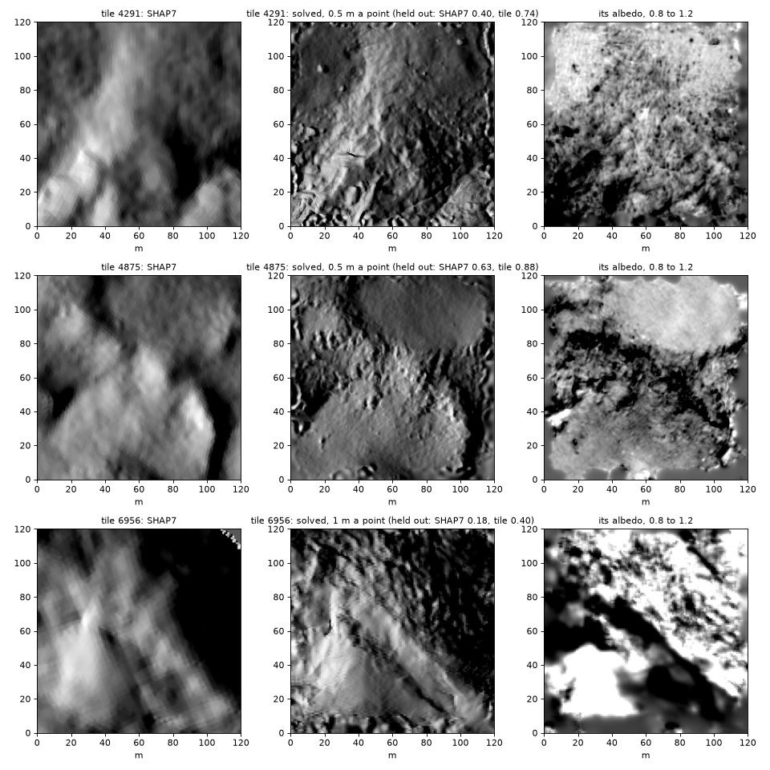
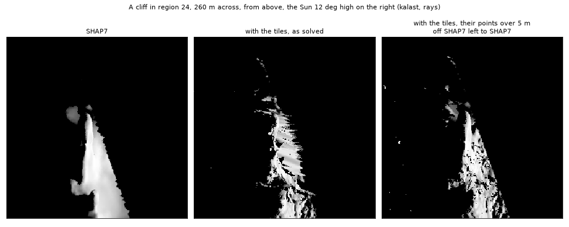
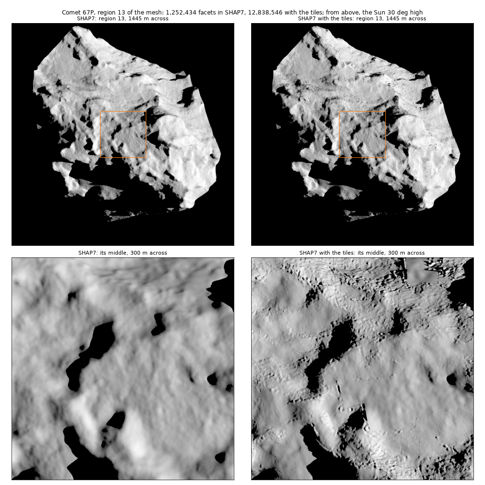
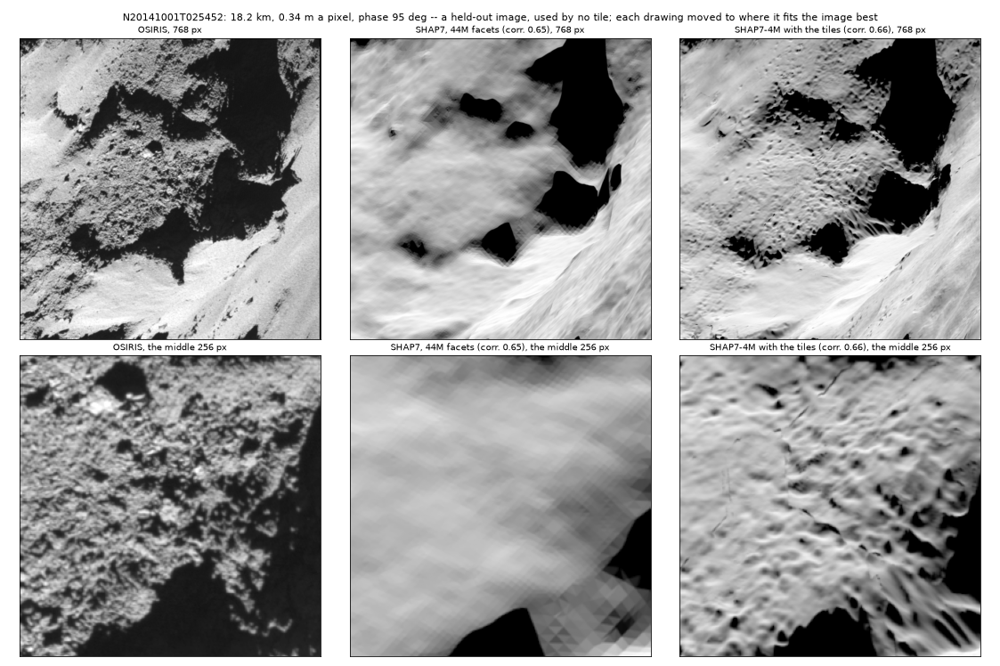
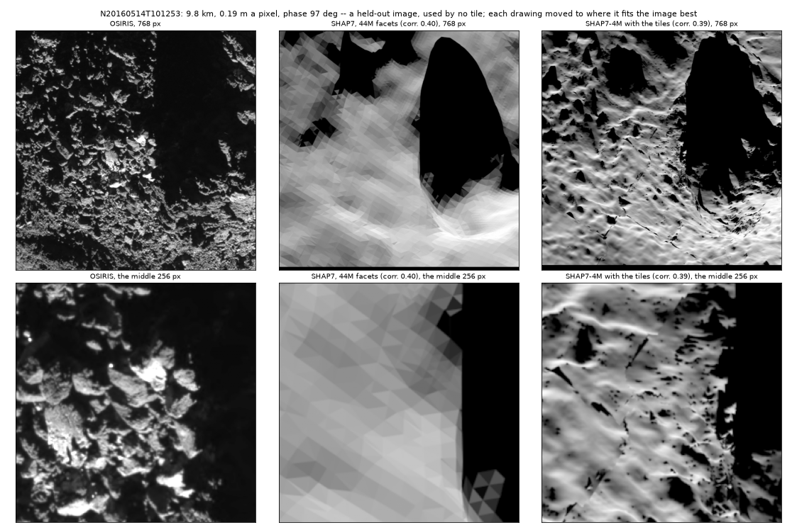

# Comet 67P's mesh: SHAP7 with the tiles in it

**Reviewed on 20 October** (`2026-10-20_67p_mesh_review/`): the tiles
change little of what the images show -- of their shadow, 37 and 65 % drawn
against SHAP7's 27 and 50 % -- since they keep SHAP7's relief above 2.5 m;
and the mesh is not one closed surface but separate patches.

19 October 2026. The tiles of `2026-10-16_67p_second_pass/` and
`2026-10-19_67p_example_two_passes/` into one shape model: SHAP7 where no
good tile is, each tile at its own spacing elsewhere.

## Progress

- [x] The results in the example's numbering, in
  `/Users/gregoireh/data/mesh/67p/tiles_v2/`: the first pass's 6,332 tiles,
  the second pass's 7,364, 10,870 held-out scores (Friday's, renumbered;
  hard links, no copy).
- [x] Every image's lines fetched whole for its tiles (the relief box):
  5,334 images, the store 27 to 29 GB.
- [x] The 1,065 tiles whose image windows had been cut, solved again (second
  pass) and scored again; their earlier results in `second_cut/` and
  `scores_cut.csv`. Nothing to see: heights 1.14 m RMS from their first
  solve at the median (3.5 m at the 90th percentile), 48.8 images used a
  tile both times, the same fit to them (0.684, 0.683); on their 1,772
  held-out pairs, 0.560 then 0.561 against SHAP7's 0.367 and 0.366.
- [x] The mesh builder (scratch `build_mesh.py`): 32 regions about k-means
  centres of SHAP7's facets, each `compose`d with every tile reaching it;
  each region a binary PLY, then the whole. Two regions welded: no facet in
  both, no edge in three.
- [x] Walls left to SHAP7: a tile's points over 5 m off SHAP7 (below).
- [x] The final set (`tiles_v2/final/`, scratch `select_final.py`): 6,941
  of the 7,364 tiles -- 408 below SHAP7 on their held-out images and 15
  that fail the home PC's test left out. Kept, of 241 points: 5,404 at
  0.5 m, 614 at 1 m, 52 at 2 m; of 121: 478, 350 and 43. Their points over
  5 m off SHAP7 marked unknown: 1.9 of their 133 km2 (overlaps counted),
  the most at 2 m, 7 and 11 %, where the ground is roughest.
- [x] The mesh, `/Users/gregoireh/data/mesh/67p/shap7_tiles/67p_shap7_tiles.ply`:
  312 million facets, 6.6 GB, in 6.5 min (below).
- [x] Previews beside SHAP7: a region of the mesh, and two held-out OSIRIS
  images drawn whole (below). The second image first meant,
  N20160709T024848, waits for ESA's archive, down for maintenance.

## The mesh

In `/Users/gregoireh/data/mesh/67p/shap7_tiles/`:

- `67p_shap7_tiles.ply`, 6.6 GB: 312,180,637 facets and 159,051,338
  vertices, against SHAP7's 43,966,474 facets. Binary PLY, little-endian:
  each vertex x, y, z in km in 67P/C-G_CK, SHAP7's frame, then its albedo
  -- the tiles' solved albedo, relative, median 1.00, 0.57 to 1.54 from the
  1st to the 99th percentile; 1 on SHAP7's own vertices -- and each facet
  three indices.
- `regions/r00.ply` to `r31.ply`, the same mesh in 32 pieces of 2.8 to 12.8
  million facets, 60 to 270 MB each: what MeshLab or Blender open (the
  whole is more than most viewers hold). `centres.npy`, their centres.

Built from the final set by the scratch `build_mesh.py` in 6.5 minutes:
the comet cut into 32 regions about k-means centres of SHAP7's facets, each
region's `compose` given SHAP7's facets of the region and every tile within
20 m of it, keeping the facets whose middle is the region's. A tile's cell
is decided the same way on both sides of a border, so the regions meet
cell for cell. Checked: the file's size to the byte, every vertex finite,
every index in range; eight neighbouring pairs of regions welded by vertex
position -- no facet in both, no edge in more than two facets, 1,400 to
2,800 border edges closed each.

Not OBJ: as text the whole would be some 20 GB. kalast's `load_mesh` reads
OBJ only, so a region goes in through `Mesh.from_arrays`:

```python
import re
import numpy
from kalast.mesh import Mesh

raw = open("/Users/gregoireh/data/mesh/67p/shap7_tiles/regions/r24.ply", "rb").read()
end = raw.index(b"end_header\n") + len(b"end_header\n")
nv, nf = (int(re.search(rb"element " + e + rb" (\d+)", raw[:end])[1]) for e in (b"vertex", b"face"))
vertices = numpy.frombuffer(raw, [("p", "<f4", 3), ("albedo", "<f4")], nv, end)
facets = numpy.frombuffer(raw, [("n", "u1"), ("i", "<i4", 3)], nf, end + 16 * nv)["i"].astype(numpy.uint32)
sim.add_mesh(Mesh.from_arrays(vertices["p"], facets, smooth=True))
```

## What a tile adds

Three tiles' relief shaded as under a low Sun from the west, SHAP7's and the
solved one's, and the solved albedo:



A tile keeps SHAP7's relief at every scale it resolves and adds what the
images show below it. Band by band (`relief.py`'s tiles):

| tile | below 2.5 m: SHAP7, tile | 2.5-12.5 m | 12.5-40 m | above 40 m |
|---|---|---|---|---|
| 4291, 0.5 m | 0.18 m, 0.35 m (corr 0.47) | 1.53, 1.54 (1.00) | 3.64, 3.64 (1.00) | 0.64, 0.64 (1.00) |
| 4875, 0.5 m | 0.16, 0.25 (0.63) | 1.32, 1.32 (1.00) | 2.18, 2.18 (1.00) | 1.04, 1.04 (1.00) |
| 6956, 1 m | 0.58, 0.75 (0.71) | 2.24, 2.26 (0.97) | 5.00, 5.01 (1.00) | 1.41, 1.42 (1.00) |

The relief's RMS in each band and the two's correlation. The solved panels
look flatter at 20-40 m only because their fine relief takes the shading's
range; the slopes at 10 m are SHAP7's (12.7 deg both, 9.2 and 9.3, 17.2
and 17.1).

## The mesh's size

On 100 tiles at 0.5 m and SHAP7 around them, `compose` took 2.6 s for
12.5 million facets. The whole comet at the tiles' own spacing is about
290 million facets -- two to each 0.25 m2 cell over 33 km2 at 0.5 m, fewer at
1 and 2 m -- 5.5 GB as binary PLY (float positions, int indices); as OBJ
text, 20 GB. `compose` over all of it at once would hold some 20 GB of
tiles: it runs region by region, each region's facets kept, the regions
meeting cell for cell since each sees every tile over its border.

## A first drawing, and smooth shading

A held-out OSIRIS image (N20141001T025452, 18.2 km, 0.34 m a pixel, phase
95 deg) drawn by `comet67p_shadows_fit`'s `tiles` mesh -- SHAP7-4M with the
180 tiles it sees -- beside the image (`preview.py`):


Drawn flat (the middle), each 0.5 m cell's two triangles take their own
normals, 1.5 pixels across here: stripes along the diagonals. The OBJ that
`shap7` loads is smoothed; the tiles' mesh, made by `Mesh.from_arrays`,
was not -- `smooth=True` (the right) draws them alike. The large forms are
the image's; its long shadows are not all there, which is SHAP7's relief
(the tiles keep it above 2.5 m) or the drawing -- SHAP7 in full, drawn the
same way, will tell. It is SHAP7's relief: drawn with the reference, SHAP7
in full casts no more of them (Previews, below).

## Walls: a tile's points far off SHAP7 left to it

Region 24 drawn from above under a low Sun (`region_view.py`, kalast's
rays) has combs on a cliff, tall thin triangles side by side; turning the
Sun 25 deg does not turn them, so they are the mesh's. The tiles there, of
121 points at 1 and 2 m where the surface turns, run 30 to 90 m off SHAP7
along the walls: a height field cannot follow a wall near square to its
plane, and SHAP7's facets farther than `compose`'s depth from a tile (8 to
26 m) are not its, so they stay too -- two surfaces.

Over the second pass's 6,970 tiles, each tile's farthest point off SHAP7:
3.7 m at the median, 17.5 m at the 90th percentile, 50 m at the 99th. The
held-out gain falls with it, +0.23 under 10 m, +0.19 at 10-20 m, +0.16 at
20-40 m, +0.11 over 40 m. The tiles keep SHAP7's relief above 2.5 m
(above), so a point over 5 m off it is not the finer relief they add: those
points, and two more all round, are SHAP7's -- their reference set unknown,
which `compose` reads as no tile there. 1.3 % of the tiles' ground, in
2,736 tiles; the combs go:



Drawn with shadow maps instead, much of the region under that 12 deg Sun
was lit where the rays shadow it. The previews below are drawn with the
reference.

## Previews

Region 13 of the mesh, 1.4 km across, beside SHAP7's facets there, drawn by
kalast from above under a 30 deg Sun (`region_view.py`, rays): 12.8 million
facets against SHAP7's 1.25 million.



The thin straight lines in the middle are tiles' edges, where two tiles'
heights differ a little and the step casts a shadow under a low Sun.

Two held-out OSIRIS images, used by no tile, drawn by kalast as
`comet67p_shadows_fit` draws them -- the reference, 64 samples a pixel, the
refitted Hapke law, SPICE's geometry -- with SHAP7 in full, SHAP7-4M alone,
and SHAP7-4M with the final tiles in view (its `tiles`; 191 and 29 tiles).
The whole of the mesh is more than this Mac draws. Each drawing's
correlation with the image at SPICE's pointing, and moved to where it fits
best (`best_shift.py`); then, at that, where both are lit, and the detail
under 8 pixels alone:

| | SHAP7 | SHAP7-4M | with the tiles |
|---|---|---|---|
| **N20141001T025452**, 18.2 km, 0.34 m a pixel, phase 95 deg | | | |
| at SPICE's pointing | 0.633 | 0.632 | 0.607 |
| at its best (moved, px) | 0.649 (+8.5, -6.5) | 0.648 (+8.5, -6.5) | **0.662** (+5.5, -6.5) |
| where both lit | 0.571 | 0.570 | 0.587 |
| the detail under 8 px | 0.086 | 0.080 | **0.193** |
| **N20160514T101253**, 9.8 km, 0.19 m a pixel, phase 97 deg | | | |
| at SPICE's pointing | 0.368 | 0.366 | 0.299 |
| at its best (moved, px) | 0.395 (-41.5, -9.5) | 0.392 (-41.5, -9.5) | 0.388 (-27.5, -15.5) |
| where both lit | 0.178 | 0.159 | 0.170 |
| the detail under 8 px | -0.003 | -0.013 | **0.072** |

- A whole image's correlation is its light and shadow: SHAP7 in full and
  SHAP7-4M, ten times coarser, score alike. What the tiles add is the
  detail under a few metres, which correlates with the image 0.19 against
  SHAP7's 0.09 at 18 km, and 0.07 against nothing at 9.8 km.
- SPICE's pointing is 8 to 40 pixels off. A finer model loses more by it:
  at SPICE's pointing the tiles fall below SHAP7. The tiles' own held-out
  scores, each tile registered on the image on its own, are on these
  images 0.628 against SHAP7's 0.451 (121 tiles) and 0.408 against 0.216
  (17).
- N20160514T101253's ground is boulders 5 to 10 m across. SHAP7 has none of
  them here, its facets as coarse as they are, and the tiles have none
  either: they keep SHAP7's relief above 2.5 m and add only what is finer.
- The long shadow left of the middle of N20141001T025452 is in neither: it
  is SHAP7's relief, not the drawing.





## Open

- N20160709T024848, the second held-out image first meant, when ESA's
  archive is back.
- The whole mesh drawn at once: 312 million facets, untested in kalast; a
  region or a few draw.
- Where SHAP7 is coarse -- boulder fields, walls -- the tiles add nothing
  above 2.5 m: what SHAP7 lacks there stays lacking.
- Shadow maps light ground the rays shadow, on region 24 under a 12 deg
  Sun.
