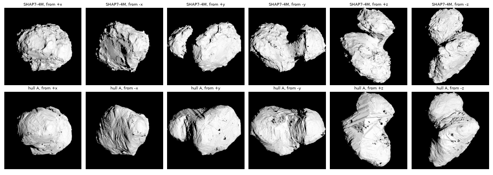
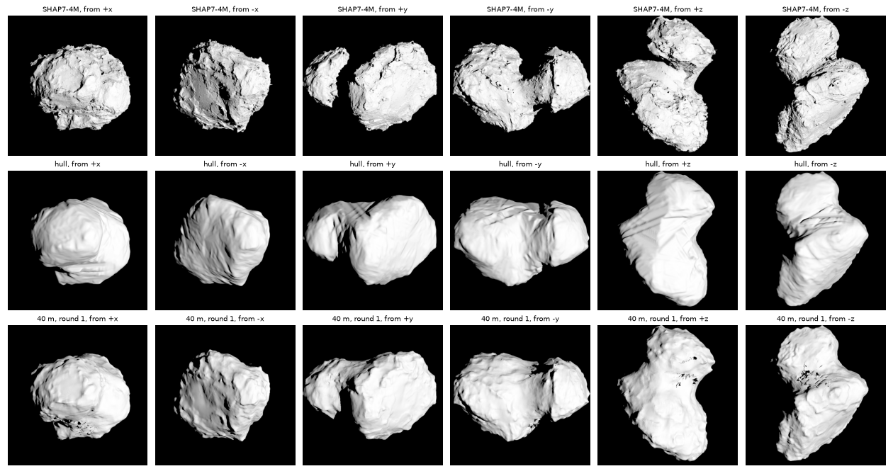
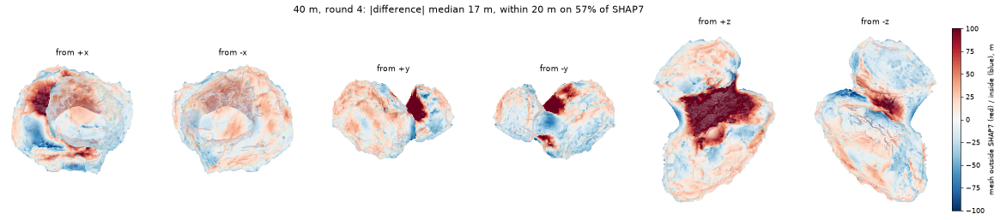
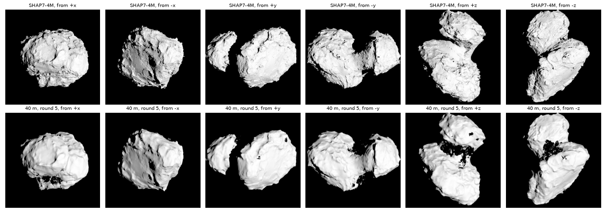
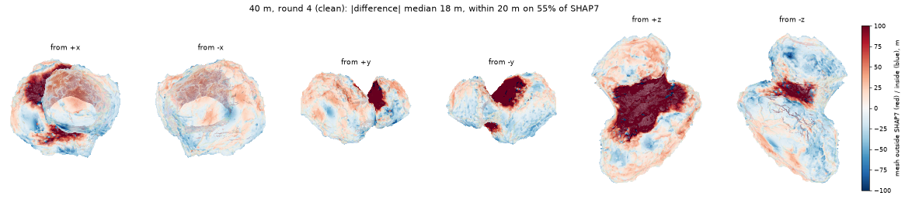
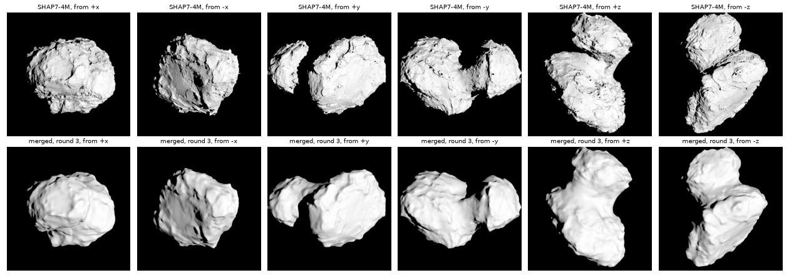
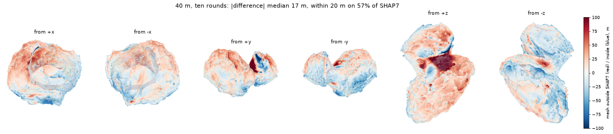

# Comet 67P from its images alone

20 October 2026. After the review (`2026-10-20_67p_mesh_review/`), the user,
to "Build 67P from the OSIRIS images with kalast, using SHAP7 only to
measure against, not as a starting point. Start coarse and whole: about 10
m over the whole comet, as one closed mesh. Measure it against SHAP7 at
that resolution before going finer": "yes".

A test of what kalast can do with Hera's AFC images of Didymos and
Dimorphos: a shape model from a spacecraft's images and its kernels, no
model to start from.

## Progress

- [x] The plan (below).
- [ ] Silhouette images: 340 full NAC frames picked, 60-600 km away, phase
  31-70 deg, from 178 of 180 directions around the nucleus (scratch
  `select_hull.py`); 336 of them whole frames. Downloading from NASA's
  Small Bodies Node: ESA's archive went back into maintenance at 16:40,
  every product answered with its maintenance page.
- [x] The visual hull in kalast (Rust, `src/shape/hull.rs`):
  `kalast.shape.Hull` carves the views' silhouettes into a closed mesh by
  marching tetrahedra; `Surface.draw` and `align` register a view on it.
  An ellipsoid from 60 synthetic views: volume within 0.1 %, vertices an
  eighth of a pixel off at the median, genus 0, every edge in two facets.
  A view that does not hold the whole body carves within an earlier hull
  (`within`), where the bounding sphere would leave its night side and the
  sky past its frame alike.
- [x] 67P's hull (scratch `hull67p_v2.py`): 335 frames, one left out that
  holds no nucleus -- stray light, which marked every point as seen
  against the sky once already. Each frame registered on the hull by its
  limb -- its lit pixels next to the sky on the hull, that sky off it --
  three times; 56 frames have a limb to register by, moved 2.7 px at the
  median the first time, 0.6 px the third. Then smoothed by 30 m before
  meshing, which closes the tunnels small errors cut: one closed piece,
  genus 0, 1.1M facets at 20 m (`hullsm_20_30.ply`).

  | | volume, km3 (SHAP7 18.56) | genus | SHAP7 inside the hull by, m: median, 90 %, 99 % | SHAP7 outside by 20 m+ |
  |---|---|---|---|---|
  | carved, pointing as SPICE has it | 22.83 | 47 | 42, 282, 748 | 1.52 % |
  | the limbs registered, three times | 22.81 | 38 | 42, 282, 748 | 1.29 % |
  | smoothed by 30 m: the start | 22.80 | 0 | 45, 295, 758 | 1.90 % |
  | smoothed by 50 m | 22.77 | 0 | 45, 302, 769 | 2.92 % |

  SHAP7's surface lies within 20 m of the hull or inside it on 98 % of it;
  inside by 45 m at the median and up to 760 m -- the neck, the pits, the
  night sides no frame saw past, what the tiles are for. The frames that
  do not hold the whole nucleus carve little within the bounding sphere;
  within an earlier hull they carved more but cut into it too -- their
  pointing, a few pixels at 1-3 m a pixel, is the tiles' to fix.

  

- [ ] Tiles over it, coarse to fine: each image registered on each tile;
  each image's pointing and each tile's place -- its height too, the stereo
  -- fitted at once; the relief solved from the shading. Running at 40 m
  (scratch `spc67p.py`): tiles of 31 x 31 points, 40 frames each at the
  median, Fornasier et al. (2015)'s published Hapke law -- nothing fitted on
  a shape model. Each round, the tiles merged into the mesh by `fuse`:

  | | volume, km3 (SHAP7 18.56) | SHAP7 against it, m: median, rms | SHAP7 inside by, 90 %, 99 % | the fit's residual, px |
  |---|---|---|---|---|
  | the hull | 22.80 | 45, 193 | 295, 758 | |
  | 40 m, round 1 (124 tiles) | 21.28 | 25, 160 | 242, 646 | 20.5 |
  | 40 m, round 2 (154 tiles) | 20.41 | 19, 122 | 166, 534 | 5.1 |

  The tiles go down where the hull is too full -- 26 then 10 m at the
  median, 111 then 78 m at the 10th percentile -- and the fit's residual
  falls as the surface comes nearer the frames'. Two things found: where
  tiles disagree a move can turn a facet over (0.24 % in round 1), which
  `fuse` now untangles; and every tile moved one way with every frame's
  pointing the other explains the shifts alike -- far frames moved 9 px --
  so the frames registered by their limbs now keep their pointing
  (`pointing(..., fixed=...)`) and hold the model in SPICE's frame.

  

  Rounds 3 to 5, the limb frames holding their pointing:

  | | volume, km3 | SHAP7 against it, m: median, rms | SHAP7 inside by, 90 %, 99 % | residual, px |
  |---|---|---|---|---|
  | 40 m, round 3 (130 tiles of 176 with five frames) | 19.75 | 18, 90 | 110, 422 | 6.3 |
  | 40 m, round 4 (131 of 198) | 19.34 | 17, 64 | 68, 291 | 5.5 |
  | 40 m, round 5 (131 of 210) | 19.06 | 16, 50 | 43, 227 | 5.2 |

  Within 20 m of SHAP7 on 57 % of its surface after round 4, within 50 m
  on 87 %; what is left is mostly the neck, filled by the hull by up to
  700 m and dug at 100-190 m a round:

  

  But the neck dug so came out crumpled: each vertex was moved along its
  tile's normal, and where the tiles over a saddle sink 100-190 m a round
  the surface's parts pass through each other. Tiles laid on it grew in
  number, 124 to 210, while those any frame sees stayed at about 130: the
  rest lie under the crumpled surface.

  

  `fuse` now moves each vertex along its own normal, to where that line
  meets the tile's surface, smooths the moves over the mesh and holds them
  to a step a round (1.5 spacings): a surface moved far gets there in
  rounds, its neighbours with it. The 40 m rounds again from the hull, the
  hull's triangles relaxed first; `fuse` relaxing before it untangles, and
  putting back what stays turned over: no facet turned over after a round.

  | the 40 m rounds again | tiles with five frames, of those laid | volume, km3 | SHAP7 against it, m: median, rms | SHAP7 inside by, 90 %, 99 % |
  |---|---|---|---|---|
  | round 1 | 121 of 121 | 21.31 | 23, 174 | 256, 715 |
  | round 2 | 225 of 283 | 20.85 | 20, 156 | 225, 652 |
  | round 3 | 210 of 383 | 20.50 | 21, 135 | 193, 574 |
  | round 4 | 187 of ? | 20.51 | 19, 126 | 162, 538 |

  Clean, but the hollows hardly dig: within 20 m of SHAP7 on 55 % of its
  surface, 50 m on 82 %, the neck and the small lobe's large depression
  still 100 m and more too full.

  

  Why: `Surface.tiles`, laid afresh on each round's rougher surface, put
  down more tiles every round -- 121, 283, 383, 608 -- many facing into
  the body on the backs of bumps, which no frame sees; of the 297 laid over
  the hollows in round 4, 57 had five frames. Laid once on the hull and
  kept -- SPC keeps its landmarks so -- each tile's middle found on the
  surface as it is now, 106 of the 121 have five frames of the 335, and 18
  more frames from the archive serve the rest bar 12. The rounds go on so,
  from round 4.

  On that layout the tiles did not fold the surface less: whatever the
  smoothing and the steps, moving one mesh's vertices hundreds of metres
  into a saddle folds it -- the dug neck needs walls the hull's mesh has no
  facets for. So each round now makes the mesh again (`merge`): the tiles
  as a field over space -- each one's distance along its normal from its
  surface, positive below it, weighed toward its middle and fading at 400 m
  from it -- the last mesh's own distance where the tiles weigh little,
  and the surface where that crosses zero by the hull's marching tetrahedra
  (`march`, shared): closed, genus 0, 24 s for 1M facets at 20 m. From
  the hull again, on the fixed layout:

  | merged, 40 m | tiles with five frames | volume, km3 | SHAP7 against it, m: median, rms | SHAP7 inside by, 90 %, 99 % |
  |---|---|---|---|---|
  | round 1 | 121 of 121 | 21.39 | 22, 175 | 262, 714 |
  | round 2 | 121 | 20.62 | 19, 140 | 199, 616 |
  | round 3 | 121 | 19.97 | 18, 103 | 133, 499 |
  | round 4 | 121 | 19.64 | 18, 80 | 92, 409 |
  | round 6 | 121 | 19.20 | 16, 53 | 48, 275 |
  | round 8 | 121 | 19.00 | 16, 39 | 40, 178 |
  | round 10 | 121 | 18.89 | 17, 33 | 38, 124 |

  Every tile stays in view of its frames, and the hollows dig by about a
  third of what is left a round:

  

  After ten: the volume within 1.8 % of SHAP7's, the surface within 20 m of
  it on 57 %, within 50 m on 93 %; what is left, the neck's deepest part,
  50-100 m too full, and regions 20-40 m off either way -- the next for the
  20 m tiles, 600 m wide, laid once on this mesh.

  
- [ ] The tiles merged into the mesh (Rust): its vertices moved, one closed
  mesh still.
- [ ] Again at 20 m and at 10 m; each version against SHAP7.
- [ ] Against SHAP7 at 10 m: heights, volume, the 57 images of
  `2026-10-13_67p_osiris_shadows/` drawn with both.
- [ ] Made usable: an example, `docs/API.md`, the changelog, the bundle.

## The plan

What goes in: OSIRIS NAC images and ESA's SPICE kernels -- the spacecraft's
path, its attitude, the comet's -- as they are, as Hera's will be. ESA made
those kernels with the shape models of their day, as every mission's
navigation does; no shape model enters here. SHAP7 only measures the
result.

Stereophotoclinometry as Gaskell et al. (2008) run it from scratch: a
shape from the limbs first, then maplets over all of it, each image's
pointing and each maplet's place fitted together from where the images
put it, the relief from the shading, the maplets merged back into the
shape; coarse to fine.

1. **The hull.** In images that show the whole nucleus, the sky is what is
   neither lit nor behind lit ground from the Sun (the night side); a
   point of space that falls on the sky in any image is not the comet.
   Over a grid of 10 m cubes, each one's distance to the nearest sky in
   every image, the least of them (the second least, against a wrong
   one) its distance to the hull; the surface where it crosses zero, by
   marching cubes: closed. Concavities -- the neck, pits -- stay filled
   where no limb crosses them: what the maplets are for.
2. **Pointing.** SPICE's pointing is a few pixels off at these distances
   (`2026-10-13_67p_osiris_shadows/`): each image registered on the hull
   drawn in its geometry, and carved again.
3. **Maplets** over the hull, by kalast.shape as it is: laid by
   `Surface.tiles`, their images by `choose`, solved by `Maplet.solve`.
   Its pointing fit takes a maplet's offset across its plane only, which
   was enough with SHAP7 under it; from a hull, the height is what is
   wrong, and the images' parallax tells it -- the fit takes it too.
4. **Merging** (new): each vertex of the mesh moved along its normal to
   the maplets over it, weighted toward their middles; the triangles
   relaxed. The mesh stays closed, the hull's topology.
5. Steps 3-4 at 40, 20, then 10 m; each version against SHAP7.

## Not used

SHAP7, SHAP8, ESA's DSKs, the tiles of `2026-10-15_67p_tiles/` to
`2026-10-19_67p_mesh/`: nothing of them, except SHAP7 to measure.
