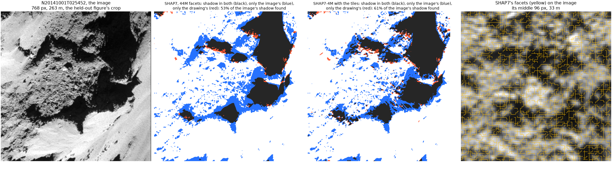
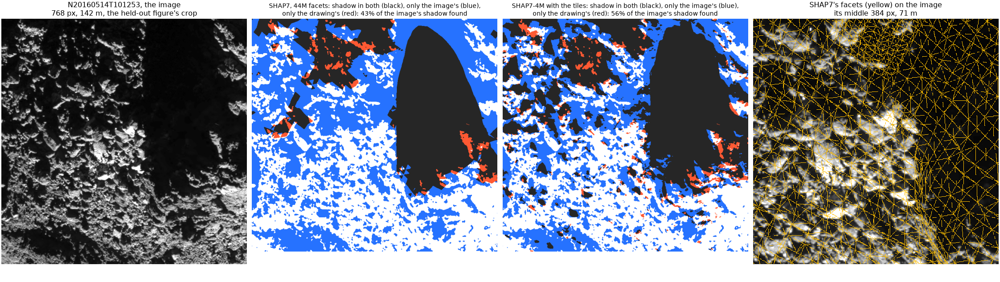
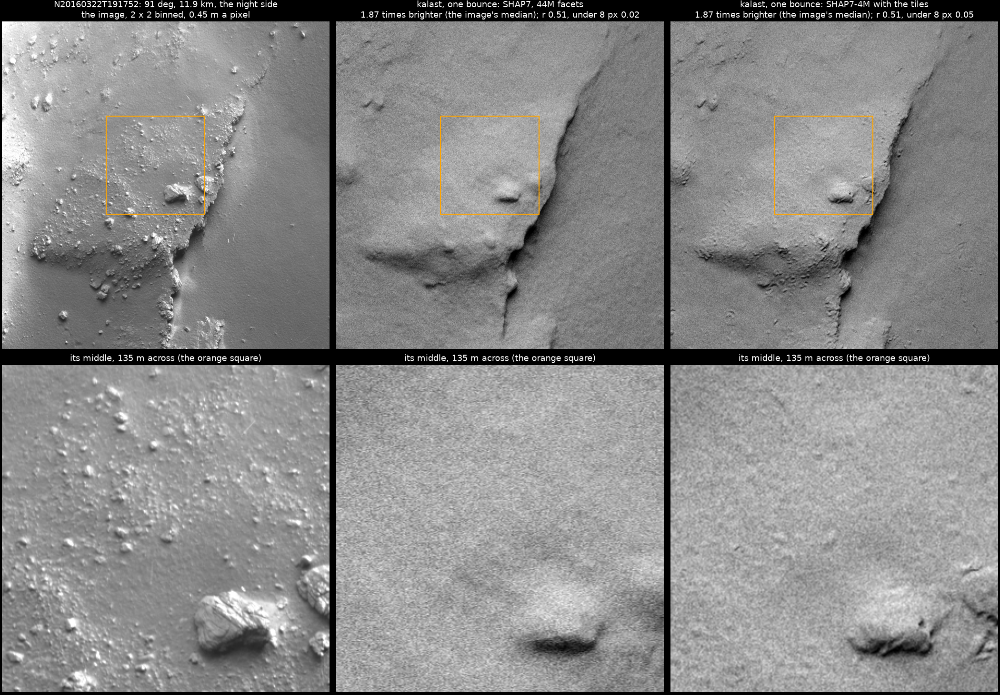
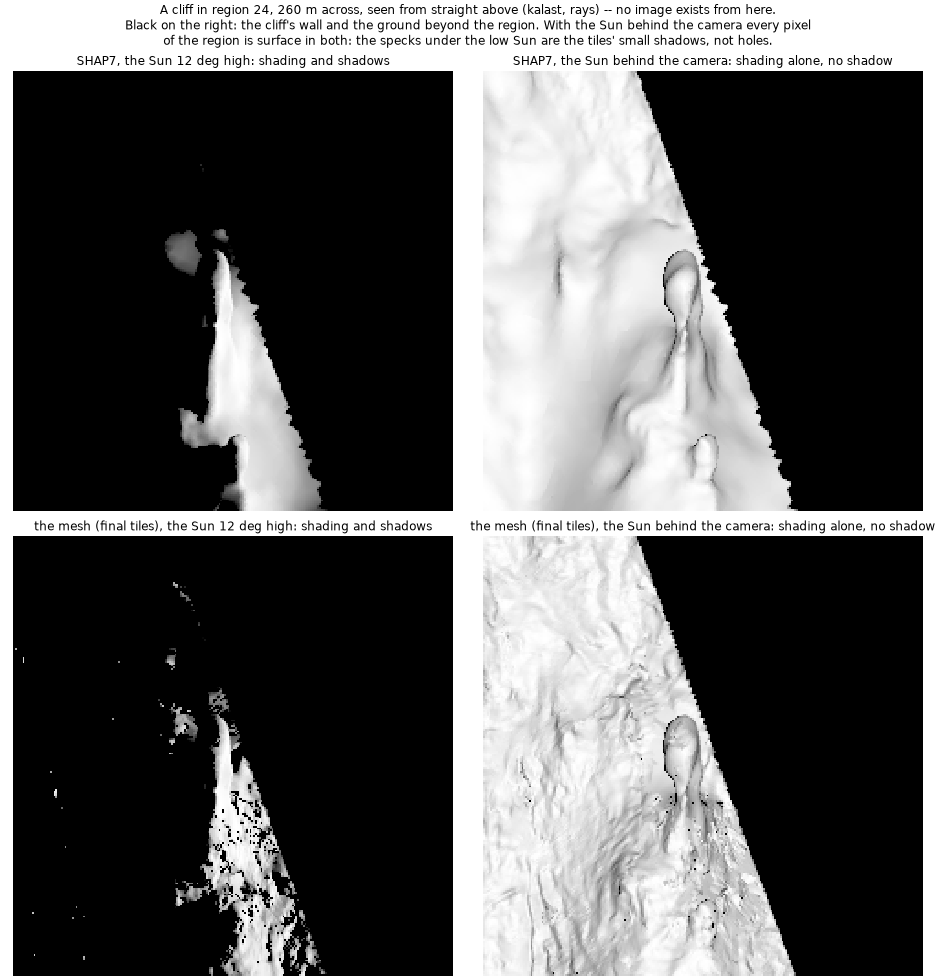

# Comet 67P's mesh, reviewed

20 October 2026. The user, reading `2026-10-19_67p_mesh/`: most of the
largest shadows are not the image's, the ground's features are not there,
the tiles look like noise, figures have no image to compare with, the PLY
in Finder is "a non closed mesh like agglomerate of tiles and region", and
"this cant be a final product". Their questions answered here, measured;
the decision -- stop, or reproduce the best model from the images instead
of improving it -- is theirs.

## In short

- **The tiles change the images little.** Of the image's shadow, kalast
  draws 27 and 50 % with SHAP7 on the two held-out images, 37 and 65 % with
  the tiles; their whole-frame correlation stays 0.65 to 0.66 and 0.40 to
  0.39; the night-side image is unchanged, r 0.51 both.
- **By construction.** A tile keeps SHAP7's relief above about 2.5 m
  (measured: correlation 1.00 in every band above it,
  `2026-10-19_67p_mesh/`): it was held to SHAP7 there, the first tiles left
  free having come out rippled by +-5 m (`2026-10-15_67p_tiles/`). The large
  shadows are cast by relief of metres and more: they stay SHAP7's, and
  under these images' low Sun SHAP7 misses half of them or more.
- **The mesh is not one surface.** 6,941 separate tile grids, each
  overlapping its neighbours by a ring of cells, and SHAP7's facets where
  no tile is: no vertex shared between two of them, 1-2 % of the edges
  open. It draws as a surface; it is a patchwork.

## The shadows kalast draws, against the images'

Each drawing of `2026-10-19_67p_mesh/`'s held-out figures -- the reference,
exact shadows, moved to where it fits the image best -- against the image:
in shadow where under a tenth of the lit ground's brightness (its 90th
percentile). Over the frame, 40 pixels in from its edges, and over the crop
those figures show:

| | the image in shadow | of it, SHAP7 draws | with the tiles | IoU, SHAP7 then the tiles |
|---|---|---|---|---|
| **N20141001T025452**, 18.2 km, 0.34 m a pixel, phase 95 deg | | | | |
| the frame | 14.6 % | 27 % | 37 % | 0.26, 0.35 |
| the crop, 263 m | 28.5 % | 53 % | 61 % | 0.52, 0.58 |
| **N20160514T101253**, 9.8 km, 0.19 m a pixel, phase 97 deg | | | | |
| the frame | 68.8 % | 50 % | 65 % | 0.48, 0.61 |
| the crop, 142 m | 61.2 % | 43 % | 56 % | 0.41, 0.54 |

The drawings' own shadow is mostly the image's: 5-8 % of SHAP7's falls on
ground the image has lit, 7-15 % of the tiles'. They miss shadow, they do
not invent it: the blue below.

Why so much is missing:

- **The Sun is low where they are.** Under each pixel, SHAP7's facet and
  the Sun from SPICE: where SHAP7 misses the image's shadow, the Sun is 19
  deg above its facet at the median at 18 km (35 deg over all the ground in
  view), 12 deg at 9.8 km (9 deg). A shadow is the height over the tangent
  of the Sun's elevation: a metre of height casts 2.9 m at 19 deg, 8.5
  pixels at 18 km, and 4.7 m at 12 deg, 25 pixels at 9.8 km. Relief of a
  metre to a few metres decides these shadows.
- **SHAP7 has no metre-level relief here.** The facets kalast drew, under
  the pixels of each crop: their longest edges 2.2 m at the median at 18
  km (6 pixels), 4.0 m in the boulder field at 9.8 km (22 pixels, the
  right-hand panel) -- the boulders, 5-10 m across, one or two facets each.
  Stereophotogrammetry smooths over several facets more.
- **The tiles add relief only below 2.5 m.** Hence the 8-15 points of
  shadow they gain, at the edges of SHAP7's; the shadows' outlines,
  cast by the larger relief, stay where SHAP7 puts them.

The two held-out images are the hardest case: on the 57 images of
`2026-10-13_67p_osiris_shadows/`, SHAP7 drawn by kalast has the lit pixels'
IoU at 0.98 (median) under 30 deg of phase, 0.94 at 30-60, 0.89 at 60-90,
0.60 at 90-100.

`first_render_flat_vs_smooth.png` was drawn with shadow maps, which light
ground the rays find in shadow (found the same day on region 24), at
SPICE's pointing: the worst of the figures, replaced by the held-out ones.
The black strip along the bottom of kalast's panels of
`held_out_N20160514T101253.png` is the move: the rows the drawing left when
shifted 9.5 pixels up.

## The night side, with the tiles

`2026-10-13_67p_osiris_shadows/`'s `comet_shine.jpg` drawn again, one
bounce, the refitted law, at half resolution, with SHAP7 in full and with
SHAP7-4M and the 47 tiles in view (`main.py`'s `tiles`), each moved to fit:

| | r, smoothed 6 px | the detail under 8 px | the image over kalast |
|---|---|---|---|
| SHAP7 | 0.51 | 0.02 | 1.87 |
| with the tiles | 0.51 | 0.05 | 1.87 |

Unchanged. The large boulder in the middle has a little more relief; the
small boulders on the plateau, 1-5 m, are in neither.

## The mesh, as a mesh

`67p_shap7_tiles.ply`, checked (scratch `plycheck.py`):

- 3 million facets drawn at random: every index in range, no triangle
  longer than 13 m among the tiles' (86 m among SHAP7's); 99.9 % of them
  the tiles' -- SHAP7's facets are what is left on walls and where no tile
  reaches.
- Its facets face out as SHAP7's do: 99.97 % and 99.83 % of regions 13's
  and 24's face the same way as the nearest of SHAP7's in full, 0.6 m
  away at the median; SHAP7's face out (18.56 km3 inside).
- **Open**: region 13 has 227,032 edges in one facet only, of 19.4 million;
  region 24, 135,102 of 5.8 million. No vertex is shared by two tiles or by
  a tile and SHAP7, even by position: `compose` overlaps a tile's edge with
  its neighbour's by a ring of cells instead of joining them. A closed mesh
  needs the tiles resampled into one surface, which `compose` does not do.

What Finder's preview showed is what is there: thousands of separate
patches.

## The cliff figure

`cliff_masked.png` was drawn from straight above under a 12 deg Sun: on that
cliff 90 % of the crop is shadow even on SHAP7, and no image exists from
there. Drawn again with the Sun behind the camera, shading alone, beside
it: the region is surface everywhere in both -- 1,858 of the view's 1.44
million pixels black in the mesh and not in SHAP7 -- so the specks under
the low Sun are the tiles' small shadows, not holes. The combs of the
middle panel are gone; the tiles' surface is rough where SHAP7's is smooth,
and nothing here says whether that roughness is the ground's.

## Figures with no image beside them

`mesh_region13.png` (the region from straight above) and `relief_tiles.png`
(three tiles' heights shaded) compare the mesh with SHAP7 only. They cannot
show whether the tiles' detail is the ground's: the straight lines in
region 13 are tiles' edges, and the rest is the tiles' rough surface, real
or not. relief_tiles.png's titles carry each tile's score on images it was
not solved from (SHAP7 0.40, the tile 0.74; 0.63, 0.88; 0.18, 0.40), but
not the images.

## Why tiles on SHAP7

- 14 October, the user: "i would like implemented in kalast a method to
  derive shape model ... for 67p to match the best images you have shown
  me where we can all agree the 44M is lacking details. This will be a good
  exercize for the upcoming images of Didymos/Dimorphos by Hera AFC/TIRI".
  Taken as: add what SHAP7 lacks below its metre. Stereophotoclinometry
  maplets, each a grid of heights over SHAP7 solved from the images'
  shading, SHAP7 giving its start, the shadows cast from beyond it, and its
  relief above a few metres (`2026-10-14_shape_from_images/`).
- 15 October, the whole comet: kept as tiles in SHAP7 rather than one new
  global mesh -- the comet at 0.5 m is about 290 million facets, and SHAP7's
  44 million, 835 MB as PLY and 1.9 GB as the OBJ kalast loads, already
  take 31 GB of memory at the peak while kalast draws them on this Mac, 12
  GB resident (measured again on 20 October, `/usr/bin/time -l`;
  `2026-10-15_67p_tiles/`). Chosen here, not put to the user as a choice.

So the tiles could not change anything larger than a few metres -- the
shadows above -- and the mesh is SHAP7 with patches on it.

## `/Users/gregoireh/data/mesh/67p`

35 GB; downloaded 4.4 GB, converted 3.0 GB, made here 28 GB (`du`, hard
links counted once).

| path | size | facets | what | from |
|---|---|---|---|---|
| `shap7/cg-dlr_spg-shap7-v1.0.ply` | 835 MB | 44.0M | **SHAP7**, DLR's stereophotogrammetry from 1,531 NAC images, August 2014 to February 2016 (Preusker et al. 2017): vertices 1-1.5 m apart | ESA's Rosetta simulator server (comsim) |
| `shap7/cg-dlr_spg-shap7-v1.0.obj` | 1.9 GB | 44.0M | the same as OBJ, for `load_mesh` | converted here |
| `shap7/cg-dlr_spg-shap7-v1.0_4Mfacets.ply` | 76 MB | 4.0M | DLR's reduction of SHAP7 | comsim |
| `shap7/cg-dlr_spg-shap7-v1.0_4Mfacets.obj` | 158 MB | 4.0M | the same as OBJ | converted here |
| `shap8_qmaps/cg_spc-qmaps_shap8_024m_cart.wrl` | 2.9 GB | 23.8M | **SHAP8-QMAPS**, LAM and PSI's photoclinometry: 1,515 maps of 1 m fused, about 1.5 m, from 20,679 NAC and 6,072 WAC images to September 2016 | comsim, VRML |
| `shap8_qmaps/cg_spc-qmaps_shap8_024m_cart.obj` | 985 MB | 23.8M | the same as OBJ | converted here |
| `esa_dsk/ROS_CG_M004_OSPGDLR_N_V1.OBJ` | 264 MB | 4.0M | DLR's stereophotogrammetry as ESA's DSK: 4.6 m facets in the north, a hull of 30-150 m facets over 21 % of the surface in the south | ESA's SPICE server, `kernels/dsk/` |
| `esa_dsk/ROS_CG_M001_OSPGDLR_N_V1.OBJ` | 66 MB | 1.0M | the same at 1M facets | the same |
| `esa_dsk/ROS_CG_M004_NSPCESA_N_V1.OBJ` | 264 MB | 4.0M | ESA's stereophotoclinometry from NAVCAM images, 6-8 m facets everywhere | the same |
| `tiles/` | 9.5 GB | | the first tiles, 15-16 October: `tiles/` and `tiles2/`, the first and second pass of 6,489 tiles of 241 x 241 points, their scores; `replan/`, the smaller tiles tried | made here, this Mac and the home PC |
| `tiles_e2e/` | 46 MB | | `examples/comet67p_tiles` checked end to end against them, 19 October, hard links mostly | made here |
| `tiles_v2/` | 5.2 GB | | the tiles in the example's numbering: `first/` 6,332 (hard links), `second/` 7,364, `second_cut/` 1,065 superseded, `final/` the 6,941 in the mesh, their points over 5 m off SHAP7 marked unknown; `pointing.npz`, the scores | made here |
| `shap7_tiles/67p_shap7_tiles.ply` | 6.6 GB | 312M | SHAP7 with the final tiles in it | made here, 19 October |
| `shap7_tiles/regions/` | 6.6 GB | 2.8-15M each | the same in 32 pieces, `centres.npy` their centres | made here |

How they compare, drawn by kalast against OSIRIS images:

- **The DSKs against SHAP7**, 54 images at SPICE's pointing, lit pixels'
  IoU at the median: DLR's 0.851, NAVCAM's 0.833, SHAP7 0.855; at 60 deg
  of phase and more, DLR's 0.685 and SHAP7 0.769; DLR's southern hull draws
  as large triangles (`2026-10-13_67p_osiris_shadows/`).
- **SHAP8-QMAPS against SHAP7**, 39 images within 120 km, registered: IoU
  0.903 against 0.926, worse on 21 of 27 and better on 1; smoother; the
  better of the two at 90 deg and more, r 0.53 against 0.44 on 6 images
  (`2026-10-14_67p_response_albedo/`).
- **SHAP7-4M against SHAP7**: on the two held-out images, whole, alike
  (0.648 and 0.649, 0.392 and 0.395).
- **The mesh against SHAP7**: above.
- Not here: Lamy et al. (2024)'s 67P-132M, about 0.9 m, of the surface
  after perihelion, from its authors on request -- the one model finer than
  SHAP7.

## Open

- The user's decision: stop the 67P shape work for now, or build a model
  of 67P from the OSIRIS images with kalast -- SHAP7 the yardstick, not the
  start -- to see how near it comes, as a test for Hera's AFC images of
  Didymos and Dimorphos.
- Eli's light curves, next in the user's order.
