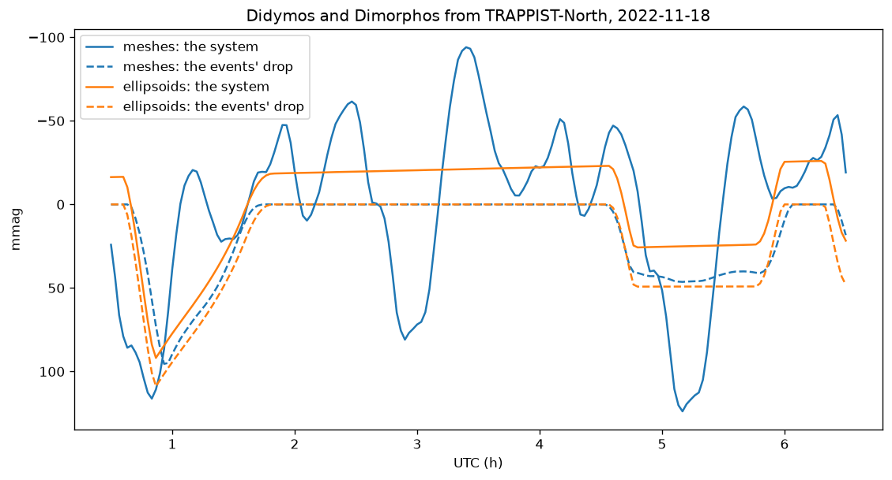

# The light-curve example: Didymos and Dimorphos from an observatory

21 October 2026. The user, reading `examples/lightcurve`: "Maybe the
lightcurve example could be on Didymos/Dimorphos at a given date from a
given observer point on Earth"; then "Can be good to be able to run
ellipsoid or real mesh to see difference".

It drew one triaxial ellipsoid -- `res/ico3.obj` stretched 1.6 x 1.1 x 1.0
-- under a fixed Sun and observer, through `lightcurve` and `Spin`, and
needed no data. Now `examples/lightcurve/main.py`:

- **The night**: TRAPPIST-North, 2022-11-18, 00:30 to 06:30 UTC every 2
  minutes, phase 60.6 deg -- a night of Eli's campaign
  (`2026-10-15_didymos_lightcurves/`).
- **The geometry** as Eli's `lc.py` places it: DART's kernels (s205, s542,
  DE430), the site by `spkcpo` with converged light time, each body at the
  time its light left. Didymos at its true period from the kernel's phase
  at the impact; not the campaign's rotation offsets (8 to 50 deg,
  `phase_fix`), which come from Eli's photometry, not from DART.
- **The light**: `flux` for the system and for each body apart, Buratti et
  al.'s Hapke law; SPICE on one thread, then `flux` an epoch a thread: 30 s
  for both shape models on the M1 Pro, 8 s for the spheroids alone.
- **The shapes**: DART's PDS models (Didymos v003 at 9.3 m, Dimorphos v004
  at 1.94 m, 49,152 facets each; 0.28 s an epoch for the system, 0.23 s
  for the two apart), or Scheirich et al. (2024)'s spheroids from
  `res/ico5.obj` under the same law. The files used are the copies in
  `/Users/gregoireh/data/mesh` and `/Users/gregoireh/data/spice/dart`; the
  example's README links the public ones -- NAIF's DART archive, the PDS
  Small Bodies Node -- checked, of the same sizes.

DART's shapes add Didymos's rotation, about 0.1 mag either way at this
phase; the spheroids have none, and show the events and the phase angle's
slow change alone.

## Checked

- **The events**, each pass switched off in turn (`shadowing=False` leaves
  the occultations, `visibility=False` the shadows), every minute:

  | | DART's shapes | spheroids |
  |---|---|---|
  | Dimorphos's shadow on Didymos | 00:40 to 01:41, 97.4 mmag at 00:57 | 00:37 to 01:46, 108.8 at 00:52 |
  | Dimorphos hidden | 04:34 to 06:02, 46.4 at 05:10, all its light | 04:36 to 05:58, 49.2, all its light |
  | Didymos's shadow on Dimorphos | from 06:26 | from 06:20 |

- **Against 15 October**: Dimorphos hidden from 04:32 to 05:59 there, and
  from 04:33 to 05:57 in Scheirich et al.'s table, from Earth's centre.
- **Against Eli's run of the night**
  (`out/didymos_eli/nights/2022-11-18_TN.csv`): her spheroids' shadow
  0.1010 at 00:51 and 0.0991 at 00:53, the example's 0.1067 at both. Hers
  were under Lommel-Seeliger, as Scheirich et al.'s are: under it the
  example gives 0.1015 and 0.0994. Her spheroids of rings (3,968 and 1,520
  facets) in the example's geometry come within 0.6 mmag of `ico5`'s: the
  law is the difference, 8 mmag at 60 deg of phase. Her DART curve, turned
  by the campaign's offsets, has the shadow 0.103 deep: where it falls on
  DART's Didymos changes with its turning.
- **The spheroids' slow change outside the events**, 7 mmag over four
  hours: the phase angle, 60.57 to 60.39 deg, at Hapke's 0.04 mag a degree.

## Open

`lightcurve` and `Spin`, the single rotating body, have no example now;
`docs/API.md` keeps the stretched `ico3` as their snippet.
