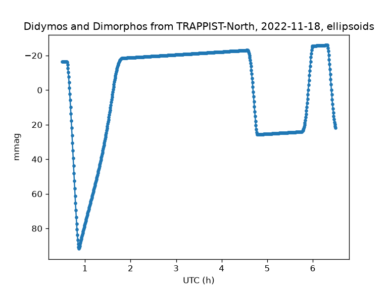
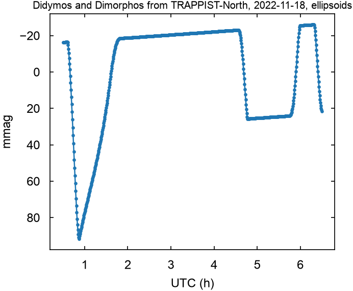
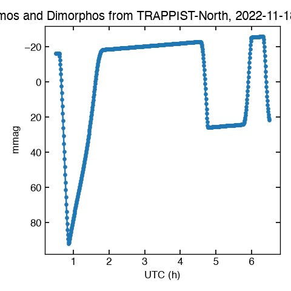
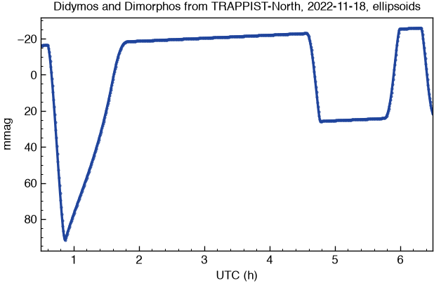
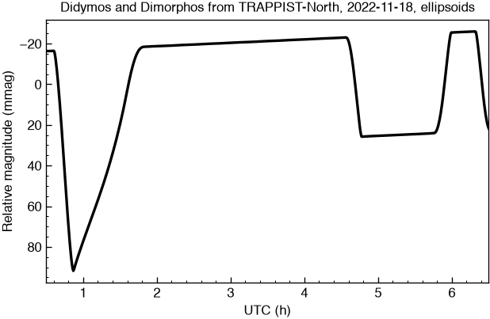
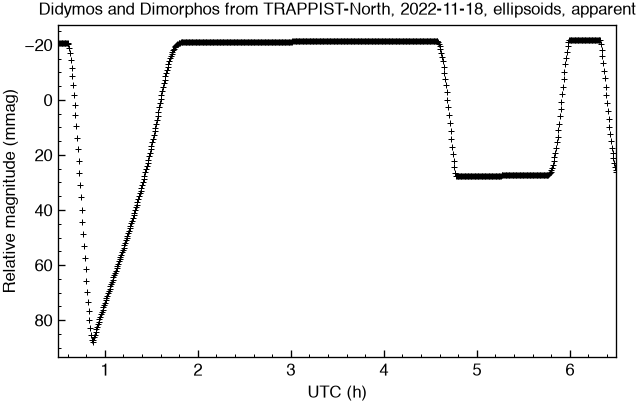
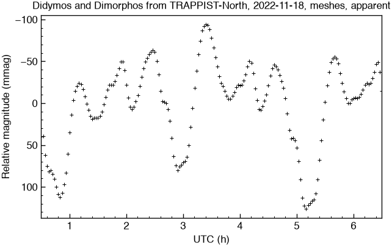

# The light-curve plot: upside down every other run, its rise, a style

22 October 2026. The user, of `examples/lightcurve_didymos/scene_lightcurve.py`
run again in the UI app: "every two runs the graph is upside down ... has it
anything to do with invert behind somewhat persistent between runs?
re-running should reset every variables like a fresh first run", and "plot
colors change everytime so i suspect this is the problem". Then: "why the
curve is increasing over time?", and `kalast.plot`'s two styles against
none, "maybe you can create a new style to match petr pravec or schreirich
lightcurve graph style plot".

## Upside down every other run

The UI app runs a script in a namespace of its own each time
(`kalast/editor.py`, `run_toplevel` for the `kalast` program, `make_runner`
for `python -m kalast`), but in one interpreter: the modules a script
imports stay loaded, and pyplot's figure stayed current with them. The
example's `plt.plot` drew on the last run's axes, in the cycle's next
colour, and `invert_yaxis()` flips whatever the axis is. The same script
four times through `run_toplevel`:

| run | curves on the axes | brighter up | colour of the last |
|---|---|---|---|
| 1 | 1 | yes | C0, blue |
| 2 | 2 | no | C1, orange |
| 3 | 3 | yes | C2, green |
| 4 | 4 | no | C3, red -- the user's screenshot |

The curves were the same each run, so only the last showed.

**The fix**, `_fresh_matplotlib()` in `kalast/editor.py`, at the start of
both runners: `plt.close("all")` if pyplot is loaded, and
`matplotlib.rc_file_defaults()` -- the settings as matplotlib read them at
start, which leaves the backend as it is, `agg` in the UI app. A style one
run chose no longer carries into the next. Other libraries' state still
does, as in any interpreter that keeps its modules -- SPICE's kernels,
unless the script clears them (`docs/API.md`, *The editor*).

`tests/test_rerun_matplotlib.py`: three runs through each runner, each with
one figure, one curve, the axis turned, the first colour, a linewidth the
last run set gone, the backend `agg`. 18 failures without the fix.

## Why the curve rises

Between the events the system brightens by 1.68 mmag/h. Nothing in the
bodies does it, since each alone rises the same way. It is the phase angle:

| over the night, 00:30 to 06:30 UTC | |
|---|---|
| phase angle | 60.627 to 60.376 deg, -0.042 deg/h |
| a unit sphere, the same law | -9.74 mmag; -1.63 mmag/h between 2.0 and 4.5 h |
| Didymos alone, the spheroid | -10.05 mmag; -1.68 mmag/h |
| Dimorphos alone | -9.74 mmag; -1.68 mmag/h |
| the system between events | -1.68 mmag/h |
| the law's phase curve there | 38.7 mmag per degree |
| Didymos's aspect | sub-observer latitude 4.97 to 5.10 deg, sub-solar 3.01 to 3.07: about the spheroid's 0.3 mmag more than the sphere |
| distance from the observatory, from the Sun | 0.14693 to 0.14742 au, 1.05244 to 1.05314 au |

`flux` takes directions, not distances, so the curve is at unit distances
already. The observatory would have seen the system 8.8 mmag fainter by the
end of the night for the distances, nearly all the phase's 9.7 taken back.

Pravec et al. (2022) reduce their data "to unit geo- and heliocentric
distances and a consistent solar phase, e.g., using the H-G phase
relation", G = 0.20, then subtract the primary's rotational light curve,
fitted as a Fourier series outside the events (the decomposition Scheirich
et al. 2024 use too). Their orbital light curves are flat between events;
ours is not reduced to a fixed phase.

Measured with a copy of `lightcurve.py` in scratch, the four fluxes and the
geometry every 120 s.

## Styles

The example's plot, line for line, under each style
(`matplotlib.style.context`), the ellipsoids' night at 30 s steps, as
`scene_lightcurve.py` makes it:

| | |
|---|---|
|  | none: matplotlib's defaults, what the example draws |
|  | `paper`: Arial, x-large labels, ticks inside on four sides, 6 x 5 in |
|  | `style1`: Helvetica, 4 x 4 in -- the title is cut, the figure narrower than it and saved without a tight box |
|  | `lightcurve`, new |
|  | `lightcurve`, the curve drawn `"k-"`, as Scheirich et al. draw a model |

**`kalast/plot/lightcurve.mplstyle`** follows Scheirich et al. (2024,
PSJ 5:17, arXiv:2403.02804), Figure 5, whose 2022-11-18.4 row is this
night's:
- Helvetica;
- a frame of 0.8 pt;
- ticks inside, on the left and bottom only, with minor ticks between;
- the observations as open circles in their blue, `#1f449c`, and their
  red, `#f05039`, read from the figure's pixels, alternating as their
  nights do;
- the model a thick black line;
- the curve meeting the frame at both ends, `axes.xmargin: 0`.

The fonts are named through `font.sans-serif` under the generic
`sans-serif`, so where Helvetica is missing Arial is taken without a word.
Named in `font.family` instead, as `paper` and `style1` do theirs, a missing
family warns at every draw.

A style cannot turn an axis over, nor tell a model from data: brighter up
stays the script's `invert_yaxis()`, and the black line its `"k-"`.

## Apparent or reduced, a cross a point

The user, of the measurements that would have been almost flat: "then it
should show flat"; of the fixed phase: "it would be better to include it as
option no?"; and "show lightcurve without line connecting and with +
symbol, using black lightcurve style version".

`lightcurve.py` and `scene_lightcurve.py` have `MAGNITUDES` at their top,
beside `SHAPES`:
- `apparent`, the default: each epoch's flux over `(r * delta)**2`, the
  system's distances from the Sun and the site;
- `reduced`: over a sphere's flux under the same law at the same Sun and
  site, the law's own phase curve -- unit distances and one phase angle.
  Pravec et al. (2022) reduce with H-G, G = 0.20, which falls 29.1 mmag a
  degree at 60 deg against the law's 38.7: over this night 7.3 mmag
  against 9.7, so reduced by it the curve would keep 2.4 mmag of the phase.

Both plot with `kalast.plot.style.load("lightcurve")`, `"k+"`, "Relative
magnitude (mmag)". Between the events, 2.0 to 4.5 h, the spheroids:

| | mmag/h |
|---|---|
| unit distances, the night's phase angle, before | -1.68 |
| `apparent` | -0.24 |
| `reduced` | -0.05 |

| | |
|---|---|
|  | `scene_lightcurve.py`, spheroids, `apparent`: a point every 30 s |
|  | the same, `reduced` |
|  | `lightcurve.py`, DART's shapes, `apparent`: every 2 min, Didymos's rotation in it |
|  | the same, `reduced` |

`examples/lightcurve_didymos/README.md` now shows `didymos_2022-11-18.png`,
yesterday's figure drawn again: both shapes, `apparent`, each system with
its events' drop in the new style. The drops are unchanged, since they are
ratios at one epoch: 0.095 and 0.109 mag for the shadow, 0.040 to 0.046
and 0.049 for Dimorphos hidden.

**A Mesh stays on its thread.** `scene_lightcurve.py`'s pool first ran a
function that read `mesh.indices` on its worker threads:
"kalast::py::mesh::Mesh is unsendable, but sent to another thread", a
panic. The script now takes the arrays once, before the night, which also
saves copying them each frame. `docs/API.md` says so beside the threads.

Run each way from copies in scratch, the plot redirected:
- `lightcurve.py`: 34 s with the spheroids, 91 s with DART's shapes;
- `scene_lightcurve.py`: 25 to 26 s with the spheroids.

## Open

- The primary's rotation, which Pravec and Scheirich subtract from their
  data before the events are fitted, is still in the reduced curve with
  DART's shapes.
