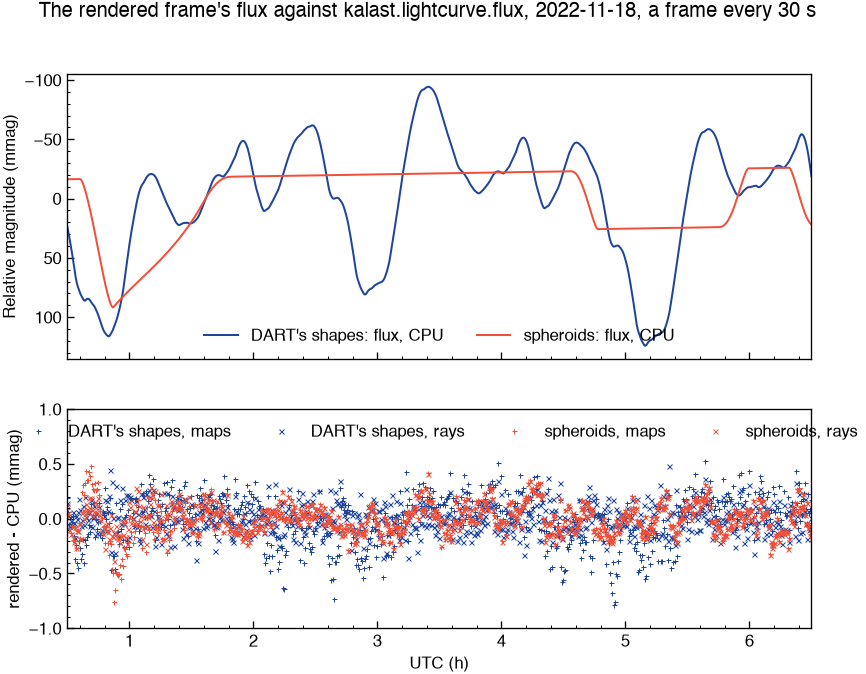
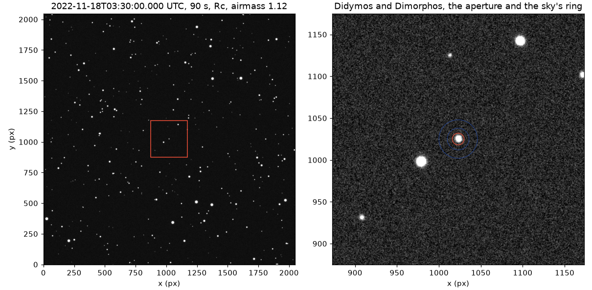
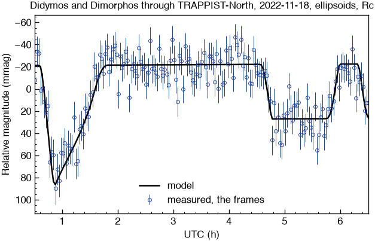
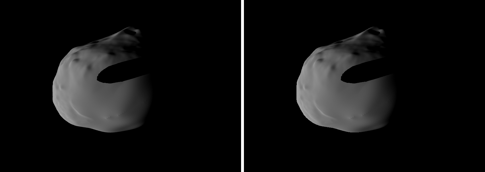

# Photometry: the rendered frame's light, and a telescope's frames of the night

23 October 2026. The user, of `scene_lightcurve.py` computing `flux` on a
thread pool beside the renderer: "Wouldnt it be better to have lightcurve
flux use the result rendered scene and not recompute shadows? This would
also avoir to have threadpoolexecutor and not slow down the rendering, and
it's one source of truth/trust." Then: "both methods shoudl give same
results". And: "I would like to also have an option to create output image
just like a telescope would and have a photometry routine processing it to
create ligthcurve similar to how you would work on telescope images" -- a
realistic night, "but every effects as option", the frames as FITS files.

## Progress

- [x] The telescope's core in Rust, `src/telescope/`: noise, FITS, the
      sky's projection, the PSF, aperture photometry, a frame (25 tests).
- [x] The orthographic camera's view direction: its axis.
- [x] A photometry pass: the rendered frame's flux, summed on the GPU, read
      back by iteration (`tests/test_photometry.py`, 11 checks).
- [x] The rendered flux against `flux` over the night, shadow maps and rays:
      0.13 to 0.23 mmag rms.
- [x] `scene_lightcurve.py` on the rendered flux, no thread pool.
- [x] The field's stars from Gaia, cached, in Cousins R.
- [x] `kalast.telescope` in Python (`tests/test_telescope.py`).
- [x] `examples/lightcurve_didymos/telescope.py`: the night as FITS frames,
      their photometry, its light curve.
- [x] Docs, changelog, timeline; the bundle with the last commit.

## Two questions first

**Apparent against reduced, little difference: expected.** This night the
phase angle closing brightens the system 9.7 mmag and its distances
growing dim it 8.8; the two curves part by 0.9 mmag over six hours, against
events of 50 to 110. Across a campaign of weeks they part by tenths of a
magnitude, which is why Pravec et al. reduce.

**The spheroid's curve is flat because it turns about its own axis of
symmetry.** It turns -- the same rotation as DART's shape, DART's frame
times the period's correction -- but `EXTENTS` gives Didymos two equal
radii about its spin axis, 0.4053 and 0.4053 km, so neither its outline nor
its lit part changes as it turns. A rotational light curve needs the two to
differ, or the real shape.

## The rendered flux

A survey of the renderer (a read-only agent, file and line cited) found:

- **The shading's law is the CPU's.** `mesh_shadow.wgsl`'s Hapke follows
  `scattering.rs` term for term: H 2002, Henyey-Greenstein, the surge, the
  roughness with porosity. The shader clamps `mu` at 1e-4 where the CPU
  gives 0, and runs in `f32` under Metal's fast maths.
- **The image cannot be summed as it is.** It is stored in 8-bit sRGB, and
  its multisampling is resolved from already-rounded samples. Floats exist
  only in the fragment, or on the float path (stretch, response or
  reference on), which turns multisampling off.
- **Large meshes are drawn by level-of-detail cuts**, 16,384 facets and up,
  their outlines simplified to the image's pixels.
- **Smooth meshes shade with interpolated normals.** `flux` uses each
  facet's own, so the two differ.
- **The orthographic camera shades toward the eye's position.** At
  `scene_lightcurve.py`'s 20 km, the direction to the camera tilts by up to
  0.02 rad across Didymos and 0.06 across Dimorphos: about 1 % in the
  image's shading, which is an observer 0.147 au away.
- **Rays are exact.** `shadows.method = "rays"` with a point Sun is one ray
  a pixel against the full meshes, and it runs on Metal (macOS 15 and up,
  `2026-10-12_ray_tracing_on_metal/`). Checked here: `sim.rays` is `True`
  on this Mac.
- **A pixel's area** under the orthographic camera is (2 side / height)²
  in the scene's units squared.

So the flux comes from a photometry pass, not the image. It runs in the
same frame, on the same poses and shadows, using the same shader's law.
- **What it draws:** the bodies again, into a float target, each facet
  with its own normal and the full meshes, seen along the camera's axis.
- **What it writes:** the law times the shadow, and nothing of the
  image's: no ambient light, exposure, colour, wireframe or 8-bit rounding.
- **How it gets back:** summed on the GPU and read back without waiting,
  tagged with its iteration.

`flux` stays the exact reference: the two must agree.

### Built

- **The orthographic view.** `Globals` gains the camera's axis and an
  orthographic flag, appended at 128 bytes so every shader's shorter copy
  still binds. `view_dir_at` gives the axis for an orthographic camera and
  the direction toward the eye otherwise; `eye_for` starts an orthographic
  pixel's rays back along the axis.
- **One shader, built twice.** `override PHOTOMETRY: bool = false` in
  `mesh_shadow.wgsl`, set only by `gpu::RenderPipeline::photometric`, where
  the compiler folds it away in every other pipeline. With it:
  - `fs_main` takes a smooth mesh's facet normal from the plane of its
    pixels (`cross(dpdx, dpdy)`, turned toward the viewer) and draws no
    wireframe;
  - `fs_shaded` skips the colour modes and returns the law times the shadow
    the moment both are known;
  - `surface` ignores the level of detail's facet table, as the meshes are
    drawn whole (`MeshBuffer::render_full`).
- **The pass**, `src/app/photometry.rs`.
  - It draws into an R32Float target at the image's size, single-sampled,
    with its own depth buffer and the main pass's bind groups (penumbra at
    6, rays at 7). It runs after the image, in the frame's encoder.
  - `shaders/photometry.wgsl` sums 16 x 16 tiles pairwise in f32, the tile
    beside what of it lies on the frame's edge; the CPU adds the tiles in
    f64.
  - Four readback slots, each tagged with its iteration and the pixel's
    area, `(2 side / height)^2`. They are mapped after the submit and
    collected without waiting.
  - Only frames that advance are measured: one flux an iteration.
  - A measured frame is never drawn in bands.
  - A perspective camera is refused, said once.
- **The API.** `config.photometry.enabled` (generated panel row, under
  Image); `sim.fluxes()`, `(iteration, flux, clipped)` since the last call;
  `sim.fluxes_pending`. From Rust: `Simulation::take_fluxes`.

### Against `flux`

`tests/test_photometry.py`, a rough Hapke sphere smooth-shaded in the
image, against the CPU:

| | rendered over CPU, less one |
|---|---|
| 5 deg of phase | +4.8e-5 |
| 40 deg | +8.4e-5 |
| 75 deg | +1.6e-4 |
| a moon before it, its shadow on it (106 mmag), shadow maps | +7.7e-5 |
| the same, rays | +5.9e-5 |

The rest of that test's checks:
- each iteration that advanced has its flux, once;
- none while paused;
- a body the frame cuts is flagged;
- a perspective camera is not measured.

**The night of 2022-11-18**, a frame every 30 s, 721 frames at 2116 x 1376
pixels (1.7 m a pixel), every frame measured and none cut. Light curves
about their means, rendered less CPU:

| | shadow maps | rays |
|---|---|---|
| spheroids | 0.152 mmag rms, max 0.76; flux ratio 1.000003 | 0.128 rms, max 0.41; 0.999988 |
| DART's shapes, 49,152 facets | 0.228 rms, max 0.79; 1.000129 | 0.135 rms, max 0.48; 1.000011 |

Noise of a few tenths of a mmag: each pixel deciding at a limb or a
shadow's edge. With the maps it is slightly larger, and the spheroids dip
0.5 mmag in the eclipse at 00:52, where the maps' texels lie along the
shadow's edge.

**`scene_lightcurve.py` on it**, the rendered flux taken by iteration:
- the spheroids: 721 frames in 24.3 s;
- DART's shapes at their finest, 3,145,728 facets each, every frame drawn
  whole for photometry: 24.7 s.

Both held their 30 frames a second, every frame measured. The plot comes as
the night ends. On the CPU's 49,152-facet copies it came 39 s later, and
took the drawing's threads.

## The telescope

`src/telescope/`, engine-side, every effect switched by `Effects`, all on
by default.

TRAPPIST-North's published specification (trappist.uliege.be):
- a 0.60 m Ritchey-Chrétien at F/8;
- an Andor iKon-L BEX2-DD on an e2v CCD42-40, 2048 x 2048 pixels of
  13.5 µm, 0.60" each;
- a gain of 1.1 e-/ADU, a read noise of 7 e- at 1 MHz;
- a dark current of 0.15 e-/s, a full well of 100,000 e-.

Assumed, as nothing is published:
- the obstruction, 0.35;
- the throughput, 0.60;
- the bias, 1000 ADU;
- a dark night at Oukaïmeden in Rc: 2" seeing, Moffat's beta 3,
  20.5 mag a square arcsecond, 0.10 mag an airmass.

The bands:
- the Sun's magnitudes, Willmer (2018), Vega: B -26.13, V -26.76,
  Rc -27.15, Ic -27.47;
- photons of a magnitude-zero star, Bessell, Castelli & Plez (1998) at
  the effective wavelength, times the band's width.

The comparison stars come from Gaia DR3's G and BP-RP, put into Cousins R
by Riello et al. (2021)'s Table C.2: `G - R = -0.02275 + 0.3961 x -
0.1243 x^2 - 0.01396 x^3 + 0.003775 x^4`, `x = BP - RP`, valid from 0 to
4, scatter 0.032 mag.

The night, from SPICE (`scratchpad`, not kept):
- **The track:** the system at RA 8h18.3m, Dec +15.18 to +15.30 deg,
  moving 1.16 to 1.29" a minute -- 2.4" in a 120 s exposure, 4 pixels.
  One field, 7' of track in a 20' frame.
- **The airmass:** 2.27 at 00:30, 1.04 at 05:00. Extinction would brighten
  the raw curve by about 0.12 mag; the comparison stars take it out.

What `src/telescope/` has, each tested (25 tests):

| | |
|---|---|
| `noise.rs` | xoshiro256++ seeded by SplitMix64, kalast's own so a seed gives the same frames in every version; Marsaglia's normal; Poisson exact, inversion under 10 and Hörmann's PTRS above |
| `fits.rs` | one image, written as unsigned 16-bit counts or floats; read from any `BITPIX`, `BZERO` and `BSCALE` applied, so real frames read too |
| `wcs.rs` | the gnomonic projection, `RA---TAN`, north up and east left, its header cards |
| `psf.rs` | Moffat's profile integrated over each pixel, 5 x 5, out to where a pixel gets 0.01 e-; along a trail too |
| `photometry.rs` | the centroid; the aperture's pixels weighted by the disc's exact area in each; the sky a clipped mean, since a median of whole counts can be off by half a count a pixel; the CCD equation; the zero point clipped about the median by the median absolute deviation, a variable star set aside, with its error from frame to frame kept apart from the catalogue's scatter |
| `mod.rs` | `Telescope`, `Band`, `Sky`, `Effects`, `expose`: a frame in ADU with its header and WCS; the airmass (Kasten & Young 1989); scintillation (Young 1967) |

The aperture's area was first sampled 7 x 7 at its edge: 0.09 px² off,
changing as the target crosses pixels from frame to frame -- about 0.5
mmag of sky. It is now exact (1e-9).

### The rest of it

- **`gaia.rs`.** A cone of `gaiadr3.gaia_source` asked of ESA's archive
  (TAP, synchronous, CSV, through `ureq`), its answer kept in a file. Each
  star:
  - is carried from 2016.0 by its proper motion;
  - gets its magnitude in V, Rc or Ic by Riello et al.'s Table C.2, inside
    each polynomial's range of colour;
  - without a colour, is drawn at a typical `G - band` but is no
    comparison star.

  1,006 stars to G = 19 within 0.3 deg of the night's track, 995 with a
  colour, in 0.5 s.
- **`reduce`.** The target, at its ephemeris's place, is centred and
  measured. Comparison stars are kept when they are:
  - inside the frame, ring included, and two rings from the target;
  - alone: no catalogue star within their ring brighter than theirs plus
    2.5 mag;
  - under 95 % of saturation, and measured to 1 %.

  The zero point comes from them, the target's magnitude from it.
- **Python, `kalast.telescope`.**
  - The engine's structs are the classes, each with keyword defaults.
  - A `Frame` carries `data` (numpy, astropy's rows), `header` (a dict)
    and `write`.
  - The functions are `expose` (Python's lock let go), `read`, `reduce`,
    `gaia`, `airmass` and `julian_date`.
  - The stub is generated from `mod.rs`, `photometry.rs` and `py.rs`
    together.

**The night**, `telescope.py` copied to scratch with its outputs there:
- 181 exposures of 90 s every 2 minutes, in Rc;
- the telescope pointed at the track's middle all night, so every frame
  has the same comparison stars;
- the target's magnitude from `flux` (the spheroids) at its distances;
- all 181 frames reduced, about 119 comparison stars each;
- 12.7 mmag a frame, the measured curve 12.7 mmag rms about the model: the
  errors say what the scatter is;
- 134 s, 1.4 GB of frames.

The measured curve sits 3.8 mmag fainter than the model. The target trails
2" in 90 s against tracked stars, so a 7-pixel aperture loses a little more
of its light than of theirs. At 4 pixels, in a first trial at 120 s, the
loss was 36 mmag.

`tests/test_telescope.py`:
- a frame written as FITS comes back as it was;
- reduced at airmass 1 and 2, the target's magnitude is its own within its
  errors, mean pulls -0.30 and -0.21 over 12 frames;
- with the effects off, the target's electrons alone, 8e-5 off.

`tests/test_stubs.py` covers the new classes, the three config groups
missing from it included (`response`, `stretch`, `photometry`). Its six
`kalast.shape` classes were already uncovered before today, and still are.

## One draw, one output

The user, of the second draw: "why drawing the scene a second times? ... if it is same poses, same
shadows, same scattering light, and same orthographic camera?", then, of the two-output design I
suggested: "can't it be one draw and one output and the rendering pipeline being the good one
required for lightcurve rendering? keeping the fast scene draw we current have when not doing
photometry".

So it is. With `photometry.enabled`:
- the frame's bodies are drawn once, by the photometric build of the
  shader, into the R32Float image (`Photometry::draw`), over the window's
  depth;
- that image is the frame. `Photometry::show` writes what the main pass
  would store -- the light's colour times the exposure times the I/F,
  through `srgb_to_linear` in "linear" mode, the background where the image
  holds -1 -- into the window's image, or into the response's or stretch's
  float frame, which carry on from there;
- the overlays are drawn over it, as on any float frame (`finish_float`);
- each frame that advances is summed and copied (`Photometry::measure`).

Photometry counts among the float path's switches, so the passes are
single-sampled. A reference image takes precedence: nothing is measured
while one is summed. Traced frames are never drawn in bands while
photometry is on. Off, nothing changed: levels of detail, multisampling,
smooth normals, 8 bits.

The show pass's uniform was 64 bytes in WGSL against 48 in Rust at first:
a `vec3` of padding aligns to 16. Three floats now.

The night against `flux`, again: the same numbers to the last digit, as
they must be -- the same shading, the same pixels.

Uncapped, 721 frames (the user took the rate limit out of
`scene_lightcurve.py`):

| | photometry on, one draw | off |
|---|---|---|
| spheroids | 1.1 s | 1.0 s |
| DART's finest shapes, 3.1M facets each | 3.7 s, 5.1 ms a frame | 2.8 s, 3.9 ms by levels of detail |

The second draw cost both, about 9 ms a frame with the finest shapes.

## Rc magnitudes

`lightcurve.py` and `scene_lightcurve.py` plot Cousins R magnitudes,
`Band("Rc").magnitude`, as `telescope.py`'s:
- apparent, Rc 16.71 to 16.82 that night;
- reduced to 1 au and the night's mean phase angle, 20.76 to 20.86.

The level is some 0.7 mag fainter than Didymos was, from the albedo
Buratti et al.'s law gives.

## Open

- `kalast.shape`'s six classes uncovered in `tests/test_stubs.py`, from
  before today.
- The primary's rotation subtracted, as Pravec and Scheirich do, for the
  reduced curve with DART's shapes.
- The model's level: Buratti et al.'s Hapke parameters leave the system
  0.6-0.8 mag fainter than H = 18.16 (`2026-10-15_didymos_lightcurves/`),
  so the frames' noise is that much higher than TRAPPIST's.
