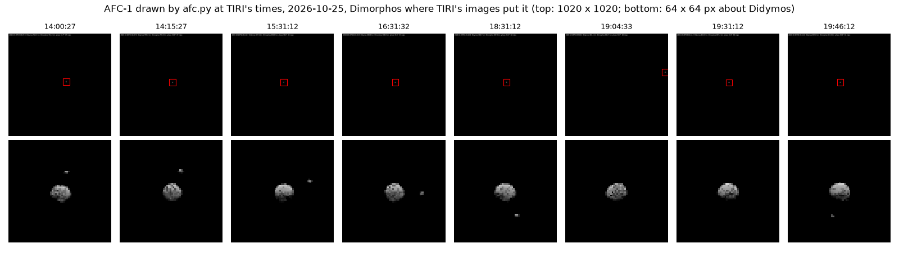
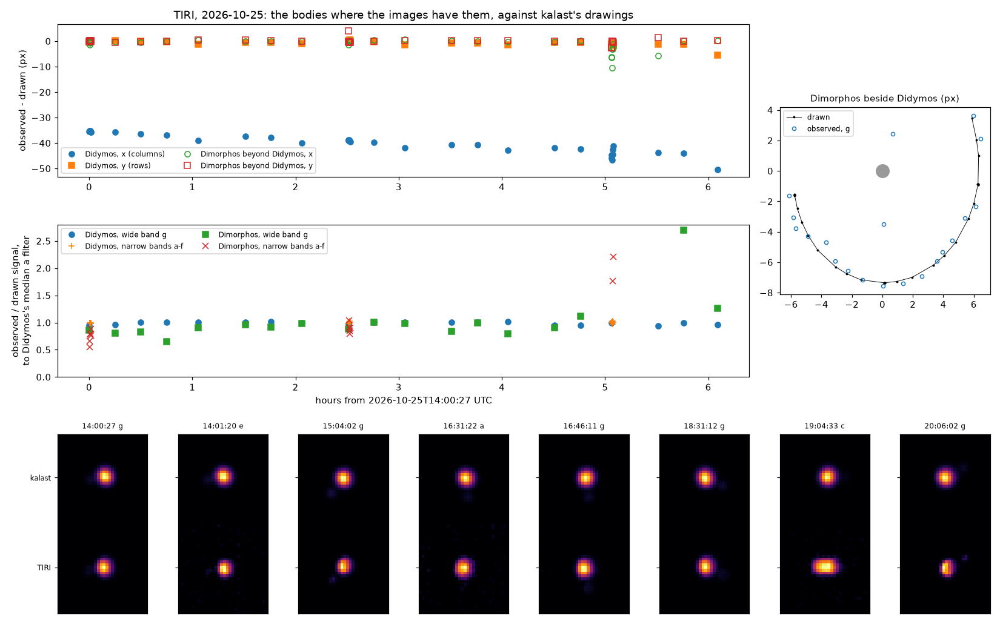
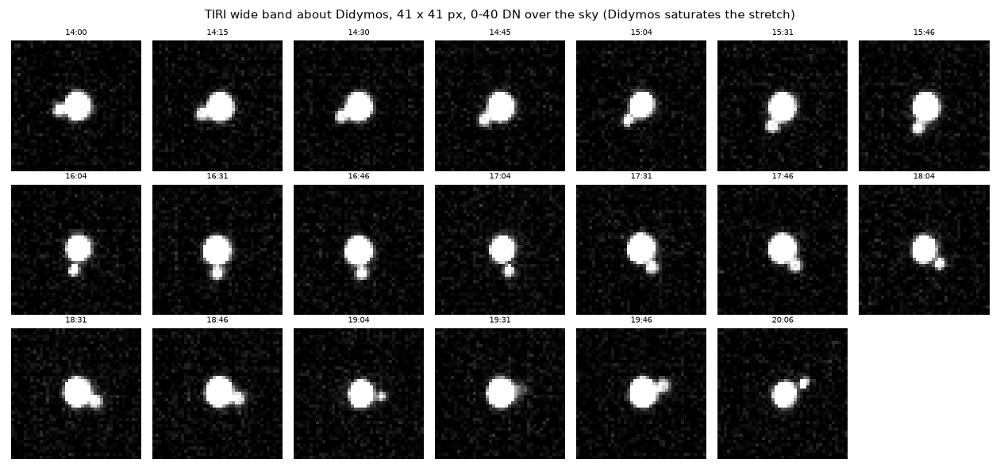
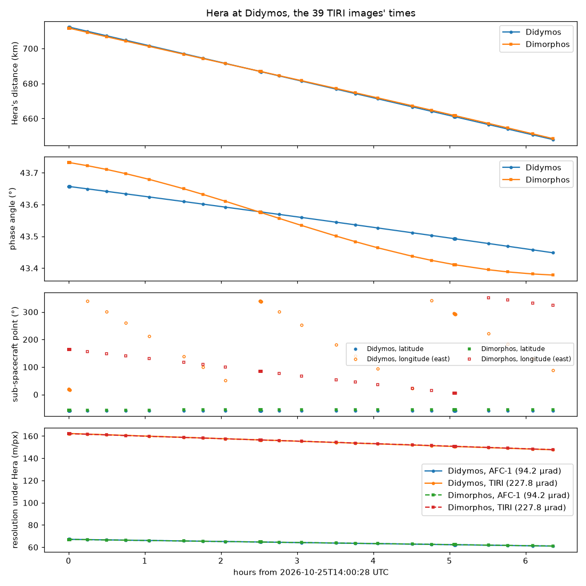
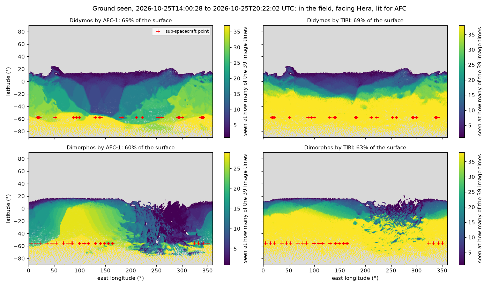

# 2026-10-27 — Hera at Didymos: AFC and TIRI at TIRI's first images

The user asked for the TIRI images of 25 October, decoded the day before in
`~/projects/edds_decoder`, to be simulated in `examples/hera_didymos`: AFC's
visible view first, then TIRI's. They also asked for graphs of Hera's
distance to the asteroids, the phase angle, the sub-spacecraft points, the
resolution, and a map of the ground in AFC's and TIRI's fields. Then they
asked for the Hera kernels to be replaced with ESA's latest. Later the same
day: Dimorphos's orbit corrected to match the images, TIRI's PSF on the
drawing, and Dimorphos's sub-spacecraft information beside Didymos's.

## Progress

- [x] Hera kernels replaced with ESA's newest (v182, 26 October)
- [x] `afc.py`: AFC at the images' times
- [x] `tiri.py`: the thermophysical model and TIRI's images drawn, set beside the observed ones
- [x] `coverage.py`: the geometry and the ground each instrument saw
- [x] `examples/hera_didymos/README.md`
- [x] Dimorphos's orbit: Dimorphos 3.80 h ahead of the ephemeris, corrected in all three scripts
- [x] TIRI's PSF on the drawing, fitted on the images
- [x] Dimorphos's phase angle and resolution in `geometry.png`
- [ ] Rerun on the images of 25 October 20:47 to 27 October, once the user has downloaded and decoded them

## The kernels

The dataset zip linked from ESA's Hera SPICE page:
<https://spiftp.esac.esa.int/data/SPICE/HERA/misc/skd/HERA.zip>, 1,097,484,283
bytes, dated 26 October 17:07 GMT. Its meta-kernels are
`hera_{ops,plan}_v182_20261026_002`.

Against the user's set of 20 October, 11 files are new and 11 were dropped:
- the measured attitude to 26 October (`hera_s{c,a}_meas_261001_261026_s261023_v01.bc`);
- the SCLK `hera_step_261023_v01.tsc`;
- Hera's trajectory and default attitude `fcp_000102`, and `cog_000103`;
- the Earth's orientation to 25 October;
- the meta-kernels.

No file in the old set was the user's own. The only local change was each of
the 8 meta-kernels' `PATH_VALUES` set to `/Users/gregoireh/data/spice/hera/kernels`,
and that is made again in the new ones. The old set was moved, not deleted,
to `~/data/spice/hera_v182_20261020` (325 files, 1.9 GB). No process had it
open. The user then had it deleted, the same day.

The new trajectory moves Hera against Didymos, whose ephemeris
(`didymos_flp_000007`) did not change. Seen from Hera (`hera_plan.tm`):

| UTC | | distance | phase | sub-spacecraft point |
|---|---|---|---|---|
| 25 Oct 14:00:27.5 | old kernels | 721.2 km | 40.66° | −55.04°, 15.27° E |
| | new | 712.4 km | 43.66° | −58.22°, 19.78° E |
| 25 Oct 20:47:01 | old | 651.4 km | 40.45° | |
| | new | 643.8 km | 43.43° | |

The old values are edds_decoder's (its movies' captions and
`tiri_asteroid_frames.csv`); those need making again with the new kernels.

The plan's attitude alone puts Didymos 2.9° and −2.8° off TIRI's boresight.
With the measured attitude loaded over it (`hera_ops.tm` after
`hera_plan.tm`, which alone holds Didymos), Didymos is within 0.27° of the
boresight at 14:00:27 and within 0.002° from 14:15. The three scripts load
both.

## AFC: `afc.py`

- The 39 times with the shutter open, 14:00:28 to 20:22:02, from the
  products' `DATE-OBS` (`SPI_TIME` without one).
- The field and the pixels come from AFC's IK: 5.5°, 1020 × 1020.
- Bodies under Buratti et al. (2024)'s Hapke law; the light linear, exposure 20.

Didymos is in 32 frames, about 12 px across (67 to 61 m/px), with Dimorphos
2–3 px beside it:
- 26 near AFC's centre, (522, 484);
- 6 at the field's edge, x ≈ 995, during the 19:04 slew.

It is out of the field in the other 7: the xx:04 pointing from 15:04 to
18:04, and 20:06 and 20:22. TIRI's wider field has it at 15:04–19:04 and at
20:06, as edds_decoder's note found in its images.

## TIRI: `tiri.py`

The model:
- each facet's column graded with depth (`core.Ground.graded`): 15 layers to
  the depth of a day's wave, the top ones 1/8 of its skin depth;
- dt 20.2 s, 3 days from the effective temperatures before the first image;
- shadows from the frames;
- the properties `kalast.tpm.properties.DIDYMOS`/`DIMORPHOS` (TI 320, A 0.07,
  ε 0.9) and TIRI's `response.csv`.

Each image is drawn at 4096 × 3072 and averaged to 1024 × 768, cut as the
products are (6 blind columns), in the products' rows and columns
(+Y up, `kalast/tiri_alignment.py`). The 39 images take 147 s on the M1 Pro.

Didymos is measured in 38 images: the centroid of the 3×3-median peak over
the sky, 25 to 359σ. At 20:22 it is not in the field.

| | observed − drawn |
|---|---|
| rows | −0.6 px (median); within 1.5 px, −5 px at 20:06 in the corner |
| columns | −35.3 px at 14:00, drifting to −44 px at 19:46 (median −39.2); −50 px at 20:06 |

- The frames' orientation and scale are right. During the 19:04 slew the
  drawing runs from x 294.6 to 683.2 and the image from 248.8 to 642.5, at
  the same rate.
- The column offset is 0.51° along TIRI's X, 6.2 km at 700 km. Two causes
  are possible:
  - an error in Didymos's ephemeris. `flp_000007` is a pre-arrival
    prediction, and Horizons puts Didymos about 3 % nearer. The drift, 8 px
    while the range fell 9 %, fits a position error better than a fixed
    angle.
  - TIRI's alignment since the Mars fit. Its Y (−0.52°) still holds; its X
    is +0.30°.

  AFC's real images would separate the two: Didymos off their centre by the
  same angle means the ephemeris or the attitude.
- The signal: observed DN against the drawn radiance, each filter scaled
  to its median, stays within ±5 % in the wide band over the 6.4 h. At the
  xx:04 pointing it reads about 4 % higher, a detector position's response.
- One sample per pixel scattered the drawn signal by ±10–15 %. That was the
  sampling of a 5 px Didymos, whose edge pixels were drawn whole or not at
  all. 4 × 4 samples cost nothing: 2.65 ms a frame against 2.49.
- In the first runs the drawing was sharper than the image, with no PSF, and
  Dimorphos was 8–12 px from where TIRI has it. Both are fixed below.

## Dimorphos's orbit and TIRI's PSF

Asked once the user saw Dimorphos's place differ in `tiri.png`, and Didymos
larger and spread in TIRI's images.

On a hard stretch (0–40 DN over the sky) Dimorphos is a blob 6–8 px from
Didymos in every wide-band image, going round it. Each image's bodies are
fitted (`tiri.py`, `fit`):
- each body's drawing, spread by a Gaussian of fitted sigma;
- Didymos moved, Dimorphos moved beyond it;
- each scaled, over the sky;
- two starts for Dimorphos, where it is drawn and where Didymos's fit leaves
  most light, the better kept.

**The orbit.** Dimorphos goes round in the ephemeris's sense and at its rate,
120° ahead. One shift of time along the orbit fits all of it: the ephemeris
(`dimorphos_flp_000007`) has Dimorphos where TIRI sees it **13,689 ± 54 s
(3.80 h, 120.4°) later**.
- 0.25 px rms per axis over the 19 wide-band images off the slew, against
  8.4 px unshifted. One minimum over the whole orbit.
- The narrow bands, not fitted, agree within 0.3–0.9 px. So do the
  projected orbit's size and tilt: only the phase is off.
- `DIMORPHOS_SHIFT` in `afc.py`, `tiri.py` and `coverage.py` applies it:
  Dimorphos's position about Didymos and its rotation (tidally locked) taken
  that much later.
- With it, `tiri.py` finds Dimorphos within 0.6 px of its drawing in the wide
  band, +29 s left (median of 18), and prints what is left, so new images
  re-measure it.

**An eclipse confirms it.** The corrected orbit puts Dimorphos in Didymos's
shadow from about 19:00 to 19:40, 0.28–0.29 km from the shadow's axis
against Didymos's 0.39 km radius. The ephemeris as it was has it on the
Sun's side then (no eclipse until after the images). TIRI sees Dimorphos fade
to less than half its usual signal at 19:31, the one image too faint for the
fit. AFC, drawn with the shift, loses it at 19:04 and 19:31.

**After the eclipse** Dimorphos comes back faster in the images than in the
drawing: at 19:46 its signal is 2.7 times its drawing, against 0.8–1.25 at
other times. The drawing's Dimorphos is still in shadow there, or too cold.
Candidates: the thermal inertia (320 for both), Didymos's shape and rotation
phase where its shadow's edge is, the shadow's penumbra.

**The PSF.** Fitted image by image, sigma is:
- 1.2–1.3 px where Didymos usually sits (column ~440, row ~422);
- 0.7–0.9 px about column 245, row 225 (the xx:04 pointing);
- 0.5 px at 20:06, in the corner.

So the spread changes over the detector. The drawing uses `PSF = 1.3`; the
fit's own sigma goes in `tiri.csv`. In the wide band the residual is 5–7 DN
against 2.4 of noise, so a Gaussian is close but not the whole shape. In the
narrow bands it is down to the noise.

**Dimorphos against Didymos.** Dimorphos's signal against its drawing is 0.8
to 1.25 times Didymos's in the wide band. So the model's Dimorphos and
Didymos are within about 20 % of each other in their thermal emission.

`geometry.png` gives Dimorphos's phase angle (43.73 → 43.38°) and resolution
beside Didymos's. Its sub-spacecraft longitude moved by the shift's 120°, as
a tidally locked moon's does: 164° E at 14:00 rather than 285°.

### A trap: `request_facet_shadow` holds one body

`sim.request_facet_shadow(body)` keeps one body a frame
(`Simulation::facet_shadow_request` is an `Option<usize>`). A second call in
the same frame replaces the first, silently. The first runs asked for
Didymos then Dimorphos, so Didymos had no shadows on every step and fell back
to `facet_incidence`.
`config.shadows.access_shadow_map = True` computes every body every frame,
which is the route `docs/API.md` gives for several bodies. `tiri.py` uses it.
API.md does not say a second request replaces the first.

## Geometry and ground: `coverage.py`

- Hera's distance to Didymos: 712 → 648 km.
- The phase angle: 43.66 → 43.45° at Didymos, 43.73 → 43.38° at Dimorphos.
- The sub-spacecraft latitude: −58° on Didymos, −56° on Dimorphos.
- The resolution under Hera, on either body: AFC 67 → 61 m/px (94.2 µrad),
  TIRI 162 → 148 m/px (227.8 µrad).

How the ground seen is found:
- each body is framed in turn from Hera, at 1024 × 1024, so that its
  100,000 facets are resolved: ~390,000 pixels on the body;
- a facet counts where that frame draws it, inside the instrument's field as
  pointed, and for AFC where it is lit.

At the 39 times:

| | AFC | TIRI |
|---|---|---|
| Didymos | 69 % of the surface | 69 % |
| Dimorphos | 60 % | 63 % |

That is everything south of about +15°. A facet's colour is how many of the
39 image times it was seen at: a count, not a duration. The red crosses are
the sub-spacecraft points, asked for on the maps too. The run takes 5 s.

Tables: `geometry.csv`, `tiri.csv`.

## Open

- The 0.5° column offset: the ephemeris or TIRI's alignment. AFC's images or a
  newer Didymos ephemeris would decide it.
- Dimorphos after its eclipse, 2.7 times its drawing at 19:46: thermal
  inertia, Didymos's shadow, its rotation phase.
- Didymos's rotation phase in `hera_didymos_v06.tpc`, not checked. DART's
  kernel turned it at 2.2600 h against 2.2604 h.
- One PSF for the whole detector, where it changes from 1.3 to 0.5 px.
- No seasonal wave in the model: the columns are a day's deep, started from
  the effective temperatures.
- `request_facet_shadow` holding one body a frame, silently.
- edds_decoder's geometry, made with the old kernels.
