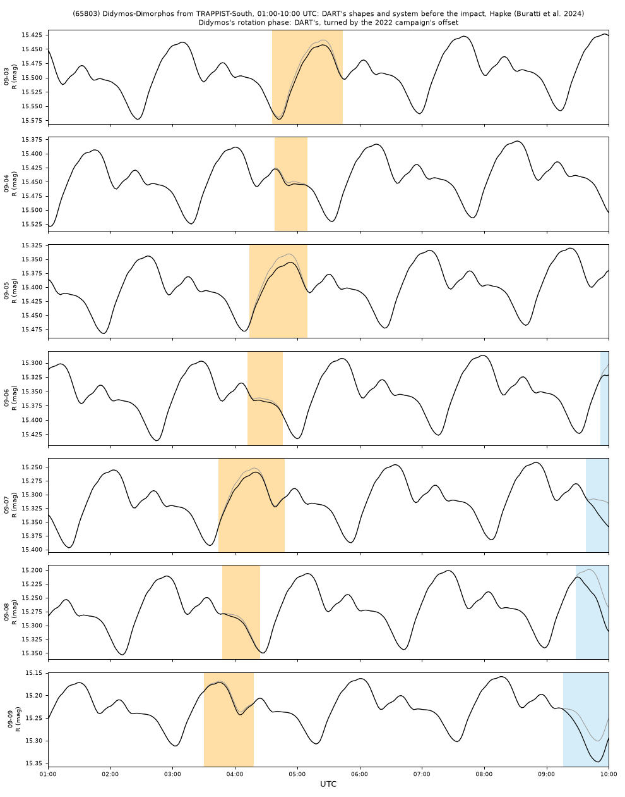
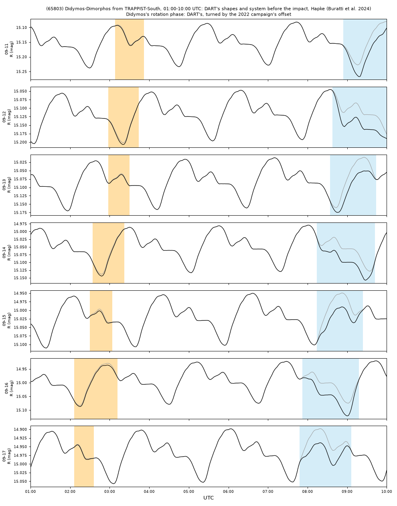
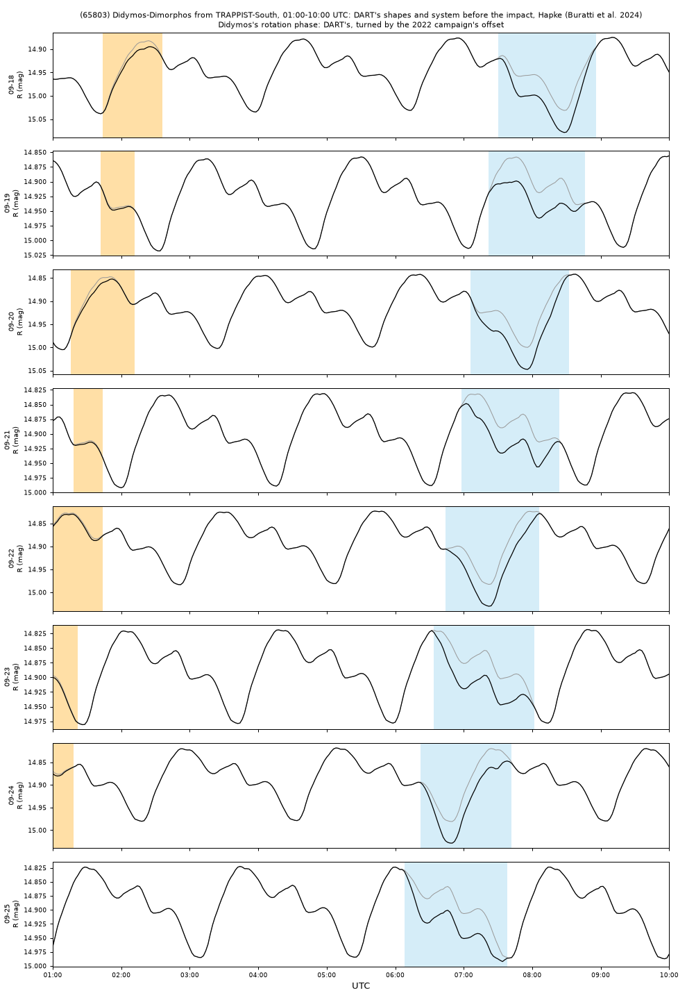

# Didymos from TRAPPIST-South, 3 to 25 September 2022: DART's shapes before the impact

3 November 2026. The user asked, in turn:
- "can you do 03-09 sept 2022 lightcurves? all from 01:00 - 10:00 UT time
  using dart mesh as it is before the impact";
- "remove the text "primary eclipse" and "secondary eclipse" they overlap
  on curves, put them as caption", then "in readme";
- "can you also do the lightcurves for 11.09 - 25.09 same times" and "also
  put the data in csv so i can share it with colleague and they can use
  the values";
- "can you detail more about this in the note?", of the rotation phase
  (*Didymos's rotation phase*, below);
- "can you generate it with and without the offset phase?"

Continued on 5 November over 26 September to 10 October, whole days, across the impact:
`2026-11-05_didymos_impact_days/`.

## The runs

- **The nights**: 3 to 9 and 11 to 25 September 2022, 01:00 to 10:00 UTC
  every 2 minutes, 271 epochs a night, all before the impact (26 September,
  23:14). They are seen from TRAPPIST-South (La Silla): the window is a
  night there, and its September nights for Eli fall in it (4 September,
  01:52 to 09:18). From Earth's centre the curves differ by 1 mmag (below).
- **The shapes**: DART's models as the PDS has them, Didymos v003 and
  Dimorphos v004, 49,152 facets each. Dimorphos's is the shape before the
  impact; there is no shape after it.
- **The system**: DART's, before the impact: solution s542, Dimorphos's
  orbit 11.921 h. Didymos turns at 2.2603891 h.
- **The rotation phase**, in two versions:
  - with the campaign's offset: DART's phase at the true period, corrected
    by the 2022 campaign's offsets, as in all of Eli's files;
  - without it: DART's phase at the true period alone.
  What the offset is, and how weak it is on 3 to 9 September: *Didymos's
  rotation phase*, below.
- **The light**: Buratti et al.'s Hapke law. `kalast.lightcurve.flux` gives
  the system and each body apart, and their ratio is the mutual events'
  drop. Magnitudes are in R as the site saw them.
- **The runs**: `out/didymos_eli/scripts/sept_nights.py` on Eli's `lc.py`,
  `--no-offset` for the second version. Each version's 22 nights took
  about 18 min on 7 processes, 0.8 s an epoch. No facet overflowed the
  clipping's piece cap.
- **The plots** carry no text over the curves, as the user asked: their key
  and each night's events are captions in the shared folder's README.
- **DART's kernels** are no longer in `~/data/spice/dart`, where `lc.py`
  and `examples/lightcurve_didymos/kernels.tm` look for them. The seven
  were downloaded again from NAIF's DART archive into the session's scratch
  folder.

## The nights

With the campaign's offset; the primary eclipses' depth also without it.
The rest of the two versions' events agree within 0.001 mag and 2 min.
"(cut)": the event goes on past the window, its deepest within it.

| night | phase | median R | rotation, peak to peak | primary eclipse, deepest: with offset / without | secondary eclipse, deepest |
|---|--:|--:|--:|---|---|
| 09-03 | 26.8 | 15.49 | 0.150 | 05:02, 0.010 / 05:14, 0.016 | – |
| 09-04 | 27.5 | 15.44 | 0.152 | 04:52, 0.005 / 04:52, 0.005 | – |
| 09-05 | 28.2 | 15.40 | 0.153 | 04:46, 0.017 / 04:34, 0.015 | 10:00, 0.001 (cut) |
| 09-06 | 29.0 | 15.35 | 0.150 | 04:28, 0.005 / 04:28, 0.005 | 10:00, 0.020 (cut) |
| 09-07 | 29.8 | 15.31 | 0.156 | 04:06, 0.011 / 04:06, 0.005 | 10:00, 0.043 (cut) |
| 09-08 | 30.6 | 15.27 | 0.155 | 04:04, 0.005 / 04:04, 0.005 | 10:00, 0.043 (cut) |
| 09-09 | 31.5 | 15.23 | 0.154 | 04:02, 0.006 / 03:54, 0.006 | 09:50, 0.046 (cut) |
| 09-11 | 33.4 | 15.15 | 0.158 | 03:24, 0.004 / 03:16, 0.002 | 09:20, 0.046 (cut) |
| 09-12 | 34.4 | 15.12 | 0.159 | 03:18, 0.005 / 03:18, 0.006 | 09:48, 0.044 (cut) |
| 09-13 | 35.4 | 15.08 | 0.160 | 03:16, 0.003 / 03:14, 0.004 | 08:54, 0.044 |
| 09-14 | 36.5 | 15.06 | 0.159 | 02:54, 0.007 / 02:50, 0.007 | 09:24, 0.046 |
| 09-15 | 37.6 | 15.02 | 0.161 | 02:46, 0.005 / 02:44, 0.004 | 08:28, 0.043 |
| 09-16 | 38.8 | 14.99 | 0.163 | 03:00, 0.007 / 02:52, 0.012 | 09:00, 0.047 |
| 09-17 | 39.9 | 14.97 | 0.159 | 02:20, 0.003 / 02:22, 0.003 | 08:40, 0.043 |
| 09-18 | 41.2 | 14.94 | 0.164 | 02:18, 0.015 / 02:10, 0.016 | 08:28, 0.047 |
| 09-19 | 42.4 | 14.93 | 0.162 | 01:56, 0.003 / 01:54, 0.003 | 08:06, 0.043 |
| 09-20 | 43.7 | 14.91 | 0.163 | 01:36, 0.014 / 01:32, 0.009 | 07:56, 0.047 |
| 09-21 | 45.0 | 14.91 | 0.162 | 01:28, 0.003 / 01:28, 0.003 | 08:04, 0.044 |
| 09-22 | 46.4 | 14.89 | 0.160 | 01:32, 0.005 (cut) / 01:26, 0.006 (cut) | 07:22, 0.048 |
| 09-23 | 47.8 | 14.89 | 0.162 | 01:04, 0.003 (cut) / 01:04, 0.003 (cut) | 07:34, 0.045 |
| 09-24 | 49.2 | 14.88 | 0.163 | 01:00, 0.006 (cut) / 01:00, 0.004 (cut) | 06:48, 0.048 |
| 09-25 | 50.7 | 14.90 | 0.165 | – / 01:00, 0.001 (cut) | 07:22, 0.046 |

*With the campaign's offset. Black: Didymos and Dimorphos. Grey: the two
bodies apart, no mutual event. Shaded where an event takes more than 0.5
mmag: orange, a primary eclipse (Dimorphos's shadow on Didymos); blue, a
secondary eclipse (Didymos's shadow on Dimorphos). Each night's events, in
both versions: `out/didymos_eli/2022-09_TS/README.md`.*

- **Didymos's rotation** dominates: 0.150 to 0.165 mag peak to peak with
  DART's shape. Before the impact that is about twice what the campaign
  observed (`out/didymos_eli/README.md`).
- **The events come about 10 min earlier each night**: two of Dimorphos's
  orbits are 9.5 min short of a day. By 22 September the primary eclipse
  begins before 01:00; on 25 September it is over by then.
- **The primary eclipses** are shallow with DART's shapes: 0.003 to 0.017
  mag, where Scheirich et al.'s table gives 0.014 to 0.019. The campaign's
  primary eclipses are 1.48 times DART's depth on average
  (`2026-10-16_didymos_every_day/`).
- **Their depth jumps from night to night** (0.010, 0.005, 0.017, 0.005,
  ...) while the geometry changes smoothly. It also differs between the two
  versions by up to 0.008 mag. What changes is the ground Didymos turns
  under the shadow, near its north pole, where DART's shape falls short
  (`2026-10-19_didymos_questions/`).
- **The secondary eclipses** come at the window's end from 5 September and
  wholly inside it from 13 September. Once total, they take 0.043 to 0.048
  mag, Dimorphos's whole light, where the table gives 0.051.
- **No occultation** falls in these nights: only eclipses, as in the
  table.
- **4 September from TRAPPIST-South**: its data have a dip from 3.5 to
  5.2 h, 0.06 to 0.09 mag, that the eclipse cannot make
  (`2026-10-19_didymos_questions/`).

## How the two versions differ

- **The rotation's features** shift by 7.0 min on 3 September to 3.4 min
  on 25 September, the campaign's offset. The magnitudes differ by 0.012 to
  0.020 mag rms over a night, and by 0.03 to 0.04 mag at most, where the
  curve is steep. The amplitude is the same.
- **The secondary eclipses** are the same, within 2 min and 0.001 mag.
- **The primary eclipses** come at the same times within a few minutes,
  but their depth changes by up to 0.008 mag: 0.010 with the offset and
  0.016 without on 3 September, 0.011 and 0.005 on 7 September, 0.007 and
  0.012 on 16 September, 0.014 and 0.009 on 20 September.

## Didymos's rotation phase

Where Didymos's features are at each epoch is set by two turns about its
pole, both in Eli's `lc.py`. A turn forward brings the light curve's
features earlier; a turn back makes them later; 1 deg is 0.38 min of
Didymos's 2.26 h day.

1. **The true period** (`spin_fix`).
   - DART's kernel turns Didymos at 2.2600 h exactly, from a phase that
     DART's shape model matches at the encounter.
   - Didymos's sidereal period before the impact is 2.2603891 h (Durech et
     al. 2025), so the kernel's phase gains 0.66 deg a day on the real one.
   - `lc.py` keeps the kernel's phase at the impact and turns Didymos at the
     true period. Before the impact that puts Didymos ahead of the kernel's
     phase: by 15.6 deg on 3 September, 1.1 deg on 25 September.
2. **The campaign's offset** (`phase_fix`).
   - A further turn read off a table by days from the impact, linear in
     between: -87 d -28 deg, -35 d -24, -26 d -20, -15 d -13, -3 d -9,
     +14 d -8, +33 d -14, +51 d -50, +90 d -46, +137 d -43.
   - It gives -18.6 deg on 3 September and -8.9 deg on 25 September.

Each night at 05:30 UTC:

| night | true period | campaign's offset | together |
|---|--:|--:|--:|
| 09-03 | +15.6 deg, 5.9 min earlier | -18.6 deg, 7.0 min later | -2.9 deg, 1.1 min later |
| 09-06 | +13.6, 5.1 earlier | -16.7, 6.3 later | -3.0, 1.1 later |
| 09-09 | +11.7, 4.4 earlier | -14.7, 5.6 later | -3.1, 1.2 later |
| 09-12 | +9.7, 3.7 earlier | -12.9, 4.9 later | -3.2, 1.2 later |
| 09-15 | +7.7, 2.9 earlier | -11.9, 4.5 later | -4.2, 1.6 later |
| 09-20 | +4.4, 1.7 earlier | -10.2, 3.9 later | -5.8, 2.2 later |
| 09-25 | +1.1, 0.4 earlier | -8.9, 3.4 later | -7.8, 2.9 later |

So against DART's kernel as it is, the curves are 1 to 3 minutes later.
The two turns nearly cancel in early September.

### Where the campaign's offsets come from

`rotcheck.py`, 15 October, fitted again today with today's `lc.py` and
`out/didymos_eli/scripts/`. The data are the 2022 campaign's photometry
(Moskovitz et al. 2024, Table 4), Didymos's own light in it (`Diffmag -
Resmag`), run by run: the 74 runs with at least 150 points over 3 hours
or more. For each run:
- DART's Didymos, turned at the true period, gives its rotational curve at
  the run's geometry.
- The curve is shifted in rotation phase in 2-deg steps, and scaled and
  levelled in magnitude to fit the run.
- The shift that fits best is the run's offset.

What the fits give, by period:

| runs | amplitude free in sign | amplitude kept positive | `lc.py`'s table |
|---|---|---|---|
| 2 to 5 July, 22 August to 4 September (11) | +62 to +76 deg, amplitude -0.43 to -0.56: DART's curve upside down | -44 to -68 deg, amplitude 0.28 to 0.43 | -28 to -18 |
| 12 September to 10 October (42) | -2 to -14 deg, amplitude +0.29 to +0.72 | the same | -13 to -8 |
| 17 November to 25 December (13) | -136 to -146, upside down (11 runs); +138 (2) | +126 to +138 | -50 to -46 |
| 26 December to 11 February (4) | -130 to -136, upside down | -20 to -32 | -46 to -43 |

The rows leave out 4 runs of 21 to 30 October, between the second and the
third.

**How the table was made.** Where the best fit has DART's curve upside
down, its offset was taken a quarter turn back (-90 deg): +62 became -28,
+66 -24, +70 -20, +76 -14, and in November -144 became -54. The 15 October
figure (`2026-10-15_didymos_lightcurves/rotation_phase.png`) shows those
converted offsets. A quarter turn turns a curve upside down only if it has
two equal maxima a rotation, and DART's does not:
- kept the right way up, it fits best at -44 to -68 deg before 5
  September, 26 to 44 deg from the table;
- in November and December the two agree within 10 deg, half a turn apart:
  DART's curve is nearly the same after half a turn.

`out/didymos_eli/campaign_rotation_phase.csv` is the fit kept the right way
up (`rotcheck_pos.py`), not the table `lc.py` uses.

**For these nights:**
- **From 11 September**, the offset rests on runs that DART's curve fits
  the right way up: both fits agree, -8 to -14 deg. The features are 3.4
  to 5.1 min later for it.
- **On 3 to 9 September** it does not. The runs nearest are Swope's, 30
  August to 2 September, and TRAPPIST-South's of 4 September. They fit
  DART's curve best upside down, and DART's amplitude is 2.3 times theirs.
  No turn makes DART's rotation look like those nights. The -15 to -19 deg
  used is the quarter-turn reading; the fit kept the right way up says -44
  to -62.
- So read the rotation's features loosely on 3 to 9 September. The mutual
  events' times do not depend on it: Dimorphos's orbit sets them. Their
  depths depend on it a little, through the ground Didymos turns under the
  shadow.

## Checked

Against Eli's files for 4 September, made with 3,072 facets:
- From TRAPPIST-South (`nights/`): -0.4 mmag at the median, 0.3 mmag rms
  about it, 0.8 at most.
- From Earth's centre (`days/`): -1.0 mmag at the median.
- The primary eclipse is 0.0049 mag in both. The rotation is 0.147 mag
  peak to peak, against 0.146.

## Files

`out/didymos_eli/2022-09_TS/` (local: `out/` is not committed). It has its
own README, so it can be shared alone: the columns, the model, the two
versions and the figures' captions. In each of `with_campaign_offset/` and
`without_campaign_offset/`:
- `lightcurves_2022-09_TS_with_campaign_offset.csv` or
  `..._without_campaign_offset.csv`: every night in one table;
- `<date>_TS.csv` and `.png` for each night, with the events' drop below
  the light curve;
- `overview_09-03_09-09.png`, `overview_09-11_09-17.png` and
  `overview_09-18_09-25.png`, a week each (this note's figures are the
  first version's);
- `nights.csv`, the table above.
