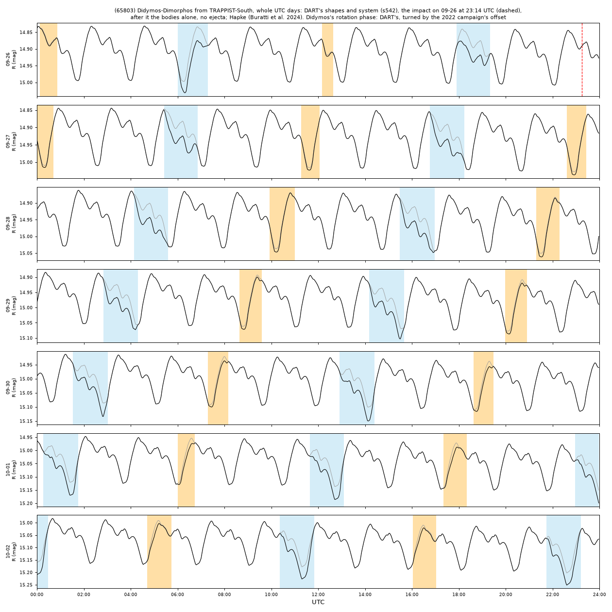
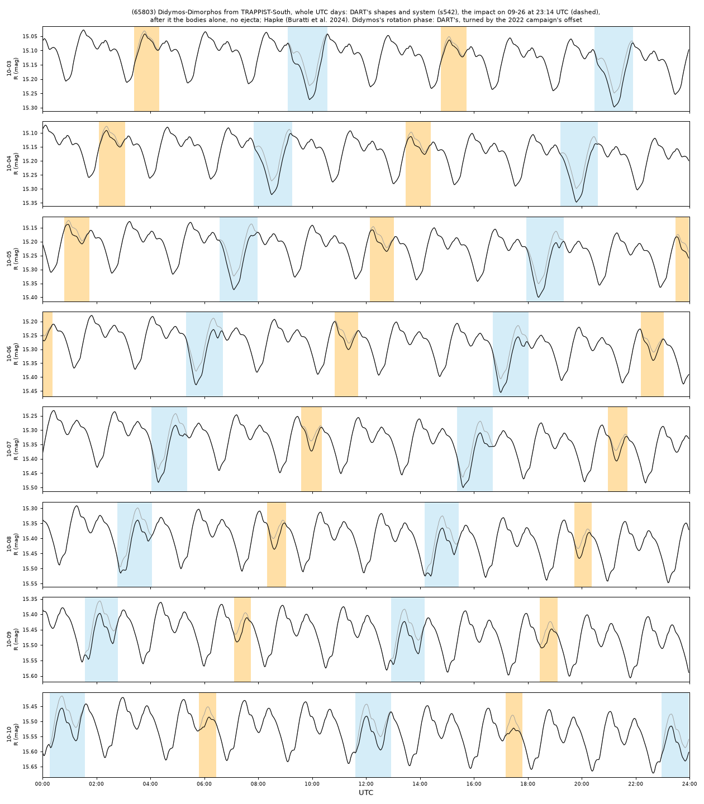

# Didymos from TRAPPIST-South, 26 September to 10 October 2022, whole days: across DART's impact

5 November 2026. The user asked: "can you simulate also didymos lc for 26.09 - 10.10 ? the whole days not just
nights". The same model as the September nights (`2026-11-03_didymos_september_nights/`), over whole UTC days, with
DART's impact in them, in the same two versions, with and without the campaign's offset.

## Progress

- [x] The impact in DART's kernels, checked (`didymos_system_s542_v01.bsp`, `didymos_system_008.tf`):
  - before it, Dimorphos's orbit is circular, 11.9215 h, 1.184 km from Didymos;
  - after it, 11.3764 h on average over 26 September to 10 October, eccentric: 1.111 to 1.184 km;
  - Dimorphos faces Didymos either side: within 0.01 deg, the frames kernel's own post-impact frame after it;
  - 0.5 s an epoch for the three light computations at 49,152 facets a body.
- [x] With the campaign's offset: 15 days of 720 epochs, 14:29 to 14:57 on 6 processes, no facet past the clipping's
  piece cap.
- [x] Checked against Eli's days (`out/didymos_eli/days/`: 3,072 facets, from Earth's centre).
- [x] Without it: 14:57 to 15:24, no facet past the cap.
- [x] Figures, tables and the shared folder's README (`out/didymos_eli/2022-09-26_10-10_TS/`).

## The runs

- **The days**: 26 September to 10 October 2022, 00:00 to 23:58 UTC every 2 minutes, 720 epochs a day. Seen from
  TRAPPIST-South, as the September nights, at every hour, whether or not Didymos is up there.
- **The impact**: 26 September, 23:14:24 UTC, in DART's solution s542. After it, Dimorphos's orbit is 11.376 h on
  average and eccentric (above). Didymos turns at its true periods either side: 2.2603891 h before, 2.260440 h after
  (Durech et al. 2025, `lc.py`).
- **The shapes**: DART's Didymos v003 and Dimorphos v004, 49,152 facets each. There is no shape of Dimorphos after
  the impact: v004 is used throughout.
- **The ejecta are not modelled**. After the impact these are the bodies alone. The system observed was brighter,
  and its rotation and events shallower, for weeks. The shared README says so first.
- **The rotation phase**: the campaign's offset is -8.9 deg on 26 September to -8.0 on 10 October, 3.3 to 3.0 min
  later. The true period puts the features later than DART's kernel after the impact: 0.1 min on 27 September, 3.8
  min on 10 October.
- **The runs**: `out/didymos_eli/scripts/impact_days.py`, on `sept_nights.py`'s events and captions and Eli's
  `lc.py`, `--no-offset` for the second version. DART's kernels from the copy fetched from NAIF on 3 November, in
  the session's scratch folder (`--kernels`); `~/data/spice/dart` is still gone. Each version took 27 min on 6
  processes.

## The days

With the campaign's offset; the primary eclipses' depth also without it. "(cut)": the event goes on past midnight,
its deepest within the day.

| day | phase | median R | rotation, peak to peak | primary eclipses, deepest: with offset / without | secondary eclipses, deepest |
|---|--:|--:|--:|---|---|
| 09-26 | 52.5 | 14.90 | 0.176 | 00:26, 0.004 / 00:36, 0.004; 12:22, 0.004 / 12:22, 0.004; 23:58, 0.001 / 23:58, 0.001 (cut) | 06:24, 0.047; 19:02, 0.044 |
| 09-27 | 54.0 | 14.92 | 0.183 | 00:14, 0.006 / 00:16, 0.007 (cut); 11:34, 0.007 / 11:34, 0.009; 22:54, 0.009 / 22:52, 0.010 | 06:30, 0.045; 17:48, 0.045 |
| 09-28 | 55.5 | 14.94 | 0.191 | 10:14, 0.011 / 10:12, 0.011; 21:34, 0.012 / 21:34, 0.011 | 05:22, 0.045; 16:42, 0.046 |
| 09-29 | 57.0 | 14.96 | 0.197 | 08:56, 0.012 / 08:54, 0.013; 20:14, 0.013 / 20:38, 0.017 | 04:04, 0.047; 15:26, 0.048 |
| 09-30 | 58.5 | 14.99 | 0.203 | 07:34, 0.016 / 07:52, 0.021; 19:14, 0.021 / 19:08, 0.025 | 02:48, 0.049; 14:10, 0.049 |
| 10-01 | 60.0 | 15.03 | 0.206 | 06:28, 0.027 / 06:24, 0.029; 17:44, 0.030 / 17:40, 0.027 | 01:30, 0.049; 12:44, 0.049; 23:58, 0.048 (cut) |
| 10-02 | 61.4 | 15.06 | 0.220 | 05:00, 0.028 / 04:58, 0.021; 16:18, 0.024 / 16:16, 0.016 | 00:02, 0.049 (cut); 11:18, 0.049; 22:36, 0.049 |
| 10-03 | 62.9 | 15.11 | 0.225 | 03:36, 0.019 / 03:36, 0.014; 14:58, 0.016 / 15:16, 0.016 | 09:54, 0.049; 21:12, 0.049 |
| 10-04 | 64.2 | 15.16 | 0.231 | 02:36, 0.018 / 02:30, 0.022; 13:52, 0.024 / 13:48, 0.025 | 08:30, 0.049; 19:48, 0.049 |
| 10-05 | 65.6 | 15.21 | 0.241 | 01:10, 0.027 / 01:08, 0.026; 12:28, 0.028 / 12:26, 0.025; 23:48, 0.028 / 23:56, 0.024 (cut) | 07:06, 0.049; 18:24, 0.049 |
| 10-06 | 66.9 | 15.27 | 0.247 | 00:00, 0.020 / 00:00, 0.021 (cut); 11:16, 0.026 / 11:16, 0.028; 22:38, 0.031 / 22:38, 0.033 | 05:42, 0.049; 17:00, 0.049 |
| 10-07 | 68.1 | 15.33 | 0.252 | 10:00, 0.036 / 10:00, 0.037; 21:20, 0.040 / 21:20, 0.040 | 04:22, 0.048; 15:44, 0.048 |
| 10-08 | 69.2 | 15.39 | 0.256 | 08:40, 0.042 / 08:40, 0.042; 20:00, 0.045 / 20:00, 0.044 | 03:06, 0.047; 14:26, 0.046 |
| 10-09 | 70.3 | 15.46 | 0.250 | 07:20, 0.046 / 07:20, 0.044; 18:42, 0.046 / 18:42, 0.044 | 01:48, 0.045; 13:08, 0.044 |
| 10-10 | 71.2 | 15.53 | 0.256 | 06:04, 0.046 / 06:04, 0.046; 17:24, 0.048 / 17:24, 0.049 | 01:14, 0.044; 12:32, 0.044; 23:50, 0.044 (cut) |

*With the campaign's offset. Black: Didymos and Dimorphos. Grey: the two bodies apart, no mutual event. Shaded where
an event takes more than 0.5 mmag: orange, a primary eclipse (Dimorphos's shadow on Didymos); blue, a secondary
eclipse (Didymos's shadow on Dimorphos). Red dashed line: the impact. Each day's events, in both versions:
`out/didymos_eli/2022-09-26_10-10_TS/README.md`.*

- **The events come about 1 h 15 min earlier each day** after the impact: two of Dimorphos's orbits are 22.75 h,
  where they were 9.5 min short of a day before.
- **The primary eclipses deepen**, from 0.004 mag on 26 September to 0.046-0.049 on 9 and 10 October.
  - The Sun comes nearer Dimorphos's orbit plane, from 8.6 to 5.9 deg south of it, and the orbit is smaller after
    the impact. Dimorphos's shadow falls about 0.18 km north of Didymos's equator on 26 September, 0.12 km on 10
    October.
  - Earth goes from 50 to 34 deg south of the plane, so the ground under the shadow is seen less obliquely too.
  - In September the shadow grazed Didymos's northern ground, lit and seen at low angles, where DART's shape falls
    short (`2026-10-19_didymos_questions/`).
- **The secondary eclipses** take 0.044 to 0.049 mag, Dimorphos's whole light, flat-bottomed.
- **Didymos's rotation** grows from 0.176 to 0.256 mag peak to peak with the phase angle, 52 to 71 deg.
- **No occultation** falls in these days: only eclipses.

## How the two versions differ

- **The rotation's features** shift by 3.0 to 3.3 min. The magnitudes differ by 0.012 to 0.014 mag rms over a day,
  0.029 to 0.033 at most. The amplitude is the same.
- **The secondary eclipses** are the same within 0.9 mmag (0.1 at the median).
- **The primary eclipses** start within 4 min of each other and end within 14 (a shallow one's end is where its drop
  passes 0.5 mmag). Their depth differs by 1.6 mmag at the median and by up to 7.8: 0.024 with the offset and 0.016
  without at 16:18 on 2 October, 0.016 and 0.021 at 07:34 on 30 September.

## Checked

Against Eli's days (`out/didymos_eli/days/`, 3,072 facets, from Earth's centre, the campaign's offset), on 26 and
27 September and 1, 5 and 10 October:
- outside the events, -0.8 to -1.1 mmag at the median, about 1 mmag rms about it, 2.9 at most;
- every event at the same times within 2 min, and as deep within 0.3 mmag, the impact's day included.

## Files

`out/didymos_eli/2022-09-26_10-10_TS/` (local: `out/` is not committed), laid out as `2022-09_TS/`. It has its own
README, so it can be shared alone: the columns, the model, the impact and the ejecta, the two versions, the
figures' captions and how the versions differ. In each of `with_campaign_offset/` and `without_campaign_offset/`:
- `lightcurves_2022-09-26_10-10_TS_with_campaign_offset.csv` or `..._without_campaign_offset.csv`: every day in one
  table;
- `<date>_TS.csv` and `.png` for each day, with the events' drop below the light curve;
- `overview_09-26_10-02.png` and `overview_10-03_10-10.png`, a week each (this note's figures are the first
  version's);
- `days.csv`, a line a day.

9.6 MB in all.
