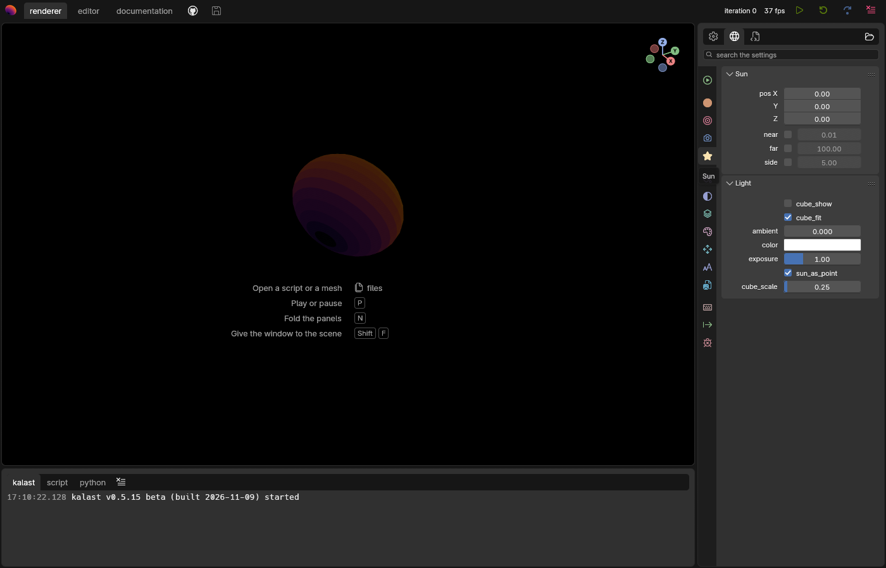
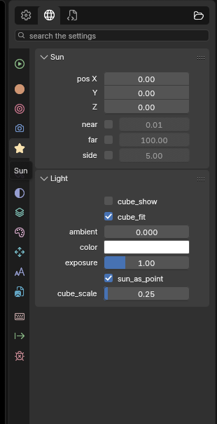

# 2026-11-09 — The UI app's panels drawn after Blender's

The user (9 November), shown BUI (Blender's UI widgets taken out of Blender as a C library) and told it could not be
kalast's -- GPL-3.0 where kalast is MIT or Apache-2.0, no GPU drawing on macOS yet, no browser, its own window and
renderer -- and offered kalast's own panels restyled instead:

- "yes restyle the panels like blender"
- "things nice that BUI does from Blender that I want too in Kalast UI: Menu search ("ad cu" finds "Add cube", typos
  forgiven, ...), Type in any menu: Blender's fuzzy search; blender number fields (drag, shift finer, ctrl snap, type
  math like 2*pi or 90/, expression evaluator), ctrl+z undo"

Done here, in four steps: the look and the number fields; the searches and `F3` (now `E`); undo. Then two rounds of
the user's review, and a pass closer to Blender, measured against its source.

## Progress

- [x] The look: Blender's colours, panels, rows, fields, sliders, checkboxes, menus, tabs and font.
- [x] Number fields: typed maths, `Ctrl` to snap, `Shift` finer.
- [x] Type in any menu to filter it, and a search over the settings (Blender's properties search, `Ctrl+F`).
- [x] `F3`: a search over the actions and the files.
- [x] `Ctrl+Z`: undo for what the panels change.
- [x] The user's first review: sliders while dragged, Mocha, `E`, more in the search, bodies to add, the scene in a card.
- [x] The user's second review: the search's long names, every setting in the search, the Sun placed, Mocha's menus.
- [x] Closer to Blender: its measured gaps and sizes, what was missing, and the washed look.
- [x] The user's third review: the three tabs back on top, the simulation tab's topics as tabs down its left, the
  Sun's settings in two panels, Sun and Light.

## The look

The colours are Blender's default theme, as Blender ships it in `release/datafiles/userdef/userdef_default_theme.c`,
the values alone: a new theme, `"blender"`, the default (`src/app/gui/theme.rs`, `theme::blender`).

| | Blender's | kalast's use |
|---|---|---|
| the properties editor's region | `#303030` | the side panel, the cards |
| a panel, its header and back | `#3d3d3d` | a section |
| a button, a number field, a checkbox | `#545454`, `#656565` under the pointer | egui's widgets |
| a text field | `#1d1d1d` | text fields, the strip tabs sit on |
| a menu's button | `#282828` | a list of values |
| a menu, a tooltip | `#181818`, outlined `#242424` | popups |
| the gap between editors | `#161616` | the backdrop the cards stand on |
| the active, the chosen, the checked | `#4772b3` | selection, sliders' fill, checked boxes |
| the text cursor, the console's output | `#71a8ff` | |
| the text editor's syntax | strings `#e6d573`, built-ins `#e62e67`, numbers `#48d9e6`, comments `#939393`, ... | the script editor |

A theme chosen before is remembered and stays: `"catppuccin-mocha"` and `"dark"` are still there, in the app tab.

The shapes are Blender's for every theme (`src/app/gui/widgets.rs`):

- **A section** is a panel: a rounded box a shade lighter than the region, its header a thin chevron and the title.
  One inside another -- a body, a HUD -- is a sub-panel, a shade darker within it (as measured below).
- **A setting** is Blender's split row: its name right-aligned against its control. Names share a column as wide as
  the longest, cut short only to leave the control 72 points, and shown whole on hover when cut.
- **A vector** is three rows, "pos X", "Y", "Z", one block of three fields, as Blender's location.
- **Fields**: a number field fills its row (`widgets::number`); a slider is a field filled in blue as far as its
  value goes (`widgets::Slider`, which takes egui's `Slider` calls); a checkbox is blue with a white tick when ticked
  (`widgets::checkbox`); a menu's button is darker than the others, its items lit blue (`widgets::ComboBox`).
- **Tabs** -- the toolbar's, the log's -- are Blender's: on a dark strip, the chosen one in the colour of what it
  opens, its top corners round. The side panel's are its properties editor's navigation bar (below).
- **Trees** -- the scripts tab, the editor's outline, the documentation's -- open with Blender's triangles.
- **The font** is Inter, Blender's since 4.0 -- now Blender's own build of it (below), `res/Inter-Blender.ttf`, under
  the SIL OFL 1.1 (`res/LICENSE-inter`).

The settings panel is generated: `tools/gen_config_panel.py` writes `widgets::checkbox`, `widgets::number`,
`widgets::Slider` and `widgets::ComboBox`.

## Number fields

As Blender's (`widgets::number`, `widgets::Slider`):

- **Dragged**, a field moves by its speed; slower with `Shift`, which egui's `DragValue` already does; held to round
  steps with `Ctrl`: two significant digits of the value for a field (13.47 to 13, 0.385 to 0.39, a whole number for
  an integer), a tenth of the range for a slider, two significant digits of the value for a logarithmic one.
- **Typed into**, it reads maths: `src/app/gui/expr.rs`, a small parser of Python's arithmetic, its precedence and
  `math`'s functions -- kalast runs without Python, and a field has no business running code. An operator first
  applies to what the field holds: `*2`, `/4`, `+1`. A number before a name or a parenthesis multiplies it: `2pi`.
  What is not read leaves the value as it was. `Enter` takes it, as in Blender.
  - egui reads a field's text twice, on `Enter` and the frame after, and with the field's value then: `*2` doubled
    the value twice. The text is now read against the value the field held when typing began
    (`typing_base`, `typing_kept`).
  - egui's response says no focus while its text is being typed; the memory is asked instead.
- Written by a helper agent of this session, against a written specification, in a scratch crate: `expr.rs` (and
  `fuzzy.rs`, for the next step). Checked against CPython on 400,000 random expressions: they agree except where
  Python turns a value complex.

## Searching

One matcher for all three, `src/app/gui/fuzzy.rs`, after Blender's search as its menus have it: what is typed and the
names are cut into words -- at anything not a letter or digit, and where camelCase starts one -- and each word typed
must find a word of the name of its own, in any order: the whole word (100 points), its beginning (80), the initials
of a run of words (60: "lp" for `lod_pixels`), a piece inside it (40), or the word with typos, one from three letters
and two from seven (20, 10). Words found in the order typed, and a first word on the name's first, score more; a
shorter name breaks a tie. Written by the helper agent as `expr.rs` was, its 12 tests with it.

- **Menus** (`widgets::ComboBox`): a search field atop each, which holds the focus as it opens; the items are drawn
  by `widgets::choice` and `widgets::choice_label`, egui's `selectable_value` and `selectable_label`, hidden when
  they do not match, the first that does taken by `Enter`. The menu closes on a click outside it rather than on any
  click, so that the field can be clicked; an item closes it when chosen. The generated panel's menus are written
  with them; the colormaps' rows, a swatch and a name, ask `widgets::in_menu_search`.
- **The settings** (`widgets::search_field`): the field atop the app and simulation tabs, `Ctrl`+`F` over the panel.
  While it holds words, `widgets::setting` draws only a setting whose name matches -- one that does not is drawn into
  a child the panel gives no room, invisibly, so that what draws it still runs and returns -- and a section shows,
  open, when its title matches, which shows all of it, or when something in it matched the pass before: a hidden
  section is drawn invisibly too, to count, and a change of the count asks egui for the pass again
  (`request_discard`), so that nothing is seen a frame late.
- **`F3`** (`src/app/gui/search.rs`): a field over the window, the actions that match -- the toolbar's Play, Step,
  Restart and Reset, Save, Open a file, the middle's tabs, clearing the log's tab, the settings' search -- before
  the files of `examples/` (not `examples/old/`) and `scripts/` that do, 14 at most. What is chosen is done the frame
  after: the toolbar's buttons by their own code, `|| chosen == Some(Action::Step)` beside `.clicked()`, so that
  each is done only when its button could be; a file is opened in the editor as the scripts tab opens one.
  - Actions first: "stp" ranked `examples/sphere/tpm.py` above Step, as the initials of "sphere tpm" score above a
    typo.

## Undo

`src/app/gui/undo.rs`, as Blender undoes a property's change:

- **What**: `app.simulation.config`. Not the camera nor the Sun: turning the view moves them, which Blender does not
  undo, and their `Projection` holds the planes fitted every frame, which would make every frame a change. Not the
  bodies, whose meshes are too big to keep copies of, nor `app.config`, the window's own.
- **A step** is a change made while the frame draws -- by a widget, a script never running then -- kept from the
  config as the frame found it, and ended once nothing holds it: the pointer let go, no field focused. A drag is one
  step, a value typed and taken one. A new step drops what was undone. 100 kept.
- **The keys**, `Cmd`/`Ctrl`+`Z` and with `Shift`, are taken out of the frame's input before it draws, so that the
  widgets draw what was put back; left there while a field or the editor has the focus, which keep their own undo.
- `Config` and its 20 groups derive `PartialEq` for it; a frame clones and compares a few kilobytes.
- Checked that no frame changes the config by itself: the page left alone 5 s recorded no step.

## The user's review, and what came of it

The user, after looking at the beta:

- "blender theme sliders to change values are wrongly fully colored while sliding": egui's active colour, Blender's
  blue for a button held down, filled the whole field while it was dragged. A dragged field and slider are now grey as
  under the pointer, the slider's fill alone blue.
- "capuccin mocha team sliders values are too hard to read": Mocha's sections were surface0, its fields too, so its
  unticked boxes and its sliders' fields vanished, and its slider fill was egui's selection, a 20 % tint. Each theme
  now gives the widgets its own colours (`theme::Extra`, kept in the context by `theme::apply`): the sections' box --
  base in Mocha, on the side panel's mantle --, a ticked box and its tick -- blue and crust --, and a slider's fill --
  blue at 45 % over base, under the value written across it.
- "change from F3 to E key if E is unused": nothing in kalast took `E` (it binds A, D, F, H, K, N, P, S, T, W); the
  search opens on `E` while nothing is typed into, the letter kept from the field.
- "many things are not in the menu, like adding body": the search lists, beside what it did, exporting one frame,
  the side panel's tabs, folding the panels, fullscreen, focus mode, printing the camera, the grid and the colour bar
  shown or hidden, checking for updates, GitHub; each shape kalast ships, "Add body: Cube"; the shadows' presets; the
  themes. What it switches in the scene's config is one undo step.
- "cant easily add default bodies like cube or sphere, i typed res/cube.obj but is not found": the panel's
  `try_load` asked `std::path::Path::is_file`, which in the page sees none of the page's own files; it asks
  `crate::fs` now. And "add these bodies to a list menu": the Bodies section's shape is a menu of what `res/` holds,
  named as Blender names its own -- Cube, Ico sphere and UV sphere with their facets, Didymos, Dimorphos, the crater
  planes (`simulation_panel::shapes`) -- or "a file of yours" by its path.
- "put the center renderer panel in a proper panel like editor and documentation, this shouldnt affect exported
  frames": the scene is in a card with no inner margin, its image's corners rounded on the screen only; a frame is
  exported from the render, whole and square. Focus mode still gives it the window to its edges.

## The user's second review

- "text can overflow in E menu": a long name -- a file's path, a body's -- is cut short with an ellipsis, short of
  the keys written at the row's right.
- "i typed "sun pos" and it should let me change sun position but it doesnt work / everything else should be allowed
  to be done like this": the search lists every setting of the app and simulation tabs, named with the sections it is
  in ("Sun › pos X"). The settings are found by drawing both tabs once more, invisibly, every section open, as the
  search opens (`widgets::catalogue`), each row noting its place: the hand-written rows as well as the generated, with
  no list to keep. Chosen, a setting is shown (`widgets::reveal`): the side panel on its tab, its sections opened, the
  panel scrolled to it, its field given the focus and its text selected, so that `5` typed replaces the value -- egui
  selects a field's text only for a focus given before it is drawn, and "5" made 0.00 into 0.005.
- "by default Sun is 0 0 0 which when loading a body doesnt show it, make Sun somewhere else": a body added, or a mesh
  opened, while the Sun is still at the origin puts it 1 au from the scene's centre, 50° to the left of the camera and
  35° above it (`Simulation::light_for_viewing`), so that the side the camera sees is lit. A Sun a script set is left
  where it is.
- "background filled color inside list menu like the actual theme list is not easily readable for catpuccin mocha":
  a menu's chosen item and the one under the pointer are in the theme's solid fill, their text bright, where Mocha's
  selection was a 20 % tint behind grey text.
- And the values far from 1: a field writes one past 10⁷ or under 10⁻⁴ in powers of ten, to four digits (the Sun at
  1 au: -3.063e10, which ran past its field).

## Closer to Blender

The user, at the first review: "the UI does not look exactly like blender already, not talking about the colors, but
just the gaps and padding for example. But many things looks like missing. Our UI kalast looks a bit washed or fade
compared to the vibrant UI of Blender". A helper agent of this session measured Blender 4.5's properties editor from
its source (the `v4.5.15` tag: `interface_style.cc`, `interface_panel.cc`, `interface_widgets.cc`,
`userdef_default_theme.c`) and against the manual's 1x screenshot, pixel by pixel; the numbers below are Blender's at
a UI scale of 1, where its unit is 20 pixels.

**The washed look** was the blending. egui drew into the surface's sRGB view, so it blended in linear light: the
edges of the text, the tints over the panels, came out lighter and flatter than Blender's, which blends in the
display's colours -- its sub-panel tint measures `#363636` where linear light gives `#3a3a3a`. The UI now draws through
a view of the surface without sRGB (`Window::ui_format`): on the desktop where the device allows a second view
(`DownlevelFlags::SURFACE_VIEW_FORMATS`; Vulkan without `VK_KHR_swapchain_mutable_format` keeps the sRGB view), and in
the browser, whose canvas is not sRGB, at all times -- the page drew the UI through the sRGB view of it too. The scene
is unchanged: egui shows its image with the same colours through either. Checked in the page: the emboss under a
field, 15 % black over `#3d3d3d`, reads `#343434`, Blender's measured value, where linear light gives `#373737`.

**The font**: Blender's own Inter, `Inter.woff2` from its `release/datafiles/fonts` -- Inter Variable 4.001 with its
glyph variants in the character map, as Blender ships it: tabular digits, an open 4, 6 and 9, a flat-topped 3, a
serifed capital I and a tailed l -- instanced with fontTools at weight 400 and the optical size Blender sets on a
Retina display (22), and cut to what the UI writes: 124 KB. Every text at 11 points, Regular, titles included, as
Blender's every style is (`theme::metrics`), and widgets 20 high.

**The panels** (`widgets::draw_section`): a header 25 high, the body padded 8 on every side, corners of 4, no outline,
2 between panels. Blender's thin chevron at 80 % of the title's colour, the title at 22 from the edge with Blender's
text shadow, a point lower, and its grip at the right of a top-level panel -- four dots by two at a pitch of 3, each
with a black dot under it; drawn as a mesh of whole pixels, since egui drew such small squares as nothing. A sub-panel
spans its parent, its header bare, its chevron and title 14 further in, its body `#0000001f` over the panel with round
bottom corners. The section icons are gone: Blender's panels have none.

**The rows** (`widgets::split`, `row`): Blender's split -- the label column 0.4 of the row less its decorators' 20 and
the 8 between, the label right-aligned a point short of the column's edge, the field the rest. A checkbox's row
leaves the label column empty, the box and its name in the field column (`widgets::toggle`). A vector is a block of
20-high fields with one line between them -- each lower field drawn a point higher, so that the two outlines are one
-- round at its outer corners only, its emboss under its last field and 5 round it (`widgets::components`).

**The fields** (`widgets::number`, `Slider`, `field_back`): painted by kalast rather than egui, so that they are
Blender's: `#545454`, `#656565` under the pointer, `#222222` while held or typed into; the value centred, at the left
while typed into, 8 in; a slider's fill in blue to its value, square-ended until it reaches the end. Under the
pointer a number field shows Blender's arrows, thin `<` and `>` 8 from either end, the zone of 14 under the pointer
lighter; a click on one steps the value -- by 1 for a whole number, by ten points of its drag otherwise, as Blender
steps a hundredth of a property's step -- and gives back the focus the click had taken. A colour is a swatch as wide
as its row (`widgets::color_rgba`); a value fitted rather than set, a camera's planes, is a field greyed out, as
Blender greys what cannot be edited. Under every field, Blender's emboss, a line of black at 15 %.

**The rest**: a menu's button `#282828`, `#303030` under the pointer, Blender's blue at 70 % while open, its one thin
chevron 6.4 from its right edge; a text field `#181818` while typed into, its outline unchanged -- egui ringed it in
white (`widgets::text_field`); an operator's button as wide as its row (`widgets::button`); a choice among a few as
Blender expands an enum, one block of joined buttons, the chosen one blue (`widgets::segmented`: a mesh's flat or
smooth shading); a readout in the panels' font, cut short rather than past the edge; the shadows' presets a menu.

**The side panel** became Blender's properties editor (`widgets::nav_bar`, `nav_tab`): its navigation bar down the
left, 29 wide on `#1d1d1d`, a tab 28 high an icon, the chosen one in the region's colour, its left corners round so
that it runs into the region; the panels 8 in from the bar and from the edge. It opens 300 wide, about as Blender opens
it, where it was 240. The bar first held the app, simulation and scripts tabs, under a header with the settings'
search; the user then put those back on top, and the bar holds the simulation tab's topics (below).

## The user's third review

- "ok so I believe app settings + simulation settings + examples/scripts 3 buttons should remain top / and in
  simulation tab the sun/bodies/selection/camera/sun could be the left side vertical sub tabs / and then in sun you
  would have two foldable category sun and light"

The three tabs are back atop the side panel, on their strip, the folder button beside them and the settings' search
under them. The simulation tab's topics, which were fifteen closed sections, are a tab each down Blender's navigation
bar under the search (`simulation_panel::TOPICS`, `topic_tabs`): an icon in its colour, at 80 % unless chosen or
pointed at, named on hover, in Blender's groups with a gap between -- the run; what is in the scene; how it is drawn;
the rest. The chosen topic's page is beside it (`widgets::tab_page`), its settings in panels that fold
(`widgets::panel`), open at first as most of Blender's are -- the tabs are the table of contents now; a body's and a
HUD's panels stay closed at first. What were subheadings inside a topic are its panels:

| Tab | Panels |
|---|---|
| Run | Run |
| Bodies | one per body, Add a body |
| Selection | Selected, Display |
| Camera | Camera |
| Sun | Sun (where it is), Light (what it does) |
| Shading | Shading |
| Shadows | Shadows; Reference image, with that method |
| Wireframe | Wireframe |
| Data colouring | Data colouring, Colour bar |
| Axes & grid | Axes, Grid |
| HUD | one per HUD, Font |
| Image | Image, Camera response, Stretch, Photometry; Telescope, once a frame is made |
| Controls | Controls |
| Export | Export, Output |
| Debug | Diagnostics, Switches |

- Only the chosen page is drawn: the others cost nothing, where every section was drawn, closed, each frame.
- The searches follow the tabs, as Blender's properties search does: while the settings are searched, every page is
  drawn invisibly to count what in it matches; a tab with nothing fades, and if the page shown has nothing, the
  first that has is shown. A setting chosen in the `E` search chooses its tab. A setting is named by its tab and
  panel, a name repeated once: "Sun › pos X", "Sun › Light › exposure".
- Each page is under ids of its own, so two topics' panels of one name -- the old "settings" subheadings -- keep their
  own state.

## Two more

- "what is this "reload" button after loading a body? and what is the barely visible button to the right of it?":
  `reload` loads the file typed in a body's `file` field in place of its mesh, keeping its transform and the handle a
  script holds; it is greyed until the field holds another path. Beside it, once the field is edited, `revert` puts
  the body's own file back -- a sliver at the row's edge since `reload` was made as wide as the row; the two now share
  it. And what was typed was kept by the body's place alone, so a body taking another's place -- a script run again,
  a reset and another added -- was shown the other's file, `reload` ready to load it over this one: it is kept per
  body and per file now.
- "pressing render back face on E menu doesnt toggle render back face button in shading": a setting that is on or off,
  chosen in the `E` search, is switched, as Blender's menu search switches what it finds, and the list says whether it
  is on (`Place::on`, `widgets::toggle`).

## Checks

- In headless Chrome on the page built locally: "2*pi" in the camera's x gave 6.283, "*2" in its y -6 to -12, "/4" in
  its z 5 to 1.25; a `Ctrl`-drag of the z moved it in steps of 0.1.
- The searches, in headless Chrome: "shdow" in the settings' field showed the shadows' section and the two settings
  ending in `_show`; "colormap" its row, and its menu, opened, "mag" in it magma and managua; `F3` listed every
  action and the files, "sph tpm" put `examples/sphere/tpm.py` first and `Enter` opened it in the editor, and
  "step" stepped the scene from iteration 0 to 1.
- Undo, in headless Chrome with the keys pressed as a hand does, `Cmd` first: a drag of `lod_pixels` from 2.0 to 11.2
  was one step, `Cmd+Z` put back 2.0 and `Cmd+Shift+Z` 11.2; `lod` unticked, `Cmd+Z` ticked it again.
- Unit tests: the themes (Blender's in both of egui's slots, the names read back), the names' column, the parser's 9,
  the matcher's 12, undo's 3 (a drag one step, typing keeps the keys, a new step drops what was undone).
- The generated panel, the Python bindings and the stubs regenerated, and their tests pass; the crate's package
  holds the font and its licence.
- Two of the documentation tab's tests fail, before this as after: the README's Phobos image, 3975 by 3089, is
  larger than the test context's 2048-texel limit (since 13 October, 67f97cc).
- The second review, in headless Chrome: `E`, "sun pos", `Enter` showed the Sun's `pos X`, its text selected, and
  `5`, `Enter` made it 5.00; a cube added to a new page was lit from the upper left.
- Closer to Blender, in headless Chrome at 1x beside the manual's screenshot of Blender 4.x: closed panels at a pitch
  of 27, as Blender's; a vector's fields one line apart, the emboss `#343434` under the block; the arrows on hover,
  three clicks moving the Sun's x from 0 to 1.5 (its step 0.5); a held field `#222222`; typed text at the left; the
  Mocha theme's bar and panels. In a native egui test, a click on a field's right arrow made 0.385 into 0.395 and
  left the field without the focus.
- On the desktop, the UI's second view of the surface was built and the app ran 25 s without an error, its window in
  the background -- where an occluded window presents nothing, so the desktop's look itself was not seen here.
- The two more, in headless Chrome: a reset and an ico sphere where a cube was showed `res/ico2.obj`, `reload`
  greyed; edited, `reload` and `revert` each half the row. `E`, "render back face" listed it "off"; `Enter` ticked
  it in the Shading tab, and the list said "on" after. A unit test switches a toggle chosen in the search, once.
- Unit tests: 103 of the UI's pass (two of the names' column's became one of Blender's split, and the far values'
  is new); the documentation tab's two fail as before.
- The third review, in headless Chrome: the three tabs atop, the fifteen topics down the bar; the Sun's tab showed
  its two panels; "exposure" in the settings' search kept the Sun's tab, its Light panel and that row, every other
  tab faint; `E` with "sun pos" listed "Sun › pos X" and, from the Run tab, showed the Sun's tab, `5` setting x to
  5.00; "grid color" showed the Axes & grid tab, its Grid panel.

## Open

- The README's screenshot of the UI app (`res/kalast-ui.png`) shows the panels as they were.
- A field's value is drawn by egui's `DragValue`, with no text shadow under it; the labels and titles have Blender's.
- Blender's text is drawn through a coverage gamma (`BLF_GAMMA_CORRECT_GLYPHS`) that makes it a little fuller; egui's
  is not.
- Rows of two buttons (a colormap's, a render's) are still egui's buttons side by side.
- The desktop's look after the blending change is to be seen on a screen.
